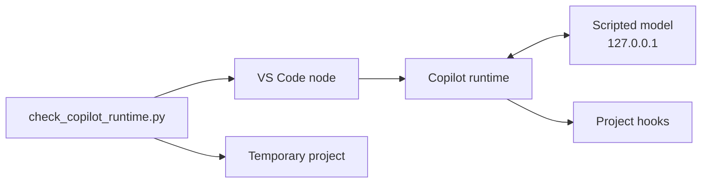

# Runtime Checks

Run:

```bash
uv run python scripts/check_runtime.py
```

The runtime checker verifies generated runtime files exist, including the
Ponytail coding/review skills and upstream license/provenance, and reports
optional helper availability.

## Refreshing This Repository's Own Overlay

The bootstrap's dogfood overlay is refreshed with `--allow-self`:

```bash
uv run python scripts/generate_targets.py --all
uv run python scripts/install_bootstrap.py . --allow-self --local-only
```

`install_bootstrap.py` normally refuses overlapping source and target, because
the generated source (`dist/multi-agent`) lives inside this repository.
`--allow-self` permits **only** that case, and only when the target is the
bootstrap repository itself. Installing a tree over itself, or into a directory
beneath the source, stays rejected with or without the flag. Removal is safe
here because it walks only `target/.claude` and the restorable root adapters,
so `dist/` is never a removal candidate. `update_consumers.py` accepts the same
flag and forwards it.

Never hand-copy `dist/` into place; always regenerate and install.

### What a self-refresh removes

Files under `.claude/` that the generated target does not contain are removed as
obsolete owned files. The exception is a project skill: a folder under
`.claude/skills/` that holds `.project-skill` is never removed or overwritten.

Before any write, the refresh refuses, among other cases (the README lists
the project-skill refusals):

- an `.agents/` tree it cannot prove it generated;
- an unmarked skill folder it cannot account for: one the new source does not
  ship and the shipped-before record does not list, or one whose name the new
  source ships and the shipped-before record does not list. The second
  refusal applies with or without a record, because the refresh would
  overwrite the folder;
- an unsafe write destination. A destination is unsafe when a link sits at
  any part of the path, when a part above the written path exists and is not a
  real folder, when a path written as a file is a folder or a special file
  such as a FIFO, or when a path written as a folder is not a real folder. The
  check reads each part with `lstat` and never follows a link. It covers the
  copy step's paths (with the copy's own skips: existing consumer state,
  preserved tracked adapters, and claimed third-party bundles), the
  project-name and Python-version files (`CLAUDE.md`, `AGENTS.md`, and the two
  workspace instruction files), `.gitignore`,
  `.claude/bootstrap-ownership.env`, every `.claude/bootstrap-root/` adapter
  path, and `.devcontainer/devcontainer.json` when a state remote is set,
  through `--state-remote` or an exported `AI_STATE_REMOTE`. A path at a
  substitution file or `.gitignore` is checked even when no rewrite would
  happen, so a symlinked `AGENTS.md -> CLAUDE.md` is refused. The check also
  runs under `--dry-run`. One refusal lists every problem in two sections:
  `Refusing to write through symlinks:` (replace each link with a regular
  file or folder, or remove it) and
  `Refusing to write over a path of the wrong kind:` (each path with its
  reason; move or rename it). Kinds that the obsolete-file cleanup once
  resolved silently are now refused too, for example a regular file at
  `.claude/templates` or a folder holding an untracked link at `CLAUDE.md`. A
  bootstrap version that turns a generated file into a folder, or the reverse,
  makes each refresh refuse until you move the old item by hand.

A second check runs at copy time. Every file copy of a full refresh and every
folder the copy creates is checked first, and an unsafe destination stops the
run (`Refusing to write <path>: ...`). That stop can leave a partial refresh.
When a legacy migration ran (pre-Git `.claude/` content, not a dry run), the
`.agents` takeover, project-skill, and unsafe-destination checks run again
before the copy, so a refusal there comes after the migration's own writes. An
unsafe state-folder README is skipped with a warning, not refused.

These are not checked: the nested state sync's own writes (it may append to
`.claude/.gitignore` and `.claude/.gitattributes`, and it restores
`settings.local.json`); Git's own writes (`git config core.hooksPath` in the
outer repository, and the nested state commit in `.claude/`); hard links;
whether the macOS quarantine strip
(`xattr -rc` over whole folders, consumer state included) follows links; and
reads through links, for example a preserved, tracked root adapter that is a
link, which the record copy reads into the AI state, which can then be pushed.

The shipped-before record is `.claude/bootstrap-root/.agents/skills`, the copy
of what the last install shipped. When that copy is missing, the live
`.agents/skills/` stands in for every check. A legacy consumer with old
bootstrap skill copies and no record is refused once, and the refusal lists
each folder. Move every listed folder into one backup folder outside
`.claude/`, refresh, then copy back the project's own skills and mark them
with `.project-skill`.

Consumer state (`MEMORY.md`, `plans`, `explorations`,
`session_logs`, `quality_reports`, `project-context.instructions.md`,
`settings.local.json`, and the nested `.gitignore` and `.gitattributes`) is
preserved, as are tracked authoring adapters such as `.codex/config.toml` and
`AGENTS.md`. `state-sync.sh` keeps the two nested Git files current without
overwriting them: it appends `settings.local.json` to `.gitignore` when that
file would not be ignored, and `session_logs/*.log merge=union` to
`.gitattributes` when the line is missing, so a consumer's own lines survive
every refresh.

`.claude/settings.local.json` is now consumer state and is preserved. It used
to be deleted as an obsolete owned file on **every** install, in every consumer
— and because `state-sync.sh` deliberately gitignores it in the nested repo
("local convenience only; never synced"), that deletion was unrecoverable. Any
file matching the nested ignore list is local-only by design and must never be
treated as bootstrap-owned.

A file that exists under `.claude/` but not in the generated target is still
removed as obsolete. `check_runtime.py` reports such orphans before a refresh
does anything, so read its output first. In this authoring repository, an authored skill
living only in the overlay should be promoted into `shared/skills/` so it
regenerates. In a consumer, mark the folder with `.project-skill` so the next
refresh keeps it.

### Expected side effects

A self-refresh writes the consumer ignore block into `.gitignore`
(`.claude/`, `.codex/`, the Copilot surface, `.vscode/mcp.json`). Files already
tracked stay tracked; the installer prints a `git rm --cached` hint if you want
to untrack them.

The refreshed hook guards are stricter than older installed copies. Process
substitutions (`<(...)`/`>(...)`) and heredocs (`<<WORD`, `<<'WORD'`,
`<<"WORD"`, `<<-WORD`) are extracted quote-aware and recursively classified,
so a safe read-only use of either no longer fails just because the guard
cannot parse it, and a mutation nested inside one is still detected regardless
of the outer command. Wider syntax support does not weaken that nested
detection. A malformed, unbalanced, or unterminated construct still fails
closed. `for`/`while`/`{ }` and other complex control flow remain unmodeled by
the lightweight parser — put that logic in a script file and run it, which
stays classifiable and keeps the guard active rather than routing around it.
Known, unchanged limitation: the guard never recursively parses `-c` script
content (`bash -c '...'`, `python3 -c '...'`); it only scans that text for
literal protected paths, so a path assembled from pieces inside `-c` (for
example `bash -c 'E=env; touch ".$E"'`) is not detected.

It also performs a read-only, bidirectional dogfood drift check. Bootstrap-owned
files in this source checkout must match freshly generated output (after the
documented project-name substitution); unexpected obsolete owned files fail too.
The check deliberately excludes consumer-owned `.claude` state: `MEMORY.md`,
plans, explorations, session logs, quality reports, explicit project-context
customization, `settings.local.json`, and the nested `.gitignore` and
`.gitattributes`. Tracked source adapters such as root `AGENTS.md` are checked for
their authoring invariants rather than byte-compared to a generated consumer
adapter. A failure names the stale path, its authoritative source, and the
regenerate/reinstall command.

Optional helpers:

- `context-mode` (optional filtered `ctx_index`/`ctx_search`/`ctx_stats` MCP server, routed through `context-mode-dispatch.sh` and pinned to `2.1.8`). The kit wires no Context Mode hooks on any client; a hook call from stale wiring reads its input, prints nothing, and exits 0. The filter accepts the server only when `serverInfo.name` is exactly `context-mode`. The 2.x server reports `serverInfo.version` as `"dev"`, so the version is never proved over the wire. The dispatcher alone proves it: for a direct `context-mode` executable it resolves the file and reads the owning package manifest's `name`/`version` before running it; for the `npx` route it pins the version in the command (`npx -y context-mode@2.1.8`). A binary that is not provably exactly `2.1.8`, including one whose version cannot be determined, is never executed; the pinned `npx` fallback is used instead when available, and otherwise the server warns and exits nonzero. The 2.x binary has a working `context-mode --version`, and the Dockerfile checks it. `bash .claude/hooks/scripts/context-mode-dispatch.sh --self-check` reports `required-version`, `resolved-path`, `observed-version`, a `version-contract` result, and `required-node`/`observed-node`.
  - **Node.js floor.** Context Mode 2.x needs Node.js 24.15.0 or newer (`engines.node`). In server mode and `--self-check`, the dispatcher reads `node --version`. Server mode exits 1 with one error line when Node.js is older; `--self-check` warns. Legacy hook calls run no Node.js check. The devcontainer image is `node:24.22.3-bookworm-slim`.
  - **One server identity.** Every client starts `context-mode server --agent codex` (or `npx -y context-mode@2.1.8 server --agent codex`) through the filter. The dispatcher changes to the outer repository root first, and sets no `CLAUDE_PROJECT_DIR` and no `--workspace-folder`. Under `--agent codex` the server keys its project to the working folder's Git repository, so a server started inside the nested `.claude` repository would use a separate project. Starting from the root also lets the server and the filter resolve a relative `ctx_index` path from the same folder.
  - **Storage.** The dispatcher exports `CONTEXT_MODE_DATA_DIR` as the guarded root `.claude/.cache/context-mode/`, overwriting any inherited value. 2.x ignores `CONTEXT_MODE_DIR`; the dispatcher still reads it as the kit's own override, subject to the same guard. Everything the three tools write is under that root (spike S4 saw no network calls and no writes elsewhere).
  - **Adapters and override guard.** The root adapters (`.mcp.json`, `.vscode/mcp.json`, and `.codex/config.toml`) start the server only through the guarded dispatcher, and `validate_targets.py` checks each adapter's `context-mode` entry. The dispatcher exports the absolute project-local cache root `<repo>/.claude/.cache/context-mode` by default. An override that resolves anywhere else, inside or outside the repository, is ignored with a warning and the project-local cache is used. The cache is derived local state: never commit, sync, restore, or cite it as lifecycle evidence.
  - **Older caches.** A cache the dispatcher did not produce for this exact pin is moved aside as `<cache>.untrusted.<timestamp>.<pid>`, never migrated and never deleted. Provenance includes the exact version, so every pin bump starts with an empty cache, and the 1.x cache is not imported. The moved folders use disk space; delete them by hand when you no longer need them.
  - **Lost race.** Two servers that start together may both try to move the old cache. When the move fails and the cache folder no longer exists, the dispatcher treats the other server as the winner, warns once, and continues with a fresh root. When the folder still exists, the move fails as before and the server exits nonzero.

  The client sees only `protocolVersion`, `capabilities.tools`, and `serverInfo` from `initialize`, with short kit tool descriptions. The filter answers `server/discover`, the probe of the 2026-07-28 MCP revision, itself with `-32601` and never forwards it, so a client that speaks both revisions falls back to `initialize` and never receives the upstream `instructions` that the probe's answer would carry. `ctx_index` accepts raw text (`content`) or one regular file inside the repository; it rejects folders, links, and URLs.

  To bump `PINNED_CONTEXT_MODE_VERSION`:

  1. Install the candidate into a private prefix: `npm install -g --prefix "$HOME/.cache/context-mode-pin" --ignore-scripts "context-mode@<candidate>"`.
  2. Set `PINNED_CONTEXT_MODE_VERSION` in `shared/hooks/scripts/context-mode-dispatch.sh` to the candidate. The real-binary test in the next step runs the dispatcher, which accepts a direct binary only when its version equals the pin and never falls back to `npx` there.
  3. Run the real-binary server test with the private prefix first on `PATH`:

     ```bash
     PATH="$HOME/.cache/context-mode-pin/bin:$PATH" CONTEXT_MODE_REAL=1 uv run pytest tests/test_context_mode_mcp_filter.py -q -k real_upstream
     ```

  4. Compare the candidate's `tools/list` (schemas and property descriptions) with the kit descriptions and `INDEX_ARGS` in the filter.
  5. Run the two slim-image checks: the Node.js engine check on the Dockerfile's `FROM` image, and `npm install -g --ignore-scripts context-mode@<candidate>` followed by `context-mode --version` in that image.
  6. Optionally build the full devcontainer image.
  7. Bump the pin in the Dockerfile and `CONTEXT_MODE_PINNED_VERSION` in the validator to match the dispatcher, then update every doc that names the pin, found with `rg -F '<old pin>'`.

  Known limits:

  - Tool-result text can name another client's tool prefix, because one identity serves every client and the filter does not rewrite results. The routing policy names the real tools.
  - Upstream 2.x folder indexing has no bound on files, depth, or size, follows symbolic links inside the repository's parent folder, and ignores a `.gitignore` above the folder. That is why the filter accepts only content or one regular file.
  - The user-level Claude Code plugin `context-mode@context-mode`, when enabled, adds its own unfiltered Context Mode server and hooks. This repository cannot govern them.
  - Antigravity gets no Context Mode server entry, and its PreToolUse bridge denies MCP calls because the MCP tool-name format is undocumented. See [target-mapping.md](target-mapping.md#gate-repair-client-parity).
  - The filter speaks only the `initialize`-based MCP revisions (2025-11-25 and earlier). A client that speaks both revisions falls back to them; a client that only speaks 2026-07-28 gets no Context Mode tools.
  - The dispatcher no longer `exec`s upstream. A client that kills only the dispatcher on timeout can leave the upstream child running until it finishes.

  Rollback: reverting the merge brings back the previous pin.
  Its dispatcher moves the 2.x cache aside on the first run, but it does not restore the older cache.
  To get the old index back, do this by hand before that first run:
  move the current `.claude/.cache/context-mode` folder out of the way (a fresh one exists after 2.x started),
  then rename the `.untrusted.*` folder that holds the 1.x index (moved aside when 2.x first started) to `context-mode`.
- `openwiki` (the OpenWiki command-line tool and MCP server, installed globally and pinned in `shared/devcontainer/Dockerfile`; `OPENWIKI_PINNED_VERSION` in `scripts/validate_targets.py` names the same version). OpenWiki has no `openwiki --version`, so the Dockerfile reads the version from the installed package's own `package.json`, then runs `openwiki integrations list </dev/null`. `tests/test_openwiki_cli_smoke.py` requires the binary on `PATH` to report exactly the pinned version. It fails when the version differs or the binary is missing, and it never downloads anything. To move to a new pin:

  1. Diff the contents of `npm pack openwiki@<old>` and `npm pack openwiki@<new>`, and read the release notes between them. Look for changes to the tool names, `openwiki_begin`'s input, the managed-block markers, which paths a begin call writes, and the host integrations.
  2. Observe the candidate version in isolation, outside this repository: a scratch directory, a temporary `HOME`, and no network for the probes. Run the guard round trip (`pre`, `openwiki_begin` with `mode: "update"`, `post`) in a synthetic repository, and confirm both root adapters come back byte for byte.
  3. Change the `openwiki@` install line and the `package.json` version check in `shared/devcontainer/Dockerfile`, `OPENWIKI_PINNED_VERSION`, and `EXPECTED_TOOLS` in `tests/test_openwiki_cli_smoke.py`.
  4. Install the new version on your machine, then run `uv run pytest tests/test_openwiki_cli_smoke.py tests/test_openwiki_guard.py -q`.
  5. Run `openwiki integrations install claude --project <root>` and `openwiki integrations install codex --project <root>` again, never with `--force`. Confirm `.mcp.json` and `.codex/config.toml` are unchanged.
  6. Start a new host session, or reconnect with `/mcp`, before the next refresh, so the server running in the session matches the new pin.

  Stop rule: keep the old pin when `openwiki_begin` writes outside `openwiki/**`, `AGENTS.md`, and `CLAUDE.md`, or when the guard round trip fails. Install no host integration other than `claude` and `codex`.
- `npx`
- `gh`
- `uv`
- `uvx`
- Semble through `uvx --from "semble[mcp]" semble`
- context7 through `npx -y @upstash/context7-mcp` (missing `npx` warns, does not fail; falls back to training-data knowledge)

Target validation also checks the static Google Antigravity adapter when
generated output is present: `.agents/hooks.json` contains only
`bootstrap-safety` and one catch-all `PreToolUse` group, and its command points
to the direct Python 3.9 standard-library normalization bridge. The bridge's
runtime decision behavior is covered by the Phase B hook tests: explicit
non-mutating tools are allowed, command and write tools use the canonical
guards, and unknown or malformed requests deny with JSON-only protocol output.
This check does not prove that Antigravity has loaded or trusted the adapter;
native behavior remains the external acceptance gap/blocker described below.

Missing optional binaries produce `WARN`, not `FAIL`.

## Native Client Release Checks (Opt-In)

`check_runtime.py` remains an offline structural/runtime check. It does not
authenticate or start Codex, Claude, or VS Code Copilot, and a structural PASS
is not evidence of native instruction delivery, hook trust, compact/resume
behavior, Codex role routing, or Copilot custom-agent loading. The native
probe's default temporary mode deliberately does not launch either existing
probe client, so it is only a structure/missing-client smoke and reports an
installed client as unresolved `WARN`/`untrusted`. For actual native execution,
prepare, inspect, and manually trust a dedicated stable workspace, then rerun
against that same workspace:

```bash
uv run python scripts/check_native_clients.py \
  --workspace /absolute/dedicated-native-client-probe --prepare-only --json
uv run python scripts/check_native_clients.py \
  --workspace /absolute/dedicated-native-client-probe \
  --client codex --require --json
```

Default availability/trust failures are `WARN`; `--require` makes them `FAIL`.
`--require` also makes unresolved `unexercised` WARNs nonzero. The probe runs
two separate read-only temporary consumers (control and shim-removed candidate)
with ephemeral/non-persistent sessions, a minimal environment, process-group
timeout cleanup, no Codex MCP/apps/web search, no hook approval, and no trust
mutation. It keeps client output out of the result. Schema v2 records only
instruction sentinels; trust is preflight/execution status. Codex role metadata
can PASS only from explicit JSONL agent/thread/subagent events; undocumented or
absent events are WARN, not proof. Compact/resume and coder escalation are
currently unexercised WARNs. The current structural matrix has seven Codex
roles; the dated 2026-08-09 native observation has six. A future optional
persistent-thread probe may exercise all seven, but no native run is required
for the current feature. Claude has no Codex-role matrix. Read [Native
Client Acceptance](native-client-acceptance.md) before interpreting a report or
changing a compatibility gate.

### VS Code Copilot evidence boundary

VS Code runs a Copilot chat in one of two **harnesses**. A harness is the part
of the client that runs the agent, calls the tools, and runs the hooks. The
**Local harness** is VS Code's older built-in agent, and VS Code removes it in
February 2027 (sources: the VS Code hooks page, read on 2026-11-17, and the
VS Code 1.146 release notes of 2026-11-11). The **Copilot harness** is the agent
runtime that VS Code shares with Copilot CLI. It is the default for new chats
since VS Code 1.143. VS Code hooks are "in preview" (VS Code hooks page, read on 2026-11-17), so a VS Code
update can change what this page says.

This bootstrap supports the Copilot harness inside VS Code.
It does not claim Copilot CLI or Copilot cloud agents.
It keeps the Local harness working until VS Code removes it.

Short notes in brackets on this page, such as `[A6]` or `[F4]`, point to the
evidence report `REPORT.md` in
`.claude/explorations/2026-11-17_copilot-harness-migration-evidence/`. That
folder is in the private AI state of the bootstrap's authoring repository
(`.claude/` is its own Git repository). It is not tracked in this repository.
Every note comes after a plain description of what was seen, where, and when.

What each kind of check proves:

- **Generation and `validate_targets.py`** prove the rendered Copilot files
  only: the custom-agent frontmatter, the hook file's events and commands, and
  the size of `.github/copilot-instructions.md`. They do not prove that a
  signed-in VS Code Copilot session loads the agents, exposes their MCP tools,
  honors delegation metadata, or leaves the model that VS Code's Auto setting (the
  automatic choice in its model picker) selects unpinned.
- **The Copilot runtime probe** (below) runs the real Copilot runtime that ships
  inside VS Code, offline, with a scripted model (a small local server that
  returns fixed tool calls in place of a real model) and no account. It proves
  what the guards and hooks do on that runtime, on the one version it prints. On
  2026-11-18, `uv run python scripts/check_copilot_runtime.py --require` printed
  `Copilot runtime version: 1.0.108-0` (VS Code 1.146.0, Copilot SDK
  `1.0.30-preview.0`) and `Result: PASS (0 of 48 checks failed)`. It says
  nothing about another version.
- **Only a signed-in VS Code window** shows VS Code's own layer: the approval
  dialogs and how many appear, "Allow all", Autopilot, and the tool set VS Code
  gives each model. That tool set can differ from the runtime's own list. In the
  real VS Code on 2026-11-17 the Auto choice was `gpt-6-luna`, and it was given
  the patch tool `apply_patch`, while the runtime's own list gives that model
  `create` and `edit` [A4]. A window also shows whether VS Code lists the custom agents,
  whether a sub-agent there receives the text of the hook for sub-agents, and
  when `sessionEnd` fires. The steps are in the manual checklist,
  [VS Code Copilot harness (manual)](smoke-tests.md#vs-code-copilot-harness-manual).
  Record any item not run as `not run`.
- **The Local harness** was not run with the current answer format or the
  current hooks. The guards print each decision twice in one line: at the top
  level of the answer, and again inside `hookSpecificOutput` (the "nested
  copy"). The Local harness takes the decision from the nested copy, and it drops
  a whole result whose top-level `hookEventName` names another event, which is why
  the answer carries none. That comes from VS Code's code, not from a run (read on
  2026-11-18; see the [README](../README.md#quick-install)). The nested copy is
  unchanged. A byte comparison of it against the answer from
  before the change found no difference (944 comparisons,
  `raw/phase-C-byte-identity-battery.txt` in the evidence folder).

The persistent path must be dedicated: preparation refuses broad paths and
nonempty directories without its ownership marker. A later preparation refreshes
only marker-owned probe children. It never writes a trust setting, approves a
hook, or forces a safety bypass; trust remains an explicit operator action.

Ponytail does not add a runtime binary requirement. Its portable skills are
vendored into `.claude/`. The coder applies `ponytail` `full` once during
IMPLEMENT; the reviewer selects the separate `ponytail` profile only when the
authoritative routing table requires it. Selected findings use the ordinary
CRITICAL/MAJOR/MINOR gates, with no special zero-Ponytail gate. Node.js is used
elsewhere by the managed devcontainer, but is not required solely for this
Ponytail integration.

Guardrail scripts are generated under the shared `.claude/hooks/scripts/` basis:

- `run-hook.sh`
- `protect-files.sh`
- `openwiki-guard.sh`
- `pretool-bash-guard.sh`
- `git-protection.sh`
- `context-mode-dispatch.sh` (MCP server mode only)
- `session-log.sh`
- `state-sync.sh`
- `claude-stop.sh`
- `codex-stop.sh`
- `restore-root-adapters.sh`
- `session-start-state.sh`
- `enforce-branch-state.sh`
- `record-branch-state.sh`
- `enforce-commit-gate.sh`
- `record-commit-closeout.sh`
- `enforce-pr-gate.sh`
- `stop-session-log-check.sh`
- `reporting-reminder.sh`
- `subagent-context.sh` (GitHub Copilot `SubagentStart` only)

The scripts must remain executable in `dist/multi-agent/` (gitignored; regenerate before checking) and in copied consumer repos. `run-hook.sh` is especially important because Claude and Codex hook configs execute it directly; generated output is invalid if that dispatcher is not runnable.

`record-commit-closeout.sh` is not a `PostToolUse` handler. The native Git
`post-commit` hook runs it before `state-sync.sh push`, derives the commit from
`HEAD`, and records one atomic plan transition. If the recorder fails or returns
an unexpected result, the hook writes an actionable warning to
`.claude/session_logs/hooks-errors.log` before state synchronization proceeds.

The static reporting policy applies to all four supported targets. The
`reporting-reminder.sh` runtime reminder is narrower: prompt-start and selected
late-turn reminders are wired only for Claude Code and OpenAI Codex, and
GitHub Copilot gets the same reminder once, at session start (mode `session`,
from `.github/hooks/hooks.json`). It is warn-never-fail and non-blocking. The 183-byte reminder must remain under the
200-byte ceiling; it emits no output for ordinary commands and writes
diagnostics only to stderr. The `verify.py closeout` and findings-persistence
late reminders match on command shape only and do not inspect the command's
outcome, so a failed run of either command can still produce one reminder;
the phase-completion commit reminder is confirmed against the plan state
committed in the nested `.claude` repository. There are no periodic
every-N-tool reminders, `Stop` rewriting, or
`PreCompact` reminders. Antigravity hook events are unchanged, and
Gemini CLI is out of scope.

For the primary targets, generated `PreToolUse` routing must remain split into
groups: native file mutations (`Edit|Write` for both Claude and Codex)
call `protect-files.sh`, and `Bash` calls the single ordered
`pretool-bash-guard.sh`. No group runs `context-mode-dispatch.sh`; the
validator rejects any hook handler that does. `Read` and MCP tools must have
no mutation handler.
The Bash wrapper must preserve the guard order: protected files, dangerous Git,
branch state, commit gate, then PR gate. Lifecycle Stop/Session wrappers are
outside that lane and retain their existing sequencing.

`protect-files.sh` requires `python3` and calls its bundled classifier directly;
it never depends on `uv run` or a project virtual environment. Missing Python,
malformed payloads, classifier errors, incomplete redirects, indeterminate
in-place targets, and ambiguous shell syntax must fail closed. The classifier
must preserve the proven read-only path while checking both source and
destination operands of copy/install/move operations, so a protected source
cannot be exfiltrated through a write-bearing command. Resolve supported
wildcards, `cd`, Git `-C`, and symlink targets without executing a shell.
The classifier reads shell text with one scanner that follows Bash's rules for
quotes, escapes, comments, and line breaks. It no longer uses `shlex`.
A backslash outside quotes makes the next character literal.
`'...'` is literal. `$'...'` allows backslash escapes. `$"..."` is read like `"..."`.
Inside `"..."`, a backslash escapes only `$`, a backtick, `"`, `\`, and a newline.
Unquoted `$( )` and `$(( ))` stay part of their word, and the command inside `$( )` is checked on its own.
A substitution glued to a file name counts as empty, so `tee .env$(true)` is a write of `.env`.
An unset variable glued to a file name counts as empty, so `tee .env$X` and `tee "$X".env` are writes of `.env`.
A `#` starts a comment at the start of a word outside quotes.
A carriage return is an ordinary character, as in Bash.
An unquoted newline separates commands.
Blank lines, and a newline after `;`, `&&`, `||`, `|`, or `&`, add no empty segment.
A leading `(` opens a group, an operator may follow `)`, and a `)` may close a group on its own line.
A run of operator characters is split by longest match, so `cat x;(tee .env)` is denied.
A quoted or escaped operator is part of a word and is marked so later stages do not read it as an operator or redirect.
So `grep '>' .env` is a read and `tee '|' cat .env` writes `.env`.
Quoted glob, brace, or variable text is kept as written.
A word that is exactly one quoted glob (it holds `*`, `?`, or `[`) is a pattern, so `find . -name '*.pem'` and `ls '*.key'` are allowed.
Brace lists such as `'{a,b}.pem'` are not patterns.
In a command that changes files, `rm 'credentials*'` still treats it as a file name.
No pattern exemption applies when the command, after `sudo`, `env`, or `command`, is a shell, interpreter, or runner such as `bash -c`, `eval`, `xargs`, `python3 -c`, `timeout`, or `nohup`.
An unquoted word `case` followed by a blank, inside an unquoted `$( )`, `<( )`, or `>( )`, fails closed, because the guard does not follow `case` patterns there.
Quoting the word avoids this.
Outside double quotes, a `${ ... }` expansion is read as one unit, the way Bash does: its own quotes, `)`, `#`, and nested `$( )` or `${ }` stay inside it.
Inside double quotes, a single quote or `$'` inside a `${ }` fails closed, because Bash and POSIX shells (`sh`, `bash --posix`) read it differently.
The rules follow Bash 5.2. For the forms its tests check, where Bash and POSIX `sh` read the same text differently, the guard either denies or fails closed.
Commands run by zsh are not modelled.
A default word (`${x:-word}`) is checked like the word itself, so `tee ${x:-.env}` is a write of `.env`.
A `${ }` that never closes fails closed.
An extended glob (`@( )`, `*( )`, `+( )`, `?( )`, or `!( )` glued to text) is one word, and an extended glob in a write operand fails closed.
An array assignment `NAME=(...)` is read as one word, and a `#` right after its `)` fails closed.
All four clients share this classifier.
These cases fail closed: a truly empty segment (`| head`, `a && && b`), an unterminated quote, and a command nested too deeply.
Each command gets one work budget, and a command too complex to read fails closed ("shell command is too complex to read").
A word longer than 512 characters that holds a protected name also fails closed ("a word of N characters is too long to check for a protected name").
The classifier stops itself after 4 seconds with a process alarm, and the hook treats that as a denial, so the hook's own 10-second timeout, which would let the command through, never decides.
Ordinary commands are very unlikely to be affected by these limits.
Commands inside `"$( )"`, inside backticks, and inside double-quoted backticks are checked on their own.
In the usual commit-message form `git commit -m "$(cat <<'EOF' ... EOF)"` (also `tag`, `merge`, `-am`, `--message`, `git notes add -m`, and `git stash push -m`), the heredoc is message text, and its body is not scanned for names.
This holds only when the `cat` heredoc is the only command in the substitution. A pipe, `;`, `&&`, `||`, or a second command makes the body a script.
`|&` is a pipe. `&>>`, `<>`, and `>&` followed by a word that is not a file-descriptor number or `-` are write redirects.
Inline `sed` scripts that write (`w file`, `W file`, `s///w file`) are writes. A `sed` script that runs a command (`e`, `s///e`) fails closed ("runs a shell command").
`sed` long options are read the way GNU `getopt` reads them, so any unique prefix works (`--ex=`, `--e`).
After `cd`, the file names of a command the guard does not model are also resolved against the `cd` folder.
`cd` operands are expanded (globs and symlinks). `pushd`, `popd`, `builtin cd`, `env -C DIR`, and `--chdir` are followed.
Wrappers are recognized by base name (`/usr/bin/env -C ...`).
Any command's `-C DIR`, `--chdir DIR`, `--chdir=DIR`, `--directory DIR`, or `--directory=DIR` adds that folder for its operands (`make -C`, `tar -C`, `timeout 5 env -C ...`).
A protected config found that way gets the protected-config decision (ask on Claude Code and GitHub Copilot, deny on Codex and Antigravity).
A script that a shell or interpreter runs from there is denied on every client.
`bash -c`, `sh -c` (also `dash`, `zsh`, `ksh`, and `ash`), and `eval` scripts are read as command lines with the current folders and variables.
`source` or `.` of `/dev/stdin`, `/dev/fd/0`, or `/proc/self/fd/0` with a heredoc, `source <(cat <<'EOF' ...)`, and `eval "$(cat <<'EOF' ...)"` are read like `eval` in the current shell.
`eval` scripts are read in the current shell, so their `cd`, variables, aliases, functions, and `CDPATH=` apply to later commands.
`bash -c` and `sh -c` scripts are read in a copy, as a child shell.
`bash -O dotglob -c ...` and `zsh -o glob_dots -c ...` fail closed like `shopt -s dotglob`.
ANSI-C escapes that spell a name (`$'\056env'`) are decoded. `$'...'` is cut at a NUL byte as Bash does, and a raw NUL byte in the command fails closed.
Quoted heredoc delimiters are read as whole words.
A function defined on the same line has its name treated as an unknown command, so its operands are checked.
`$IFS` and variables whose values contain blanks are split into words.
Plain `$NAME`, `${NAME}`, `+=`, defaults on unassigned names, and `${#x}` are read.
An operation, subscript, or indirection (`${x%.md}`, `${a[0]}`, `${!x}`) on a variable assigned earlier on the same command line fails closed ("assigned earlier"). So does a default on an assigned name (`x=a; echo ${x:-b}`) and any array reference.
A name that holds a tracked value and is assigned a different value again on the same command line (`=` or `+=`, in any context: plain, `&&`/`||`, prefix, subshell, pipeline, background, `export`, `declare`, or inside `bash -c`) fails closed ("assigned twice").
A copy of a singly assigned value stays tracked, so `x=.env; y=$x; tee $y` is denied.
An assignment whose value holds a default or an unresolved expansion is also tracked when a guess names a protected file by itself, so `y=${z:-.env}; tee "$y"` is a write of `.env`.
Unresolved references glued to a protected name are checked with the reference removed, so `x=.en${z}v; tee "$x"` and `y=${z:+a}; tee .env$y` are denied.
A value that is not tracked does not trigger "assigned twice" (`PORT=${PORT:-8080}; PORT=9090` is allowed).
A command name held in a variable (`c=cd; $c .claude`, `"${c}"`) is read as that command.
A shell fed a script by a heredoc, a here-string (`bash <<< '...'`), `cat <<EOF | sh`, or `cat <<< text | sh` is read like `bash -c` (a child shell).
This holds in any spelling: a full path (`/bin/bash`), `dash`, `ksh`, `ash`, `zsh`, with `-s`, `/dev/stdin`, `/dev/fd/0`, or `/proc/self/fd/0`, and behind runners that start a shell (`exec`, `nohup`, `nice`, `setsid`, `stdbuf`, `ionice`, `timeout`, `doas`, `time`, `xargs`, `watch`, `busybox`). Those runners' `-c` scripts are read too.
`source /dev/stdin <<< text`, `bash <(cat <<EOF ...)`, and `bash -c "$(cat <<EOF ...)"` are read as well.
An assignment's value is read before the name is marked, so self-referencing defaults are allowed (`PORT=${PORT:-8080} ./run.sh`, `export PATH="${PATH:-/usr/bin}:/opt/bin"`).
A name built around one substitution is flagged when the text continues `.env.` or `credentials` (`touch $(echo cred)entials`, `.$(echo env).production`). A whole-word substitution such as `tee $(mktemp)` stays allowed.
A brace list in the command word (`{tee,.env}`) is checked.
A glob glued to a variable is checked against the real folder.
Commands after `then`, `do`, `else`, `{`, `!`, and `time` are checked.
`find -delete` and `find -exec rm {} +` (also `-execdir` and `-ok`) are checked when they can reach a protected name.
A `find` `-name` or `-iname` pattern is tested by filling each glob run with nothing, `x`, or `.`. A pattern with `$`, a backslash, or a substitution is not narrowed.
`-path`, `-ipath`, `-wholename`, `-regex`, and `-iregex` never narrow, so a deleting `find` with them is denied.
`perl -e` and other perl forms are read like an interpreter. Short-flag clusters are parsed (so `-Mwarnings` is not mistaken for `-i`).
With `-i`, the file operands are write targets (a hook config asks on Claude Code and GitHub Copilot and is denied on Codex and Antigravity, like `sed -i`), and only the `-e`, `-E`, `-M`, and `-m` text is scanned for names.
Without `-i`, every operand is scanned too, because a perl program can write to a file it only gets as an argument. `git -c NAME=VALUE` values are scanned, so `git -c alias.x='!tee .env' x` is caught. `rg --pre COMMAND` is read as a command.
`shopt`, `setopt`, `unsetopt`, `set -o glob_dots`, `alias`, `GLOBIGNORE=`, and `CDPATH=` are read from the command's own words (quotes removed). Text that only mentions them, such as a commit message or `echo`, is allowed.
These forms fail closed: `shopt -s dotglob`, `GLOBIGNORE=`, `CDPATH=`, `setopt dotglob`, zsh glob qualifiers that run code (`*(e:...:)`, `*(+func)`, `${(e)x}`), more than 64 distinct `cd` folders, a brace list of more than 256 words, the per-command work budget, and the 4-second classifier alarm.
The guard blocks a few harmless commands on purpose: `rm 'credentials*'`, `git add '*.pem'`, `echo $X.env`, `find . -name '{a,b}.pem'`, `bash -c '*.pem'`, and `timeout 5 find . -name '*.pem'` are denied.
`echo $'\056env'`, `find docs -delete`, `find . -type f -delete`, `alias cat=tee; cat .env`, and `touch cred$(echo entials).json` are denied.
Also denied: a name assigned twice with different values on one line (`x=a; x=b; echo $x`, `x=a; x+=b`, an `if`/`else` that sets one name both ways, a counter `i=$((i+1))`, `DEBUG=1 cmd1; DEBUG=0 cmd2`), `git commit -m "$(echo 'mention .env')"` (a `$( )` that is not a message heredoc is a command), any pipe after a commit-message heredoc, `x=.env; x=out.txt; tee $x` (assigned twice), `find` with `-path` or `-regex`, `find . -name "$X" -delete`, `find . -newer x -delete`, names like `.$(date).txt`, `pushd d; popd; cmd settings.json` (gated), `bash -c` scripts the parser refuses, `y=${z/#/.env}; tee "$y"` (Bash writes nothing when `z` is unset), `perl -ne 'print' .env`, a full-path mutator such as `/bin/tee .claude/settings.json` (denied where plain `tee` asks), `nice -n 5 echo bash -c ...` (read as a shell), and any `sed` `e` command.
A quoted heredoc outside a commit message whose text names a write to `.env` is denied.
Any zsh glob qualifier that starts with `e` or `+name` is denied.
`echo ${x:- ; tee .env }` and `echo ${X:-.env}` are denied.
`echo $(case a in a) echo hi;; esac)`, `echo $(grep -c case README.md)`, `echo ${x:-"a}"`, `rm @(a|b)`, `echo "${x%'}'}"`, `x="${y:-'a'}"`, and `x=readme.md; echo ${x%.md}` fail closed.
A word over 512 characters that contains a protected name also fails closed.
The guard does not yet check these forms, so a write through them is allowed:
whole-word command output used as a name (`tee $(printf '\056env')`, `rm $(find . -name '.env*')`);
names fed to `xargs` (`find . -name '.env*' | xargs rm`);
a `cd` into a folder computed at run time (`cd "$(echo .claude)" && ...`);
loop and input variables (`for`, `select`, `getopts`, `read`, `mapfile`: `for x in .e; do tee ${x}nv; done`), and names built by `printf -v`, `set --`, or `declare -n`;
other folder-change spellings (`-D`, `--cwd`, `--prefix`, `--workdir`) and folder changes inside a nested script (`xargs sh -c 'cd ...'`, `find -exec sh -c`, `ssh host '...'`, `docker run ... sh -c`);
wrappers other than `env`, `sudo`, `command`, `builtin`, and plain `time` are not unwrapped (`exec`, `xargs`, `setsid`, `stdbuf`, `ionice`, `watch`, `doas`, `timeout`, `nohup`, `nice`, `time -p`, `/usr/bin/time`); their words are scanned only (a protected name in them is denied on every client), except that runners that start a shell have their shell scripts read;
a one-character tail after a substitution for the prefix and suffix families (`touch $(echo credential)s`, `$(echo server.pe)m`; exact names such as `.env` are flagged for any tail);
`find -name` narrowing is a sample: `find . -name '*.pyc' -delete` can reach a file named `.env.pyc` or `credentials.pyc`, and it stays allowed because denying it would block every `*.pyc`, `*.log`, or `*.tmp` cleanup;
`sed -f script` (the script file is not read);
environment variables that name a command (`PAGER`, `GIT_PAGER`, `GIT_SSH_COMMAND`, `BASH_ENV`, `PROMPT_COMMAND`) and git aliases from config files;
interpreter text with escaped quotes, and variables from the environment;
a variable read when a same-line function is called (`f() { tee "$x"; }; x=.env; f`: the body is read where the function is defined);
scripts given as `bash < file`, `bash < <(cmd)`, `source <(cmd)`, or `eval "$(cmd)"` (for example `source <(echo 'cd .claude')`), unless the substitution is only `cat` of a heredoc;
text piped into a shell from any producer other than `cat <<EOF` or `cat <<< text` (`echo '...' | sh`, `printf ... | bash`, `cat file | sh`, `curl ... | sh`), and a pipe into a group that changes folder first (`echo '...' | (cd .claude; sh)`);
launchers that start a shell but are not read for names built inside their script (`su -c`, `ssh`, `flock`, `unshare`, `strace`, `taskset`, `parallel`, `script -c`, `chroot`, `runuser`, `env -S`, `sudo -s`; a name written in full is still caught);
interpreters other than shells that read a script from stdin (`python3 -`, `node`, `perl`, `ruby`, `awk -f -`) only have their text scanned;
a value whose default word, or what is left without its expansions, is only a fragment of a protected name (`y=${z:-.e}; tee "${y}nv"`, `x=.e; y=${z}${x}nv; tee "$y"`); only a guess that names a protected file by itself is tracked;
a single-quoted `$` in an assignment is read as an expansion (the quote kind is not tracked);
functions defined on an earlier command line;
a `command` carried by the `bash_shutdown` tool of VS Code's agent host: its name does not end in `bash`, so it is judged as a native tool, and no run has shown that it carries a command;
an `apply_patch` header that the runtime's parser accepts and the guard's pattern does not read: the pattern allows any blanks and any letter case around `Add File`, `Update File`, `Delete File`, and `Move to`, and nothing else;
and zsh syntax beyond the refused qualifiers, `setopt`/`unsetopt`, and `${(` flags (zsh is not modelled).

The Copilot-harness search tools (`grep`, `rg`, `glob`) are read tools. Only an explicit secret-shaped entry in their `paths` list is denied. A search over a folder, a `glob` pattern or filter such as `.env*`, and a search `pattern` that names a secret file get no decision, so a secret file inside a searched folder can be read. Shell reads such as `cat .env` are allowed too, by user decision (2026-10-21). See "Copilot harness tools and guard handling" in [target-mapping.md](target-mapping.md).

For
opaque command or interpreter syntax, verify conservative high-confidence path
coverage for `.env*`, `uv.lock`, `credentials*`, `.pem`/`.key` files, hook
paths, agent definition paths, `*.code-workspace` files, and protected hook
configuration files; do not treat prose or ordinary
source filenames containing `secret` as credentials, and do not require denial
of unknown commands that carry none of those path literals. Within that
coverage, the hook paths, agent definition paths, `*.code-workspace` files, and
protected hook configuration files (this repository's own guardrail setup) are scoped to
this repository only, decided on the resolved real path of the candidate; the
four credential-shaped alternatives (`.env*`, `uv.lock`, `credentials*`,
`.pem`/`.key`) stay protected on any path, in this repository or any other;
and a candidate whose real path cannot be resolved stays protected rather
than being allowed.

Three gates besides the classifier — commit, push, and branch creation — now
stand down for a command that provably targets a different repository: a
`git commit`, `git push`, or `git checkout -b`/`git switch -c` that carries an
explicit `-C`, `--git-dir`, or `--work-tree` redirect resolving to a
repository other than this checkout stands down, so `git -C <dir> commit`,
`git -C <dir> push`, and `git -C <dir> switch -c` are the supported ways to
act on another repository from this checkout. `--git-dir` given without
`--work-tree` does not stand down: git then treats the current directory as the
working tree, so from inside this checkout such a command still acts on this
repository's files. Creating a pull request never
stands down: `gh pr create` is always checked against this checkout, whatever
repository `-R` names, because comparing remote URLs to decide otherwise
could wrongly let a real pull request skip this repository's closeout
ceremony. Every undeterminable case — no explicit redirect, a redirect that
does not resolve to a repository, or a `cd` into another directory before the
command — keeps the full gate, exactly like the classifier's
unresolvable-path rule above. `git branch foo`, which creates a branch
without switching to it, is not covered by the branch-creation gate at all;
this is unchanged.

The runtime checker also runs the shipped `scripts/validate_plan_frontmatter.py` when it is present, and surfaces its failures as hard `FAIL` errors, not `WARN` — plan-frontmatter validation is a hard runtime contract, not an advisory check. A missing validator script is not itself an error here; the required-files/required-directories checks already gate on the generated tree.

Runtime verification also expects the installer and updater defaults to create
and publish nested `ai-state` commits. With `--local-only`, they must instead
complete the full generated refresh and leave a clean, committed nested
repository without invoking fetch, `ls-remote`, pull, merge, or push. A legacy
consumer must retain ordered `migrate: import pre-git state` and subsequent
`bootstrap:` history; the installer reports nested status and a shell-safe
manual publish command.

The installer writes `.claude/bootstrap-ownership.env` as inert data, never as
executable shell input. It records whether the Copilot surface is local-only or
committed and which root adapters may be restored from `.claude/bootstrap-root/`.
An update retains that mode unless you explicitly select the opposite
`--[no-]commit-copilot-surface` option. During a refresh, obsolete files that
are bootstrap-owned by the active mode are removed safely; consumer state and
the nested repository metadata are retained.

#### Copilot runtime probe

VS Code hooks are "in preview" (VS Code hooks page, read on 2026-11-17). The
Copilot runtime that ships inside VS Code runs repository hooks, and its version
changes with VS Code. The probe is an opt-in check that runs that real runtime
offline, so a change in what the guards do on it shows up as a failed check. Its
last full run, on 2026-11-18, printed runtime `1.0.108-0` (VS Code 1.146.0) and
48 result lines, none failed.

```bash
uv run python scripts/check_copilot_runtime.py --require
```

It is opt-in. `verify.py`, the hooks, and the pytest suite never call it. The
pytest file `tests/test_check_copilot_runtime.py` tests the probe's own logic on
recorded event shapes and never starts Node or the runtime.

**What it does.** It starts the runtime through its own SDK, with VS Code's
`node`, a private data folder, and no login. A small server on 127.0.0.1 plays
the model and returns scripted tool calls. So it makes no model call, needs no
account, and uses no network beyond 127.0.0.1 in its own code. It installs a
fresh full copy of this bootstrap into a temporary folder (`git init -b dev`, no
commit) and removes the project's `.mcp.json`, its restore copy, and its manifest
line, so no MCP server starts (see the evidence table). It removes the temporary
folder when it ends, unless you pass `--keep`. It runs three sessions, one
of them in a copy of the project (see `camel-rename` below). A session stops
after 150 seconds and the whole run after 480 seconds; either is reported as
`FAIL`.



The diagram shows what one run starts. The temporary project is where the
runtime and its hooks work.

It prints the VS Code commit, the SDK version, and the runtime version from
`client.getStatus()`. Then it prints one line per check and, for each session,
the tool inventory: each tool the model was offered, with its input keys. The
baseline checks are:

- before folder trust, discovery lists 0 hooks (`hooks-untrusted`);
- after trust, hooks load from both `.github/hooks/hooks.json` and
  `.claude/settings.json`, from the project root and from a folder two levels
  below it (`hooks-sources`, `hooks-subfolder`);
- no MCP server is discovered after trust, none is reported in the session
  events, and the project has no `.mcp.json` after the session (`mcp-none`; the
  file check does not depend on timing);
- the Claude-settings lifecycle hooks stand down on the Copilot harness. After
  the session, the project's `.claude/session_logs/hooks-sessions.log` has at
  least one `target=github-copilot` line for the session and no
  `target=claude-code` line (`single-session-log`), and
  `.claude/session_logs/hooks-errors.log` has exactly one
  `state-sync: no state remote configured; nothing to pull from.` line
  (`state-sync-once`; the probe project has no state remote, and `main` is the
  first session in it). Both read files after the run, so they do not depend on
  when an event arrives. With both hook sources running, each log shows every
  event twice;
- the session-start reminder of the Copilot hook file reaches the model: the
  first user message of the session's first model request holds the reminder
  text (`session-reminder`). The runner records the user messages of that
  request, so the check reads what the model received, not what the hook
  printed;
- the guards deny a hard reset, a force push, a secret file removal, a secret
  file read, a branch, a commit, and a pull request (`deny-*`), ask for the
  `.vscode/settings.json` and agent-wrapper edits (`ask-*`), and allow plain
  work (`allow-plain`);
- the guards never stand down, so creating `.vscode/settings.json` raises
  exactly two permission requests of kind `hook` (`guards-both-sources`). The
  probe does not see which hook source raised which; with one source (the
  `camel-rename` session) the runtime raises one. The probe answers every
  request itself, so this shows nothing about what a user sees: in the one real
  VS Code run, on 2026-11-17 with the guards from before the Copilot harness
  changes, VS Code answered the second request itself [A6]. The
  `ask-*` checks need at least one request; this check requires exactly two;
- the shell helpers `read_bash`, `list_bash`, and `stop_bash` are not denied
  (`helper-tools`; a helper call with no pre-tool hook event is not judged);
- the read tool reads `.claude/agents/coder.md` with no guard question
  (`read-agent-file`), a `grep` with `paths: [".env"]` is denied
  (`search-secret-denied`), and a `glob` for `.env*` gets no hook denial
  (`search-glob-not-judged`);
- the workflow tools are denied by name (`deny-workflow-run`,
  `deny-workflow-manage`);
- the tool `sql` refuses `ATTACH` and `VACUUM INTO` itself (`sql-no-file-write`);
- a `general-purpose` sub-agent, started with the `task` tool, has its own
  `git reset --hard HEAD` denied by the same hooks (`subagent-deny-git-reset`)
  and its `session_store_sql` `ATTACH` refused by the tool
  (`subagent-store-sql-refused`);
- the custom sub-agents `coder` and `reviewer`, started with the `task` tool,
  get the repository guidance in their first user message: it holds the heading
  `GitHub Copilot Workspace Adapter` (the first heading of the generated
  `.github/copilot-instructions.md`) and the fixed line of `subagent-context.sh`
  (`subagent-context`). The runner records the user messages of each
  sub-agent's first model request, keyed by a marker in the task prompt
  (`PROBE-CHILD-coder`, `PROBE-CHILD-reviewer`). The two sub-agents play no tool
  steps. The runner also records the `general-purpose` request; no check
  judges it.

A second session, `codex-patch`, uses the model id `gpt-5.2-codex`, because
offline only Codex-family ids are given the patch tool `apply_patch`. It sends
the five patches of the evidence scenario `sc5_codex_patch.json` and one more
with an indented header. A plain new file succeeds (`patch-plain-allowed`) and a
`.env` file is denied (`patch-secret-denied`). A hook file, a server file, an
agent file, and an indented hook file each raise at least one question of kind
`hook`, and none is denied (`patch-hook-ask`, `patch-server-ask`,
`patch-agent-ask`, `patch-indented-hook-ask`). The runtime raises two questions
for each, because both hook sources run.

A third session, `camel-rename`, runs in a copy of the project. The probe makes
the copy before any session runs, because the first sessions leave files behind
(`probe-plain.txt`, the patch files). In the copy, the events of
`.github/hooks/hooks.json` have the documented camelCase names (`sessionStart`,
`preToolUse`, `postToolUse`, `agentStop`, `subagentStart`), and `.claude/settings.json` is
renamed to `.claude/settings.json.off`, so only the Copilot hook file runs. The
rename is applied to the hook file and to its restore copy in
`.claude/bootstrap-root/`. The SessionStart hook `state-sync.sh pull` copies that
restore copy back over the live file, so a rename of the live file alone is
undone in the first session; a test runs the restore script to show it.

The session repeats the gate steps of `main` with the same expected results:
`camel-deny-git-reset`, `camel-deny-secret-rm`, `camel-deny-commit`,
`camel-deny-branch`, `camel-deny-pr`, `camel-ask-vscode-settings`,
`camel-ask-agent-wrapper`, and `camel-allow-plain`. With one hook source, a guard
question is raised once, not twice. Three more checks show that the setup held:

- `camel-hooks-source`: after trust, every hook comes from
  `.github/hooks/hooks.json`, and none from `.claude/settings.json`;
- `camel-events-renamed`: after the session, both hook files still have the
  camelCase events and the Claude settings are still off. It reads the files, so
  it does not depend on when an event arrives;
- `camel-mcp-none`: the same check as `mcp-none`, for the copy.

Before the guards printed the top-level answer, the five `camel-deny-*` checks and
the two `camel-ask-*` checks failed: the runtime ignored the nested copy of the answer under
camelCase names, so the denied commands ran and the protected edits raised no
question. The deny half was first seen in a scripted run with probe hooks on
runtime `1.0.108-0` on 2026-11-17 [F4]. The ask half was found when the
`camel-rename` session was added.

The `main` session has 28 checks, `codex-patch` has 6, and `camel-rename` has 11.
The probe also prints one line for each session, `session-main`,
`session-codex-patch`, and `session-camel-rename`: it is `PASS` when the session
finished, and `FAIL` for a timeout, a crash, a runtime error, or a run limit used
up before the session could start. A run prints 48 lines. When it cannot build
the temporary project, or its camelCase copy, within the run limit, it prints
`FAIL project` and runs no session. The counts of failed lines in the table
below (for example "12 of 15") were measured with the first version of the
probe, which had one session and printed 15 lines (14 checks and
`session-main`).

**What it does not prove.** It does not run VS Code's own layer: approval
dialogs, "Allow all", Autopilot, or the tool set VS Code gives each model.
VS Code can give a model a different tool set than the runtime's own list for that model.
In the real VS Code, Auto chose `gpt-6-luna` and VS Code gave it the patch tool
`apply_patch`, while the runtime's own list gives that model `create` and `edit`
(seen in the real VS Code on 2026-11-17 [A4]). Each printed inventory is the runtime's list for the model name of
its session: `probe-model` for `main` and `camel-rename`, and `gpt-5.2-codex` for
`codex-patch`. The
probe makes no claim about Copilot CLI, Copilot
cloud agents, or any runtime version other than the one it prints.

**Finding the runtime.** Without `--vscode-bin`, it takes the folder under
`~/.vscode-server/bin/` with the newest modification time that holds both `node`
and `node_modules/@github/copilot-sdk/dist/index.js`. Only a VS Code server
folder is known to ship a separate `node`. A desktop install needs
`--vscode-bin DIR`, where `DIR` holds both files. With no runtime found, it
prints `WARN` and exits 0, or prints `FAIL` and exits 1 with `--require`.
`--discover DIR` prints what the runtime finds in `DIR` (hooks, MCP servers,
instructions, skills, agents) and starts no session. It adds no folder trust, so
it lists no repository hooks or MCP servers.

**Not the agent host.** The probe starts the runtime through the SDK, not
through VS Code's agent host. So the missing `/run/user/<uid>` folder that
freezes a Copilot chat in VS Code (on 2026-11-17 [A1]) does not stop it, and the
probe cannot detect that fault.

**Evidence behind the design.** Evidence folder:
`.claude/explorations/2026-11-17_copilot-harness-migration-evidence/`. The
"probe note" is
`.claude/explorations/2026-11-17_copilot-harness-migration-evidence/raw/phase-A-probe-evidence.txt`.
It holds the command, the date and time, and the output lines for each figure
below that comes from a run of this script. All of those runs used VS Code
commit `69047191fc427f2f92828279aae1d90d8eeda7ab`, SDK `1.0.30-preview.0`, and
runtime `1.0.108-0`. The dates differ. The probe note, the earlier scripted runs
(`raw/outcomes-*`, `raw/discover-*`, `raw/planning-probe-*`), and the files
`raw/phase-B-*` and `raw/phase-C-*` are from 2026-11-17. The files
`raw/phase-D-*` and `raw/phase-E-*` that the table names, and
`raw/phase-F-require-output.txt`, are from 2026-11-18. Most raw files carry their date at the top. The phase session logs
under `.claude/session_logs/` give the day for the rest. The last column of each
row names the file.

| Unknown | Result | Evidence |
| --- | --- | --- |
| Can the SDK start the runtime with no account and a private data folder? | Yes. `getStatus()` returned the runtime version; sessions ran. | `raw/outcomes-g-both.txt`; probe note, section 1 |
| Can a scripted model on 127.0.0.1 drive real tool calls? | Yes. 13 scripted calls ran in 14 model replies (the first version of the probe). The current version also sends free-form calls (the patch tool) and scripts a sub-agent's own steps; its `main` session ran 27 scripted calls in 29 model replies, and `codex-patch` ran 6 in 7. The current version also sends a `task` call for `coder` and one for `reviewer`: its `main` session finished after 33 model replies. | `raw/outcomes-g-both.txt`; probe note, section 1; run of 2026-11-17 for the Copilot tool-input change; `raw/phase-E-probe-output.txt` |
| Do repository hooks load only for a trusted folder? | Yes. In a fresh install the probe counted 0 hooks before trust and 26 after trust (12 from `.github/hooks/hooks.json`, 14 from `.claude/settings.json`). Since the Copilot hook file got its `SubagentStart` entry and its session-start reminder entry, it has two more hooks, and the probe counts 28 after trust (14 and 14; `raw/phase-E-probe-output.txt`). The raw files show the same 12 and 14 for the two sources in an older test project, which also had two logging hook files (54 hooks in total). | Probe note, sections 1 and 6; `raw/discover-before-trust.txt`; `raw/discover-after-trust-hooks-and-mcp.txt` |
| Do both hook files load from a subfolder two levels down? | Yes, on `1.0.108-0`. | A planning check of 2026-11-17 on a subfolder two levels below the root [P4]; `raw/planning-probe-p4-subfolder-discovery.txt` |
| How do a deny and a guard question appear in session events? | A deny is a `hook.end` of `preToolUse` whose output reads `Denied by preToolUse hook: <reason>`, with `tool.execution_complete` `success: false`. A question is a `permission.requested` of kind `hook`; with both hook files, a protected edit raises two. | `raw/outcomes-g-both.txt` (a scripted run of 2026-11-17 with both hook files) [F3] |
| Does every tool run have a pre-tool hook event? | No. The runtime's own read of a finished shell has none. The probe judges only its scripted steps, and a scripted step with no hook event is a `FAIL`. The one exception is `helper-tools`, which does not judge a helper step that has no hook event. | A planning check of 2026-11-17 on the shell helper tools [P3]; `raw/planning-probe-e3-outcomes.txt` |
| Does deleting the project's `.mcp.json` keep MCP servers from starting? | No, not alone. The SessionStart hook `state-sync.sh pull` runs `restore-root-adapters.sh`, which copies `.mcp.json` back from `.claude/bootstrap-root/` during the session. In a control run that deleted only the project file, the traced process tree showed 2 such copies inside the session and 3 MCP server launches (`uvx` for `semble`, `npx` for `context7` and for `context-mode`). The only connection attempts outside loopback in that run were 16 DNS lookups (8 to 1.1.1.1 and 8 to 8.8.8.8, port 53), all refused because the namespace had no route. The file was back after the run in 4 of 4 control runs. The first version of `mcp-none` read only discovery and session events: it printed `FAIL` in 1 of those 4 runs (the traced run, which is slower) and `PASS` in the other 3, because no MCP event reached the session before it ended. The check now also reads the project file after the session, and the same control failed in 4 of 4 runs. The probe deletes the mirror copy and the manifest line too; the traced run of the shipped probe shows 0 copies inside the session and 0 launches. A test runs the restore script on the prepared project. | Probe note, sections 2, 3, and 7 |
| Does the run leave 127.0.0.1? | In one run, no. It ran in a network namespace with only loopback, traced with `strace -f`, counting `connect` calls: the whole process tree (Python, git, node, the runtime, the hooks) made 2 `connect` calls, both to 127.0.0.1. Only that run was traced. | Probe note, section 2 |
| Does the run write to `~/.copilot`? | Not observed. After a run, none of its session ids was under `~/.copilot/session-state`, and no file under `~/.copilot` mentioned a probe folder. | Probe note, section 5 |
| How long does a run take? | With a network: 6.06 and 5.82 seconds (the session itself 4.4 seconds; the session-start hook 1.6 seconds, tool hooks 0.1 to 0.3 seconds). In the loopback-only namespace under `strace`: 90 seconds, with the session itself 63.8 seconds, the session-start hook 32.4 seconds, and tool hooks 0.5 to 3.6 seconds. The cause of the slow hooks was not traced. The version with two sessions and 31 lines took 13.61 and 11.72 seconds in two runs with a network. The version with three sessions and 43 lines took 15.20 and 16.64 seconds in two runs with a network. The version with 46 lines took 14.99 and 12.74 seconds (`raw/phase-D-probe-run-times.txt`). The current version, with 48 lines, took 15.90 and 13.68 seconds (`raw/phase-E-probe-run-times.txt`). | Probe note, sections 1 and 2; runs of 2026-11-17 for the Copilot tool-input change; `raw/phase-C-probe-output.txt` |
| Do the checks fail on a wrong result? | Yes. With both hook files removed from the temporary project, the first version of the probe printed `FAIL` for 12 of 15 lines and exited 1. With only `.github/hooks/hooks.json` removed, 4 of 15 failed. With the file guard from before the Copilot tool-input change put into the temporary project, 11 of 31 lines failed and the probe exited 1: `helper-tools`, `read-agent-file`, `search-secret-denied`, `deny-workflow-run`, `deny-workflow-manage`, and the six patch checks. Checks of behavior that did not change, such as `sql-no-file-write` and `subagent-deny-git-reset`, still passed. With the guards from before the top-level answer change and the `camel-rename` session added, 7 of 43 lines failed: the five `camel-deny-*` and the two `camel-ask-*` checks. Three controls with a wrong camelCase setup each failed the matching setup check, in two runs each: only the live hook file renamed (`camel-events-renamed`; the restore hook put the original names back), the Claude settings left on (`camel-hooks-source` and `camel-events-renamed`), and no event renamed (`camel-events-renamed`). In all three, the deny checks still passed, because the denies came from PascalCase events or from the Claude settings source, which is why the setup checks exist. | Probe note, section 4; run of 2026-11-17 for the Copilot tool-input change; `raw/phase-C-probe-output.txt`, `raw/phase-C-probe-negative-controls.txt` |
| Do the stand-down checks fail on a wrong setup? | Yes, in two runs each on the real runtime. With the launcher and Claude settings from before the stand-down change, 2 of 46 lines failed: `single-session-log` (2 `target=claude-code` lines for the session) and `state-sync-once` (2 pull lines). The same two failed with the new launcher and old settings (no marker), and with the old launcher and new settings (the prefix is ignored), and nothing else failed in those runs, so a mixed install runs every hook as before. A launcher that also stood down `protect-files.sh` failed only `guards-both-sources` (1 question instead of 2). With the marker exported to the whole runtime environment, the shipped launcher still passed all 46 lines, because `.github/hooks` hooks have `COPILOT_HOOK_DIR` set; a launcher without that condition stood both copies down and failed `single-session-log` and `state-sync-once` (no session log, 0 pull lines). `guards-both-sources` cannot fail on the stand-down change itself, because the guards do not change; it fails when a guard stands down or a hook source stops running. | `raw/phase-D-probe-output.txt`, `raw/phase-D-probe-negative-controls.txt`, `raw/phase-D-mixed-installs.txt` |
| Do the sub-agent and session-reminder checks fail on a wrong setup? | Yes, in two runs each on the real runtime. With the install put back to the state before the sub-agent context change (no `SubagentStart` entry, no session-start reminder entry, no `subagent-context.sh`, the old reminder script), 2 of 48 lines failed: `session-reminder` and `subagent-context`. Nothing else failed, the three stand-down checks (`single-session-log`, `state-sync-once`, and `guards-both-sources`) included. Each of these changes failed only the check named: the `SubagentStart` entry removed (`subagent-context`); the fourth `SessionStart` entry removed (`session-reminder`); the guidance file removed, or made longer than 2,048 bytes (`subagent-context`); a sub-agent hook that prints only the nested copy of the text (`subagent-context`); and a reminder that prints only the nested copy (`session-reminder`). The last two show that the runtime reads the top-level text for both events in this setup. | `raw/phase-E-probe-before.txt`, `raw/phase-E-probe-negative-controls.txt` |

The runtime's environment drops every variable whose name starts with `CLAUDE`,
`ANTHROPIC`, `GIT_`, `GH_`, or `AI_STATE_`, and `GITHUB_TOKEN` and
`COPILOT_GITHUB_TOKEN`. Hooks inherit the runtime's environment, so the agent
that starts the probe must not look like the client under test, and the runtime
has no token to sign in with. `CLAUDECODE` is dropped too, so the launcher's
condition 6 (no `CLAUDECODE`) holds in the probe as it does in VS Code. A `GIT_`
or `GH_` variable such as `GIT_DIR`, `GIT_WORK_TREE`, or `GH_REPO` could point a
command that a broken guard let run at another repository, so none reaches the
runtime. The `AI_STATE_` variables steer `state-sync.sh` in the session hooks: an
ambient `AI_STATE_REPO_ROOT` would aim it at another repository, and an ambient
`AI_STATE_LOCAL_ONLY` would keep the pull line that `state-sync-once` counts from
being written, which is a false `FAIL`. The same filtered environment goes to the
two commands that build the temporary project (`git init` and the installer), so
a host `GIT_DIR` cannot move the project into another folder. The probe adds a
variable of its own only to those two commands: an empty `AI_STATE_REMOTE` and a
fixed Git identity (`GIT_AUTHOR_*`, `GIT_COMMITTER_*`), because
`state-sync.sh setup` makes a plain commit. The runtime gets neither.

### Google Antigravity ownership

`.agents/` is a bootstrap-owned root adapter, like `.codex/`. A consumer has one
`.agents/` ignore entry; the directory is mirrored at
`.claude/bootstrap-root/.agents/` and represented by
`BOOTSTRAP_ROOT_PATH=.agents` in the ordinary root manifest. No
`.claude/antigravity-ownership.env` or generated file-level allowlist is
produced.

The installer checks the complete tree before its first write. Current
generated bytes, a matching prior mirror, or strictly validated legacy
ownership evidence may establish safe takeover. Unknown, modified, unsafe,
non-regular, or unproved paths fail closed with sorted paths and instructions
to back up or move the content, remove it only if intended, and rerun. The
installer never silently adopts or deletes consumer content. A successful
migration removes obsolete per-file records and leaves the directory-level
mirror and manifest record. Repeat local-only self-installs are deterministic.

The installer never writes `~/.gemini/`. During the recorded dogfood refresh,
temporary `PATH` entries were removed before final runtime checks; no persistent
`PATH` change is part of the installer contract.

### Google Antigravity evidence boundary

Static checks prove generated structure, not a native client result. The
following Antigravity role observations are historical and predate verifier
retirement; they are not the current generated role matrix. The
authenticated `agy` CLI initially ran as 1.1.16 and later self-updated to
1.1.17. It initially reused the development repository from
a persisted project, so that run is invalid. Native tests must use
`--new-project --sandbox`; an isolated run verified workspace root
`/tmp/antigravity-native-consumer.1ZpJpK`. Root `AGENTS.md` guidance loaded
correctly, and exact-response invocations succeeded for `planner`, canonical
`coder`, `reviewer`, `antigravity_flash_coder`, `verifier`, and
the default native agent with root guidance. A custom main agent could not
invoke a workspace custom subagent. The approved adapter layout therefore
makes the default native agent the main thread through root `AGENTS.md`, sets
every custom adapter to `mainAgent: false`, and keeps only the six specialists
as subagents.

The Flash-coder and verifier checks passed after the free-tier quota reset;
their successful loading is not model-tier evidence. Earlier parallel attempts
produced no retained output and are not evidence. A fresh `agy` 1.1.17 run in
`/tmp/antigravity-final-native.y4Nx6j`, again using `--new-project --sandbox`,
gave the default agent one tiny prompt. It delegated to
`antigravity_flash_coder` and then `coder`, returned exact `F/P`, and completed
with `SUCCESS`. This proves default-agent delegation and that the bridge now
allows native task scheduling; it is not model-tier proof or proof of the
formal automatic Flash-to-Pro escalation contract. `agy mcp list` reported `No
MCP servers configured`. No native `modelName` or tier proof, bounded
Flash-only task, skill discovery or use, specialist MCP, or native PreToolUse
hard-deny execution was completed. This remains an external acceptance
gap/blocker, not a passed native acceptance result.

The generated `state-sync.sh` supports `setup`, `pull`, `checkpoint`,
`publish`, `push`, `status`, and `migrate-from-hf`. Verify `checkpoint` without
network access: it must create only a local commit. Verify `publish` only from
a clean nested worktree: it must not stage or commit, and it must preserve dirty
state for a later checkpoint. `push` remains the compatible checkpoint-then-
publish operation. Operational output belongs on stderr; `status` alone writes
a read-only, network-free report using local and cached tracking state, without
printing a remote URL or credentials. Failures remain auditable in
`.claude/session_logs/hooks-errors.log`, which is local-only: it is gitignored
and, once tracked (e.g. an upgraded nested repository), untracked on the next
commit without deleting the file, so it never needs a size cap or rotation and
never round-trips through `ai-state`. `session_logs/hooks-bypass.log` is a
separate file and stays tracked and union-merged like every other
`session_logs/*.log`.

`settings.local.json` is handled the same way. After an upgrade, the first sync checkpoint commits an untrack of `settings.local.json` in the nested `ai-state` repository (index only; the local file stays), and the next publish removes it from the shared remote. While a pull or merge runs, `state-sync.sh` keeps a byte copy at `.claude/.git/settings.local.json.<random suffix>`. After the pull or merge, it restores the copy only if `settings.local.json` is missing or its bytes equal the version on the remote (`origin/<branch>`). Otherwise it keeps the current file and the copy, and warns. A write that lands before git writes its version in the same window cannot be told apart from git's write, so the older copy is restored in that case. These messages can appear:

- `restored local settings.local.json, which git replaced during reconciliation.`: informational. The file was put back and there is nothing to do. This is the most common one during an upgrade, when a second clone pulls the untrack commit.
- `could not keep a copy ... skipped and will retry`: the pull or merge is skipped until the next sync.
- `could not restore ... its bytes are kept at <path>`: copy the bytes back yourself.
- `settings.local.json was written while state sync ran; kept the newer file. The copy taken before sync is kept at <path>.`: compare the two files and delete the copy when you no longer need it.

A run stopped by `INT`, `TERM`, or `HUP` puts the copy back itself. If a rebase or merge is unfinished, it keeps the copy and names it in a warning. A run ended any other way (for example `SIGKILL`, `SIGQUIT`, or a power loss), or by a signal that lands while the copy is being put back, can still leave the copy under `.claude/.git/`. In that case, copy it back to `.claude/settings.local.json` if that file is missing or wrong, then delete the copy.

State sync never commits while a rebase or merge is unfinished in `.claude`, or
while `git ls-files -u` lists unmerged paths (for example a conflicted
cherry-pick, revert, or `stash pop`). It warns `... not committing over it.
Inspect with: git -C <.claude> status.` A rebase or merge already in progress
when a mutating mode starts is left alone: the mode exits 0, changes nothing,
and logs one warning to `.claude/session_logs/hooks-errors.log`. The one
exception is the orphaned autostash leftover (a `rebase-merge` folder that holds
only an `autostash` file), which state sync clears with `rebase --quit` before
it continues. The warning advises `rebase --continue` or `rebase --abort`, or
`merge --continue` after fixing conflicts or `merge --abort`. If state sync's
own pull conflicts and `rebase --abort` fails, it does not fall back to
`rebase --quit`. It leaves the rebase in place and does not write
`settings.local.json` back. The warning names the copy kept under
`.claude/.git/`; copy it back after you resolve the rebase. The
unrelated-history merge behaves the same when a started merge cannot be
aborted, and `setup` then stops before restoring root adapters or committing.
Before merging an unrelated `origin/ai-state` history, state sync commits local
changes first. `status` prints `merge: none` or `merge: in-progress` right
after the `rebase:` line, then `lock: free`, `lock: held`, or
`lock: unavailable`. A `lock: held` that stays while no sync is running means a
stuck process holds the lock, for example a Git call over SSH, which has no
stall limit. Every sync skips until it ends. Find it with `lsof <repository
root>` and end it.

Only one mutating state-sync run works on a checkout at a time. It takes an
exclusive `flock` on the repository root folder. There is no lock file, and the
system releases the lock when the holder ends. A run that finds the lock busy
prints a notice on stderr and skips; the next sync catches up. `setup` and
`migrate-from-hf`, which no hook calls, wait up to 60 seconds, then log a
warning and skip; run them again later. `status` never waits. Where `flock` is
missing (stock macOS), sync runs unlocked. The lock covers state-sync runs only:
direct `git -C .claude` commands by people or agents do not take it.

State sync also exports `GIT_TERMINAL_PROMPT=0`, so Git never waits for a typed
password. Stored credentials and credential helpers still work, including in
the manual **AI state: push** task. It defaults `GIT_HTTP_LOW_SPEED_LIMIT` to
`1000` and `GIT_HTTP_LOW_SPEED_TIME` to `60`: an HTTPS transfer slower than
1,000 bytes per second for 60 seconds is cancelled. Values you already set for
those two variables win. SSH remotes are not covered.

For generated Codex and Claude hooks, verify one runtime-specific Stop wrapper
runs sequentially for each turn: session log, session-log check, `checkpoint`,
then best-effort `publish`. Codex stdout must be exactly one valid JSON object;
Claude's wrapper emits no stdout. Both `UserPromptSubmit` hooks retry `push`
with a 60-second timeout. Codex delayed, best-effort `SessionEnd` invokes only
local `checkpoint` with timeout `3`; Claude `StopFailure` also invokes only
local `checkpoint`, while Claude `SessionEnd` invokes `push` with timeout `60`.
No lifecycle event may split checkpoint and publication into concurrent handlers.
Timeout or network failure must preserve the local commit for a later retry;
use `state-sync.sh status` and `.claude/session_logs/hooks-errors.log` to
inspect recovery state (including the `lock:` line). Post-commit and the manual
VS Code **AI state: push** task remain the durable checkpoint-and-publish paths.

An install or update can change `.codex/hooks.json`, whose Codex for VS Code
project trust is content/hash-bound. Verify the installer and batch updater
only print the reopen/reload-and-review guidance: they must never approve hooks
or mutate user trust settings. A dry run must describe the potential review
without claiming that it changed hooks. If sync is not progressing after you
approve updated hooks, run `state-sync.sh status` and inspect
`.claude/session_logs/hooks-errors.log`.

Findings reports must be written as `.claude/quality_reports/findings-<phase>.json`. Each completed phase has its own immutable `verification-closeout-<phase>.json` receipt, which records the exact phase-receipt and findings paths plus SHA-256 hashes, so completed gates never choose a “newest” report. A plan's leading phases whose slug and closeout log are both dated before 2026-08-29 may have no closeout receipt, because receipts did not exist yet; see the historical receipt-chain paragraphs below. The referenced reports must match branch, phase, base ref, merge-base SHA, and current HEAD SHA; every bound report must be `dirty: false` (no unstaged changes) and must carry a `content_hash` (`git hash-object` of the diff against the merge base) that still matches the working tree.

Phase and closeout receipts also bind the governing nested control plane. Their
`control_plane_provenance` records the nested `.claude` HEAD, relevant nested
tracked/dirty state, active big- and small-plan digests, and a runtime
fingerprint, with a schema version. The runtime fingerprint excludes mutable
consumer evidence such as plans, session logs, quality reports, and local
cache state, so receipt generation does not invalidate itself. Closeout treats
the nested HEAD as informational when all other provenance fields match: an
evidence-only nested commit may advance that HEAD without staling the receipt.
Changes to governing runtime files, relevant nested state, or either active
plan make the receipt stale. Structural receipt invariants are enforced by the
schema and verifier; they are not represented as synthetic PASS check IDs.

The relevant nested tracked/dirty state that provenance binds to is not
informational the way the nested HEAD is, and its ordering is exact in both
directions.

The order of the two nested checkpoints and the receipts is CLOSEOUT steps 3
to 6 in `.claude/instructions/closeout.instructions.md`; this section explains
why. Checkpoint nested plan state once every plan and memory edit is final and
before `verify.py phase --persist`, then again once the session log is final
and before `closeout --persist`. `control_plane_provenance`
records `big_plan_digest` from the big plan's working-tree bytes, while the two
predicates that authorize a terminal push
(`has_only_terminal_big_plan_change`, `has_only_checkpointed_terminal_big_plan_change`)
can only re-derive that digest from a nested Git revision. A big plan still
dirty in nested state when the receipt is persisted therefore binds a digest
that is neither indexed nor committed, and no later state can make it match —
the completion commit becomes permanently unpublishable. A multi-phase big plan
hides this, because each intermediate commit checkpoints nested state; a
single-phase plan does not. `closeout --persist` now fails closed on that
condition before writing anything, and names the checkpoint command.

`bash .claude/hooks/scripts/state-sync.sh checkpoint` is the canonical operation, used by the
editor task and the lifecycle hooks. An agent working through its Bash tool must use `git -C .claude add -A && git -C .claude commit -m "checkpoint: <reason>"` instead, because the file-protection hook denies running it from an agent's Bash tool (any command outside the guard's read-only list that names a `.claude/hooks/` path); the nested-repository commit is explicitly exempt from the commit gate. Both forms put the plan bytes in nested Git, which is all the receipt needs, provided the nested repository is already initialized with its `.gitignore` - otherwise only the script's own seeding is correct.

Never checkpoint or publish nested state between the closeout receipt (step 6)
and the commit (step 7). That changes what the receipts are bound to and fails the next commit closed with
`closeout receipt governing control-plane provenance is stale`. Findings and
receipt files are not provenance-bound paths, so writing them after the
checkpoint is expected. Leave nested publication itself to the native
`post-commit` hook after the outer commit.

Two guards protect the recovery path. `--persist` refuses to replace a passing
receipt with a failing one, so a diagnostic run cannot destroy the only valid
evidence. And when a big plan is already `complete`, the refusal message
recommends `phase --persist --phase <slug>` followed by
`closeout --persist --phase <slug>`, in that order: the closeout receipt records
the phase receipt's digest at its own persist time, so refreshing the phase
receipt alone would leave
`closeout receipt artifact phase_receipt was tampered with`. That recovery is
only valid while the working tree still matches the commit being certified.

When `.claude` is present but is not its own Git repository, every mode except
`gate` exits 2 before building a receipt and prints one message:

```text
.claude is not its own Git repository, so nested AI-state provenance is unavailable and no verification receipt can be built; run git -C .claude add -A && git -C .claude commit -m "checkpoint: <reason>" (or, from a terminal or editor task, bash .claude/hooks/scripts/state-sync.sh checkpoint)
```

The nested-state readers report absence in that state rather than
letting Git walk up to the outer repository, so no receipt can record the
outer `HEAD`, outer file bytes, or outer dirty paths as nested provenance.

When control-plane provenance is unavailable because of a root-adapter
mismatch, the verifier's message names each affected path from the ownership
manifest, a `side` (`live`, `mirror`, `pair`, or `manifest`), and a `category`
(`missing-or-invalid`, `missing-or-unsafe`, `unsupported-file-type`,
`unreadable-bytes`, or `content-difference`). For example, `CLAUDE.md: live
missing-or-unsafe` means the live root copy is missing, or a symlink is
present somewhere along its path. `CLAUDE.md: live unsupported-file-type`
means the entry exists but is neither a regular file nor a directory (for
example a FIFO or a device file). The diagnostic never includes file
contents, absolute external paths, or hashes beyond what the receipt already
records. It recommends `bash .claude/hooks/scripts/restore-root-adapters.sh`
only when every diagnosed path is a genuinely recoverable live-side mismatch —
the mirror under `.claude/bootstrap-root/` is valid and the live destination
can be replaced exactly. It withholds that recommendation when the mirror
itself is invalid or the ownership manifest (`.claude/bootstrap-ownership.env`)
is missing or invalid, because restoring from a broken source of truth cannot
fix the problem.

### Mid-plan consumer upgrade

For a consumer with active work, use the installer or updater with
`--local-only`. The refresh preserves active plans, user-owned state, and
historical schema-v2/schema-v3 receipts. Those receipts remain available for
history, but the current schema-v4 verifier rejects them as authorization for
current gates: `validate_receipt` requires an exact `schema_version` match, so
a stale receipt fails closed (`VFY-RECEIPT-001`/receipt validation reports
`FAIL` with a diagnosable message) rather than crashing or silently passing.
Recovery needs no manual receipt rewrite or bypass — re-running `verify phase
--persist` then `verify closeout --persist` under the refreshed runtime
regenerates a valid current-schema receipt at the same deterministic path.
Before verification, confirm that nested `.claude` has a valid `HEAD` and a
clean worktree.

Re-record the current phase's findings report with `record_findings.py
--gate-result PASS|WARN|FAIL` before closeout. A report without `gate_result`
blocks the commit gate. A re-record is not always enough: the commit gate
applies the path-based profile rule to any report. If the branch diff from the
merge-base, including earlier phases, includes a test file and the report
lacks the `tests` profile, or it includes a control-plane, generator, or dependency path and the report lacks any of
`code`, `architecture`, `security`, `tests`, and `ponytail`, run a new review
with those profiles. Phases completed before the upgrade stay valid at push:
the push gates apply the `gate_result` and path-based profile rules only to
reports with `schema_version >= 2`.

Run focused and fast checks, then review. Update documentation, final plan,
`[LEARN]`, and completed session-closeout evidence; explicitly stage intended
outer files; persist findings; then persist `verify phase --persist` and
`verify closeout --persist`. Run the native commit gate and native pre-push gate
only after this sequence passes; commit and push are supported only after those
gates allow them.

An evidence-only checkpoint does not stale current evidence. A change to the
governing plan or runtime does stale it, so rerun the verification and closeout
sequence after such a change. Evidence-only checkpoints that are excluded from
the provenance fingerprint do not require a rerun.

The verifier derives consumer scopes from native project configuration and
layout. It excludes `.claude` from consumer Ruff coverage, honors configured
Mypy `files`, `packages`, or `modules`, and falls back only to a conventional
`src` root. If required Mypy scope cannot be proven, it reports `UNVERIFIED`.
Any `UNVERIFIED` check makes the whole receipt `UNVERIFIED`
(`aggregate_status`), and the commit and push gates accept only `PASS` — a
`NOT_APPLICABLE` check does not block them. A repository with no
`test_*.py`/`*_test.py` files anywhere outside version-control, virtual
environment, dependency, build, and cache directories (`.git`, `.claude`,
`.venv`, `venv`, `node_modules`, `.tox`, `build`, `dist`, `site-packages`,
`__pycache__`) reports its pytest check as `NOT_APPLICABLE` rather than
`UNVERIFIED`; once test files exist, pytest must actually collect and run
them, or the check stays `UNVERIFIED`. If part of the tree could not be read
while looking for test files, the check also stays `UNVERIFIED` and says so.
A missing Ruff, mypy, or pytest executable also reports
`UNVERIFIED`, naming `uv add --dev ruff mypy pytest` as the fix.
The bootstrap authoring repository retains its explicit `shared`, `scripts`,
and `tests` scope. The commit/push/PR gates themselves are Bash 3.2 plus
Python 3 standard-library JSON parsing; they have no `uv` dependency and
remain enforceable when `uv` is absent. Only `verify.py phase`/`closeout`
(which run `ruff check`, `ruff format --check`, `mypy`, and `pytest`) need the
project environment. `VFY-RUFF-001` folds `ruff format --check` in alongside
`ruff check` under the same scope selection, rather than a separate check ID
— `CHECK_IDS` is part of the receipt schema the gate validates its own
history against, so a new ID would invalidate every already-persisted
receipt. The summary distinguishes `lint:`/`format:` so a failure is still
diagnosable. A consumer refreshed mid-plan whose tracked files are not yet
formatted will newly fail `VFY-RUFF-001`'s format half; the recovery is
`uv run ruff format` (see "Mid-plan consumer upgrade" above).

`record_findings.py` requires `--gate-result PASS|WARN|FAIL`, accepts a
repeatable `--open-request TEXT`, and writes `schema_version: 2`,
`gate_result`, and `open_requests`. It refuses `PASS` while any open request
exists. The commit gate passes a phase only when `gate_result` is `PASS` with
no open request. The gates also require review profiles by changed path (test
surfaces need `tests`; control-plane, generator, and dependency-file paths need
`code`, `architecture`, `security`, `tests`, and `ponytail`), computed from the
closeout receipt's `changed_paths`, cumulative from the merge-base. See the
Review Profiles section of `shared/policies/workspace.instructions.md` and
`shared/policies/quality-and-testing.instructions.md`.

When routing selects the `ponytail` profile, `record_findings.py --profile
ponytail` always emits `ponytail_reviewed: true` and a numeric
`ponytail_findings` count; a new unselected report omits both. Its content hash
invalidates the review after any real source, test, script, hook, config,
manifest, template, container, or generator edit. Optional diffs may read
compatible legacy `false`/`0` reports, but high-risk routing requires true
evidence. An exemption is exactly one documentation OR one mutable
workflow-state file, only when no control-plane/high-risk condition applies;
every multi-file diff is high-risk.

#### Other gates that newly block a refresh

Beyond the receipt-schema and formatting gates above, a consumer refreshed
onto this runtime can hit more gates that either did not exist before or did
not previously block. Each row states the effect and the exact recovery; none
of this changes what a gate checks, only what an operator should expect.

| Gate | Effect on a refreshed consumer | Recovery |
| --- | --- | --- |
| Plan-frontmatter validation (`.claude/scripts/validate_plan_frontmatter.py`) runs at commit time | An existing plan with an invalid `status` blocks the next commit | Fix the plan's `status`. Valid small-plan values: `planned`, `in-progress`, `paused`, `complete`, `cancelled`. Valid big-plan values: `planning`, `in-progress`, `complete`, `cancelled` |
| A big plan's `phases:` list may carry at most one unfinished dedicated final knowledge-refresh phase, and it must be last; an earlier knowledge-refresh phase is exempt once it has settled its identity — the big plan's own `name` is non-empty, and the sibling small-plan file named after the phase slug is a regular file, not a symlink, whose frontmatter declares `type: small-plan`, a `name` equal to the phase slug, a `parent_plan` equal to the big plan's `name`, and `status: complete` or `status: cancelled`; a plan that has any knowledge-refresh phase must still end with one | `at most one knowledge-refresh phase is allowed` blocks validation when two or more phases end in `-knowledge-refresh` and are not settled; `the knowledge-refresh phase must be the last phase in phases` blocks validation when an unsettled knowledge-refresh phase is not the last entry, or when every knowledge-refresh phase is settled but the plan's last phase does not itself end in `-knowledge-refresh` | Remove the duplicate `-knowledge-refresh` phase, or move the remaining one to the end of `phases:`. To reopen a completed big plan, append one new `-knowledge-refresh` phase at the end of `phases:` (see "Reopening a completed big plan" in `shared/policies/plan-lifecycle.instructions.md`) |
| A big plan's final phase must record a stale-claims audit | The final phase's closeout log needs a non-empty `## Stale-claims surfaces checked` section, or the phase-completion commit blocks | Add `## Stale-claims surfaces checked` to that phase's closeout log, recording the documentation, memory, and LEARN surfaces checked |
| `MEMORY.md`'s mtime is not accepted as `[LEARN]` evidence | A closeout log that relied on a fresh `MEMORY.md` timestamp no longer satisfies the commit gate | Add a `## [LEARN] Entries` section to the closeout log with real entries, or the exact sanctioned no-lessons marker |
| `gate_result` and path-based review profiles (`record_findings.py`, commit gate; push gates only for `schema_version >= 2` reports) | The phase-completion commit blocks unless the findings report has `gate_result: PASS` and no open request. It also blocks when the report lacks a profile the changed paths require: `tests` for test files; `code`, `architecture`, `security`, `tests`, and `ponytail` for control-plane, generator, and dependency paths | Re-record with `record_findings.py ... --gate-result PASS\|WARN\|FAIL`, resolving or listing each open request (`PASS` is refused while one is open). If a required profile is missing, run a new review with the missing profiles; a re-record cannot add them |
| An open MAJOR finding blocks the phase-completion commit, not intermediate ones; a surviving MINOR finding needs an explicit disposition | A findings report with an unresolved MAJOR, or a MINOR with no `disposition`/`reason`, blocks the phase-completion commit | Resolve the MAJOR. Give each surviving MINOR a non-empty `disposition` and `reason` |
| `chore(typo):`/`docs(typo):` bypass only covers documentation content outside runtime/execution directories | A typo-subject commit that touches any runtime or execution path no longer bypasses the commit ceremony | Use the normal commit ceremony for that change instead of a typo-subject commit |
| `.claude/plans/README.md`, `.claude/session_logs/README.md`, `.claude/quality_reports/README.md`, and `.claude/explorations/README.md` are bootstrap-owned | A refresh overwrites these four files, even a hand-edited one, unless the README path or its folder is a link or the wrong kind; then it skips that README with a warning | None needed — treat them as generated, not editable |
| Plan-time verification lint (`scripts/validate_plan_frontmatter.py`) enforces the required `## Verification` block and the hedge rule | A live plan blocks implementation-branch creation (the big plan and its listed phases) and the next commit when a required item is missing, hedged, unfailable, or lists closeout itself: `L1 verification-block-missing:`, `L2 hedged-verification:`, `L3 unfailable-verification:`, `L4 self-listed-closeout:` | Add a `bash`/`sh` fenced block under `## Verification`; drop the hedging condition, or move that check under `## Optional Verification`; remove `\|\| true`/`\|\| :`; remove `verify.py closeout` from the block |
| `verify.py closeout` runs the plan's required verification items itself before it will persist a receipt | It refuses to persist when a required item fails, times out, or is never run because an earlier item stopped the run; it prints one line per item with status, exit code, the first line of output, and the item text — no message prefix, since this is the command's own ordinary failure path | Fix the failing command or the code it checks, then rerun `verify.py closeout`; each item gets `VERIFICATION_ITEM_TIMEOUT_SECONDS = 1020` seconds |
| Commit-time gate (`verify.py gate`), `exact` head-relation only, checks the completing phase's recorded verification evidence | Missing results, an unrun or failed required item, or an optional item with no closeout-log outcome line blocks the commit: `G1 verification-results-missing:`, `G2 verification-item-unrun:`, `G3 verification-item-failed:`, `G4 optional-verification-unaccounted:` | Rerun `verify.py closeout --persist` after the plan or code changed; add the `- optional <n>: PASS\|FAIL\|NOT RUN — <detail>` lines to the closeout log |
| OpenWiki managed-state backstop — `VFY-GEN-001`'s phase remit, and `verify.py gate` under the `exact` head-relation only | A live `<!-- OPENWIKI:START -->` block left in root `AGENTS.md` or `CLAUDE.md`, an untracked or newly staged `.github/workflows/openwiki-update.yml`, or a tracked or staged `openwiki/.run.json` fails the phase check and blocks the commit with prefix `openwiki-managed-state:` | Ask the user to run `bash .claude/hooks/scripts/openwiki-guard.sh post </dev/null` in their own shell (the guard denies an agent command that names a hook script) to restore the adapters; delete the workflow file — OpenWiki `init` mode is forbidden; run `git rm --cached openwiki/.run.json` and keep it ignored |
| More files are protected hook or server configs: `.claude/settings.local.json`, `.agents/hooks.json`, `.mcp.json`, `.vscode/mcp.json`, `.agents/mcp_config.json`, `.vscode/settings.json`, `.github/copilot/settings.json`, `.github/copilot/settings.local.json` | An agent edit of one asks on Claude and Copilot and is denied on Codex and Antigravity, including an ordinary `.vscode/settings.json` edit. Any command outside the guard's read-only list that merely names one of these files is denied on all four clients, including `ls`, `jq`, `test -f`, `git add <file>`, and an inline `gh pr create --body "..."` | Approve the prompt, or edit the file yourself outside the agent. Inspect with `cat` or the native read tool, stage with `git add -u` or a path that does not name the file, and pass PR text written with the native Write tool through `--body-file` |
| Agent definition files (`.claude/agents/`, `.codex/agents/`, `.github/agents/`, `.agents/agents/`), each protected hook folder as a whole folder, and `*.code-workspace` files inside the repository are protected | An agent edit of one, and `rm -rf`, `mv`, or `ln -s` on a whole protected folder, asks on Claude and Copilot and is denied on Codex and Antigravity. Any command outside the guard's read-only list that merely names one of them is denied on all four clients, including `ls`, `find`, `diff`, and `cmp` on an agent file. The `git -C` and `cd` forms of unmodelled Git commands (for example `git -C .claude rm -r -q hooks`) ask on Claude and Copilot and deny on Codex and Antigravity, but only when no path in the command is also protected as written from the repository root. Plain forms, and commands with an absolute path such as `git -C .claude restore <repo>/.claude/hooks/x`, are denied on all four clients. The guard also scans heredoc bodies and the arguments of commands it does not model | Approve the prompt, or edit the file yourself outside the agent. Read with `cat`, a native read tool, or `rg --files`; compare with `git diff --no-index` or `uv run python scripts/check_runtime.py`. Change agents in `shared/agents/` and regenerate (this repository) or re-run the installer (a consumer). Write findings JSON, PR bodies, and session-log additions that name a protected path with the native Write or Edit tool, then pass `--findings-json <file>` or `--body-file <file>` |
| Creating an implementation branch runs the plan-frontmatter validator on the big plan and its listed phase files | A branch-creation command is denied with the first validator errors when the big plan or a listed phase file is invalid. An unrelated draft plan does not block | Fix the reported frontmatter, then create the branch again |

The reverse also holds: three gates in this table's family now stand down
instead of newly blocking. The commit, push, and branch-creation gates skip a
command whose invocations all carry an explicit `-C`, `--git-dir`, or
`--work-tree` redirect resolving to a repository other than this checkout; an
undeterminable redirect keeps the gate active, the same unresolvable-target
rule stated above for the protected-file classifier. Creating a pull request
is not part of this stand-down and keeps gating from this checkout regardless
of what repository it names.

Three practical notes worth knowing before a refresh:

- **Root-owned tracked files.** A tracked file owned by `root` is a container
  artifact, not a bootstrap defect, and it breaks the *fix* rather than the
  check. `VFY-RUFF-001` runs `ruff format --check`, which only reads: it
  reports an ordinary formatting diff even on a file it could never write. The
  failure appears when you run `ruff format` to fix that diff, as
  `error: Failed to write <path>: Permission denied (os error 13)`. So the
  symptom is a formatting failure you cannot clear, not a misreported check.

  Expect more such files than are currently failing. An already-formatted file
  is never rewritten, so it stays silent until something needs to change it —
  fixing only today's failures leaves the rest to surface one at a time.
  Enumerate the extent once, before refreshing:

  ```bash
  git ls-files -z | while IFS= read -r -d '' f; do
    [ "$(stat -c '%U' -- "$f")" = "$(id -un)" ] || printf '%s\n' "$f"
  done
  ```

  That lists every **tracked** file not owned by you. It reads the index
  instead of walking the tree, so it changes nothing and does not stop on an
  unreadable directory, and it ignores untracked caches and vendored assets no
  gate inspects. The NUL-delimited loop keeps each path bound to its own owner
  lookup, so a filename containing a space or a newline is still reported
  correctly. Then take ownership of what it reports. A recursive `chown` over
  a source tree is quicker but changes every file beneath it, including
  anything deliberately owned by another user, so prefer the enumerated list
  unless you know the whole tree is yours.
- **`.devcontainer/hf-ai-sync.py` disappears.** It (and its earlier `.sh`
  form) is obsolete — `state-sync.sh` replaced it — and a refresh deletes it
  while pruning obsolete generated files. No fix is needed; do not spend time
  repairing it.
- **Order matters.** Fix file ownership and run `uv run ruff format` before
  refreshing, not after. Once tracked files are owned correctly and
  formatted, and the refresh has run, the obsolete `hf-ai-sync.py` stops
  mattering because it is already gone.

`verify.py closeout` runs the completing phase's required `## Verification`
block itself, in order, before it binds the tree — it never accepts a
session-log claim that a check ran instead. The run results are stored at
`extensions.verification_items` in the closeout receipt, one entry per item,
each bounded by a 1020-second timeout. The commit gate judges only the phase
being completed, and only under the `exact` head relation. See the canonical
definition in `shared/policies/workflow.instructions.md`, section
"Verification Evidence Contract", rather than restating its parsing rules
here.

## Two Layers, Two Invariants: Commit And Push Enforcement

Two workflow invariants are each enforced twice, from a single shared contract per invariant:

- **Commit invariant** — the plan/findings/closeout/LEARN ceremony, via `assert_commit_invariants` in `_lib-frontmatter.sh`:
  - **`PreToolUse` (`enforce-commit-gate.sh`)** gates the AI agent's own Bash tool calls. It can `ask`/`deny` before a turn is wasted and denies an agent commit on any branch that isn't `<plan_name>_implementation`. It exempts commits that target the nested `ai-state` repo (`git -C .claude commit`, `--git-dir=.claude/.git`, `--work-tree .claude`) — `state-sync.sh` commits there constantly and has no ceremony of its own to satisfy — but only when the *matching commit invocation itself* carries the nested-repo flag, not merely because some other `git` call earlier or later in the same compound command happens to touch `.claude/`.
  - **`commit-msg` (a real git hook, generated under `.claude/hooks/git-hooks/`)** gates every commit that reaches git itself — human, IDE, script, or alias (`git ci`) — on one code path, with no command string to classify and no timeout to fail open on. It only runs the ceremony checks on `<plan_name>_implementation` branches — `dev`/`main` commits pass through untouched.
- **Push invariant** — the completed-phase/final-closeout/commit-count/bypass-acknowledgment ceremony, via `assert_push_invariants` in `_lib-frontmatter.sh`:
  - **`PreToolUse` (`enforce-pr-gate.sh`)** gates the agent's own `git push` and `gh pr create` Bash calls, and is the only layer that checks `gh pr create --base dev` (a `pre-push` hook has no PR-creation concept to gate). It permits a paused checkpoint or the exact phase-completion commit directly certified by the predecessor phase's receipt after `post-commit` advances `current_phase`; it rejects later in-progress work. It exempts nested `ai-state` pushes the same way, and with the same per-invocation scoping, as the commit gate above. A denied command that chains a `git commit` into the same Bash call as the `git push` (`git commit -m x && git push`) gets a prefixed reason naming that ordering rule, since the gate evaluates the pre-commit HEAD — the commit and the push must be separate Bash commands.
  - **`pre-push` (a real git hook, generated under `.claude/hooks/git-hooks/`)** gates every push that reaches git itself, reading ref lines from stdin (`<local-ref> <local-sha> <remote-ref> <remote-sha>`). It derives the branch and the commit-count check from the *pushed* ref/sha, not from whatever is checked out, so a push of `foo_implementation` from elsewhere is still gated. It skips branch deletions (all-zero local sha) and only runs the ceremony checks on `<plan_name>_implementation` refs — `dev`/`main` pushes pass through untouched.

**Historical receipt-chain validation** — the push/PR gate does not check only
the terminal completed phase. `verify.py`'s `historical_chain_errors` walks
the big plan's declared phase order backwards from the terminal phase and, for
every earlier completed phase, validates that its receipt's `head_sha`
resolves to a real commit, is an ancestor of the next completed phase's head,
and that the certified commit introduces a tree matching the receipt's
`tree_sha`. A receipt's `head_sha` is the *parent* of the commit it certifies,
because receipts are generated before their completion commit, so the
certified commit is identified as the one commit on the ancestry path from
`head_sha` to the next completed phase's head whose own parent set contains
`head_sha`. Parentage is proven rather than inferred from list position: if
that path holds no such commit, the chain fails closed noting the missing
ancestry path; if it holds more than one - as a merge inside the
implementation branch could produce - it fails closed with a diagnostic
naming the ambiguity, rather than selecting whichever commit git happened to
list first. It then re-verifies every
`phase_receipt`/`findings`/`closeout_log`
artifact hash against the current file bytes. Only the terminal completed
phase receives current-tree/current-runtime freshness checks; every earlier
phase gets this ancestor/tree/artifact-hash chain instead.

Closeout receipts exist only since commit `b3c6bec` (2026-08-29), so a plan
that began earlier would otherwise never be able to commit again. The walk
therefore skips a plan's leading run of earlier phases, and only that run. A
phase is in the run when it is cancelled, or when all of these hold: it is
complete, its slug is dated before 2026-08-29 (`RECEIPT_CHAIN_SINCE` in
`verify.py`), its `closeout_session_log` file name is dated before 2026-08-29,
and nothing exists at its closeout receipt path. The run ends at the first
phase that does not qualify. Every phase after that point is checked in full,
so deleting a receipt cannot exempt a phase listed after it. A receipt file on
disk is always validated, so a malformed or tampered one still fails, and an
undated or later-dated phase is always checked. The closeout log's date is
required because slug dates are planning dates, not completion dates. The user
approved this on 2026-10-23 as a narrow reversal of the 2026-09-02 rule
(commit `8ed2c9e`) that a phase predating receipts gets no implicit pass.

The orchestrator attempts one non-force outer-repository push after every successful commit, using the configured upstream or `origin`. It sets `GIT_TERMINAL_PROMPT=0`; missing remote configuration and authentication or network failures warn and preserve the local commit. Nested `ai-state` publication remains the post-commit hook's separate best-effort responsibility. PRs and merges are still user-requested. When the native post-commit hook completes the final big-plan transition, a normal push uses that terminal receipt path and needs no manual receipt refresh; the inactive-plan diagnostic's `--phase <slug>` command is optional recovery advice only.

**Closed session logs are immutable.** Because a closeout log's bytes are
hashed into its phase's receipt, editing a log after its phase closes breaks
that historical artifact-hash check above. Corrections use a sibling
`<log-name>.errata.md` file next to the closed log instead of rewriting it; an
erratum discovered during a later active phase may be bound as that later
phase's own evidence without touching the earlier receipt.

**LEARN evidence** lives entirely inside a closeout log's own `## [LEARN]
Entries` section: either one or more explicit `[LEARN:category] ...` entries,
or the exact sanctioned marker `[LEARN] none - no new lessons this session`.
`MEMORY.md`'s mtime is never accepted as a substitute for this section.

Both git-hook layers are installed by setting `git config core.hooksPath .claude/hooks/git-hooks`. `install_bootstrap.py` sets it once at install time; `state-sync.sh`'s `configure_outer_hooks_path` (called from `restore_root_adapters`, so on every `setup`, `pull`, and fresh `checkpoint`) sets or re-activates it on every subsequent sync, so a `git clone` with no install step, or a hooks path a consumer later changed back, still gets it. It compares the current value first — a match is left alone, a different value is overwritten with a warning naming the old one — and a failure only warns, never a hard exit. A session that starts with `.claude/hooks/git-hooks` checked out but `core.hooksPath` still not pointed at it is told in its `SessionStart` context to run `bash .devcontainer/state-sync.sh setup`.

Gate orchestration uses Bash 3.2 plus Python 3 standard-library JSON parsing,
with no dependency on `uv`; the surrounding hook scripts are not all pure Bash.
The Bash baseline avoids bash-4-only builtins (`mapfile`/`readarray`),
associative arrays, and negative array indices. It also guards every array
expansion that can be empty: `"${arr[@]}"` on an empty array aborts under
`set -u` on Bash 3.2 (but not 4.4+), so hook scripts use the repository's
`${arr[@]+"${arr[@]}"}` idiom instead, and `check_runtime.py` fails a hook
script under `shared/hooks/` that reintroduces the unguarded form. This keeps
the gates working identically on a stock macOS consumer machine and on the
`macos-latest` CI runner (`.github/workflows/validate.yml`), where
`_lib-frontmatter.sh`'s
GNU-vs-BSD `stat`/`find` fallbacks are exercised.

`git commit --no-verify` / `git push --no-verify` are the sanctioned manual escapes from the `commit-msg` / `pre-push` layers respectively (git skips the hook entirely; no git hook fires when hooks are skipped). Because `.claude/` is gitignored, a fresh clone has no `.claude/hooks/git-hooks/` until it is checked out — git warns and runs no hook in that window, which is a known, accepted degradation (see `docs/plan-deterministic-commit-gate.md`). That window shrank when AI state moved from a Hugging Face bucket to a nested git repo (`plans/adr-002-git-backed-state-sync.md`): `post-start.sh` now checks `.claude/` out via `state-sync.sh setup` using the same git credentials as the code checkout, with no separate authenticated pull to wait on; `setup` itself configures `core.hooksPath` immediately after the checkout populates the hook directory (see `configure_outer_hooks_path` above), so `post-start.sh` no longer carries its own copy of that step.

Per `githooks(5)`, `commit-msg` also fires for `git merge` (not just `git commit`). A plain merge commit authors no content of its own, so the hook passes merge commits through unledgered on an implementation branch — the ceremony re-attaches at the next real commit, since the findings report's `merge_base_sha`/`content_hash` checks force a fresh report once new content lands. `git rebase` and `git cherry-pick` do **not** invoke `commit-msg` at all (this is git behavior, not a bootstrap bug); commits they create skip the git layer, but the next real commit on the branch is still gated normally. `git commit --amend` *does* invoke `commit-msg`, and the `content_hash` check is designed to survive a content-preserving amend (the diff against the merge base is unchanged, so a report generated before the amend still matches). **Known, accepted escape:** the `MERGE_HEAD`-based passthrough cannot distinguish a pure merge from `git merge --no-commit` followed by manually staging extra changes before completing the commit — this is a second, undetected way to land ungated content on an implementation branch, alongside the sanctioned `--no-verify` escape. It requires deliberately reaching for `--no-commit`, the same trust boundary as `--no-verify`.

## Devcontainer And Git-Backed State Sync

Generated output includes `.devcontainer/`:

- `devcontainer.json` uses the GPU sandbox by default and forwards `HF_TOKEN`, `HUGGING_FACE_HUB_TOKEN`, and `HF_XET_HIGH_PERFORMANCE=1` for high-performance Xet transfers (used by the projects themselves, e.g. models/datasets — not by AI state sync anymore). UV environment variables (`UV_PROJECT_ENVIRONMENT`, `UV_CACHE_DIR`, `UV_LINK_MODE`) are set to isolate the virtualenv and cache inside the container. Its list-form `initializeCommand` (`mkdir -p`, no shell) creates the two bind-mount sources, `~/.openwiki` and `~/.cache/huggingface`, on the host as the host user before the container starts, because Docker's `--mount` refuses a missing source folder.
- `Dockerfile` installs Python, uv, git, sudo, `context-mode`, `openwiki`, `mermaid`, `jsdom`, and `semble[mcp]`. `huggingface_hub>=1.0` stays pinned (not `hf_transfer`; Xet transfers are enabled via `HF_XET_HIGH_PERFORMANCE` instead) for the projects' own use.
- `post-start.sh` fixes git object ownership on the bind-mounted workspace (root can create files in `.git` during container init, breaking subsequent git writes), then runs `state-sync.sh setup` (checks `.claude/` out from the `ai-state` branch, creating it fresh if this is the very first sync anywhere) and `state-sync.sh pull`. `setup` configures `core.hooksPath` to `.claude/hooks/git-hooks` itself, inside `restore_root_adapters`, immediately after the checkout populates the hook directory, so the commit-msg gate is wired the instant `.claude/hooks/git-hooks/` exists; `post-start.sh` carries no separate `core.hooksPath` step of its own. `pull` restores `.claude/bootstrap-root/**` to the repo root (`CLAUDE.md`, `AGENTS.md`, `.mcp.json`, `.codex/**`, etc.) itself, by calling `restore-root-adapters.sh` internally once local setup and any remote reconciliation succeed; `post-start.sh` no longer invokes `restore-root-adapters.sh` directly. `REPO_ROOT` is resolved via `git rev-parse --show-toplevel` with a path-relative fallback; `state-sync.sh` and `restore-root-adapters.sh` are rendered into `.devcontainer/` itself (not just `.claude/hooks/scripts/`) because `.claude/` does not exist at all before the first of these runs. The restorer exits 0 when there is nothing to restore, and refuses (exit 1) a symlinked `.claude` or `.claude/bootstrap-root`, which `state-sync.sh` logs as `restoring root adapters failed; continuing.`

There is **no separate credential to configure** — by default the nested `.claude/`
repo's remote is the outer repo's own `origin`, so it authenticates the same way the
code checkout does. `install_bootstrap.py --state-remote <git-url>` (env
`AI_STATE_REMOTE`) points it somewhere else instead (a private personal repo, for
example); when set, the installer persists `AI_STATE_REMOTE` into
`.devcontainer/devcontainer.json`'s `containerEnv` so a fresh container clone still
finds it. A missing remote or network access produces warnings and does not fail
the container start or agent hook (see `plans/adr-002-git-backed-state-sync.md`).

Source-layout validation permits a root `.github/` self-install overlay only
when Git ignores it and it is byte-identical to the generated target. A tracked,
unignored, or stale mirror fails validation, preventing generated runtime files
from becoming a second editable source.

The generated devcontainer does not require `/dev/fuse` or apparmor overrides for
`huggingface_hub`. It does set `SYS_ADMIN` and `seccomp=unconfined` so `bubblewrap`
can create namespaces inside Docker.

Codex-specific runtime notes:

- `.codex/config.toml` omits the flat `[features]` block — hooks are on by default, so restating `hooks = true` is redundant — but includes `[features.multi_agent_v2]` with visible spawn metadata in the `agents` namespace so named custom-agent model and effort profiles are honored.
- `.codex/config.toml` leaves the interactive session model and reasoning effort unpinned; generated custom agents carry their explicit model intent.
- `.codex/config.toml` sets the documented `agents.max_concurrent_threads_per_session = 6`, never emits the legacy `agents.max_threads`, and omits `agents.enabled` because its documented default is `true`.
- `.codex/config.toml` retains `max_depth = 1` as a separate protected removal candidate to keep custom-agent fan-out bounded (the reviewer runs its own passes, so no second nesting level is needed).
- `.codex/config.toml` includes one `[[skills.config]]` entry per skill whose `path` points at the skill's `SKILL.md` file (`../.claude/skills/<name>/SKILL.md`). Codex lists repository skills from `.agents/skills/`; these entries add no skill of their own (2026-11-13 client spike, codex-cli 0.147.0).
- `.codex/hooks.json` uses the narrow native-edit and ordered-Bash matcher groups; it must not send every tool through the mutation guard.
- `.codex/agents/*.toml` files are project-scoped custom agents and must define
  `name`, `description`, `model`, `model_reasoning_effort`, and
  `developer_instructions`; model and effort must match canonical `agent.yaml`
  metadata. Codex has seven files: the five universal agents plus Codex-only
  `luna_coder` and `sol_coder`. Claude and Copilot retain only the universal
  five.
- Each Codex instruction body has one generated delimiter and the exact
  transformed role prompt, with no runtime read of a Claude-native agent file.
  Normal Codex supplements append once to their own prompt. The two derived
  coders use one-level composition: transformed `coder` base, one literal role
  delimiter, then their supplement. Per-agent MCP and skill overrides are
  omitted, so the trusted project config supplies the shared registrations.
  The validator checks exact composition and records actual sizes; native
  probes, not a static threshold, must establish delivery without truncation.
- The current model/effort matrix is orchestrator Sol/xhigh, planner Sol/xhigh,
  coder Terra/high, reviewer Sol/high, documenter Luna/medium, `luna_coder`
  Luna/xhigh, and `sol_coder` Sol/xhigh. The named graph
  is exactly `luna_coder -> coder -> sol_coder`; it uses no spawn-time model or
  effort override, no same-tier retry, and no successor after Sol.
- Only the Codex orchestrator receives the bounded-routing supplement. It
  validates the packet and five Luna-selection conditions, structured blocker,
  preservation of prior work, and four-category failure attribution. Only an
  implementation-attributable Terra failure advances automatically to Sol.
  Environment and baseline failures stop escalation; indeterminate evidence
  returns to orchestrator judgment.
- `.claude/skills/*/SKILL.md` stores the shared skills. Claude Code reads them there; Codex reads the generated copy in `.agents/skills/`, and Copilot lists one copy per name, preferring the `.agents/skills/` copy.
- `.claude/review-profiles/*.md` stores the unified reviewer checklists.
- `.codex/hooks.json` uses event groups with nested `hooks` arrays.
- Repo-local Codex hook commands resolve shared scripts from `$(git rev-parse --show-toplevel)/.claude/hooks/scripts` so hooks still work when Codex starts in a subdirectory.
- Codex project trust is required before `.codex/config.toml` and hooks are loaded. Repository skills in `.agents/skills/` are listed with or without trust (2026-11-13 client spike).
- Because Codex `PreToolUse` cannot request approval, hook-config mutations are denied instead of downgraded to an approval prompt. Claude asks for approval. Both allow a read-only inspection of a protected configuration when the command classifier can prove it has no mutation target; redirects, in-place edits, and ambiguous commands fail closed.

The generated consumer `.codex/config.toml` is carried in
`.claude/bootstrap-root/.codex/` and restored on a fresh consumer machine. In
this bootstrap repository, the root `.codex/config.toml` is protected tracked
authoring, so a dogfood refresh preserves it while it updates generated sibling
adapters. The protected V2 shim is not removed based on parsing or static
validation alone. See the [dated Codex routing compatibility record](2026-08-08-codex-routing-compatibility.md): repeated trusted-project, six-role native probes on two supported versions are required before removing the shim; `max_depth` has its own removal gate. Six-role routing was verified on 2026-08-09 with the shim present.
Those statements describe the preserved compatibility gate and historical
evidence. They do not claim that the two current Codex-only roles have been run
natively.
