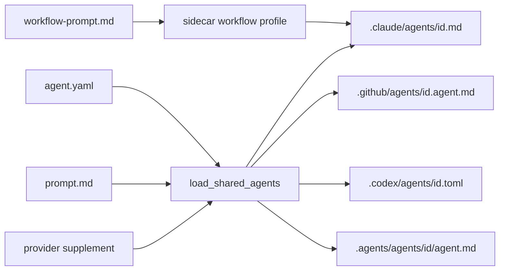

# Agent roster, prompts, and the skill library

Source, tests, and the policies under `shared/policies/` outrank this page.

Every agent is defined once under `shared/agents/<id>/` and rendered into a native adapter for each host it is eligible for. Skills live once under `shared/skills/` and are copied to every host the same way. The generator does the rendering, and the target validator refuses output that breaks the contract.

## How one agent definition becomes four adapters

This diagram shows what the generator reads for one agent and what it writes per host.

An agent directory holds two kinds of file:

- `agent.yaml`, which holds JSON metadata despite its name: `id`, `description`, `role_type`, `visibility`, `capabilities`, optional `delegates`, optional `targets`, optional `prompt_base`, and a `model_intent` object.
- One or more prompt bodies: a canonical `prompt.md`, or a provider supplement named `prompt.openai-codex.md` or `prompt.google-antigravity.md`.
- For the five canonical agents, a `workflow-prompt.md`: a complete, self-contained relaxed prompt that the sidecar's `workflow` profile ships instead of `prompt.md`. It names no verifier, receipt, checkpoint, or hook, and the target validator checks that with a forbidden-token list. The full install never reads it.

The generator's `load_shared_agents` parses every `agent.yaml`, validates it, requires unique ids, and checks prompt composition before anything renders. That validation is code, not policy: a bad metadata file stops generation.

## The metadata contract

`validate_agent_metadata` in `scripts/generate_targets.py` enforces these rules:

- Unknown fields are rejected.
- `id`, `description`, `role_type`, and `visibility` are required. `visibility` is `public` or `hidden`.
- `capabilities` come from a fixed vocabulary (`read`, `search`, `edit`, `execute`, `delegate`, `todo`, and a few more).
- `delegates` must be stable agent ids.
- `model_intent` must have an entry for exactly the targets the agent is eligible for, no more and no fewer.
- An agent that omits `targets` is eligible for all four hosts. One that lists them is rendered only there.

## The roster

Five canonical agents are eligible everywhere and each has its own `prompt.md`.

| Agent | Role | Visibility | Note |
| --- | --- | --- | --- |
| `orchestrator` | main-thread lifecycle driver | public | the only agent with `delegates`: `planner`, `coder`, `reviewer`, `documenter` |
| `planner` | phased implementation plans | public | |
| `coder` | implementation and focused verification | hidden | its Codex `model_intent` names `sol_coder` as the escalation target |
| `reviewer` | profile-driven review in two passes | public | |
| `documenter` | README and docs updates | hidden | |

Three more agents exist for one provider each and are derived from `coder` through `prompt_base`:

- `luna_coder` and `sol_coder` for `openai-codex`.
- `antigravity_flash_coder` for `google-antigravity`.

A derived agent has no `prompt.md`. It carries only its provider supplement, and the generator composes the base prompt plus the supplement at render time.

## Prompt composition rules

Composition is one level deep, and `validate_prompt_composition` enforces it. The generator refuses:

- a `prompt_base` that points at itself, at a missing agent, or at an agent that itself has a `prompt_base`;
- a derived agent that also ships a `prompt.md`;
- an empty supplement;
- a supplement that contains the whole transformed base prompt, so a supplement cannot silently fork the canonical text;
- a supplement file on a canonical agent for a provider that agent is not eligible for.

## What each host receives

- **Claude Code.** `render_claude_agents` writes `.claude/agents/<name>.md` with the frontmatter that `claude_agent_frontmatter` builds. It holds `name`, `description`, and a `tools` list derived from `capabilities`. It adds an optional `model` and `effort` from `model_intent["claude-code"]` and an `agents:` list from `delegates`. Hidden agents get `user-invocable: false`, and the orchestrator gets `disable-model-invocation: true`. The body is the canonical prompt with target path rewrites. The `search` capability maps to `Grep`, `Glob`, and the server-level grants `mcp__semble`, `mcp__context-mode`, and `mcp__context7`, so every agent that can search also gets read-only documentation lookup through Context7.
- **Sidecar workflow profile.** `render_sidecar_workflow_units` writes the same `.claude/agents/<id>.md` for the five canonical agents into `dist/sidecar/workflow/`. Each file wraps the agent's `workflow-prompt.md` in `sidecar_agent_frontmatter`. That is the Claude Code frontmatter with every `mcp__*` tool grant removed, because the sidecar ships no MCP configuration. No `.github/agents` or `.codex/agents` file ships in that profile. The workflow orchestrator delegates a step only to an agent the session can start. Otherwise it does that step itself and labels a self-review as one. The planner and reviewer return their plan or report as reply text, and the agent that asked saves it under `.ai-bootstrap/`. They cannot save it themselves, because their tools come from the shared `capabilities` and include no `Write` or `Edit`. These relaxed prompts carry short advisory versions of the checks described under "Requirement authority and evidence" below. The planner names each decisive assumption. The coder maps every place a change must reach and reruns the original reproduction after a bug fix. The reviewer compares the diff against the approved requirements, reads the code the change touches, and lists anything it still needs at the end of its report. The [sidecar overlay page](../operations/sidecar-overlay.md) covers how those files reach a team-owned repository.
- **GitHub Copilot.** `render_github_agent_adapter` writes a thin pointer: frontmatter with `name`, `description`, tools, an `agents:` list from `delegates`, `user-invocable: false` for hidden agents, and `disable-model-invocation: true` for the orchestrator. The body tells Copilot to read the canonical `.claude/agents/<name>.md`. An agent not eligible for Claude Code gets a self-contained body instead.
- **OpenAI Codex.** `render_codex_agent_adapter` emits TOML with `name`, `description`, optional `model` and `model_reasoning_effort`, and the composed prompt as `developer_instructions`. Codex custom agents inherit the parent session's MCP servers, sandbox, and approval policy, and a custom agent file cannot override them. The adapter therefore no longer writes `sandbox_mode`, and `validate_targets.py` rejects it as a per-agent override, the same way it rejects `skills` and `mcp_servers`. Read-only Codex roles are read-only by their instructions only, which `docs/target-mapping.md` records as a remaining gap.
- **Google Antigravity.** `render_antigravity_agent_adapter` writes `.agents/agents/<id>/agent.md` with `mainAgent: false`, `subagent: true` for every agent except the orchestrator, the provider model, and `inheritMcp: true` for subagents. `inheritMcp` is not a documented Antigravity field (the documented subagent field is `mcpServers`), so whether Antigravity subagents reach the workspace MCP servers is unverified, and the Antigravity hook bridge denies MCP tool calls in any case.

The sidecar planner uses different status lists for big and small plans. Big plans use `planning`, `in-progress`, `complete`, or `cancelled`; small plans use `planned`, `in-progress`, `paused`, `complete`, or `cancelled`. These labels are descriptive and do not gate a sidecar commit.

The workflow profile also ships its own `onboard` skill at both sidecar skill roots. It records project context in `.ai-bootstrap/project-context.instructions.md` and adds one pointer in `.ai-bootstrap/MEMORY.md`. The planner and coder prompts read that context when present, check relevant claims against source, and follow tracked team guidance when it differs. The [sidecar overlay page](../operations/sidecar-overlay.md) explains the profile boundary and private state.

## Review profiles

The `reviewer` carries no checklists in its prompt. It loads one or more profiles from `shared/review-profiles/`, each with its own `## Severity` section, then runs a primary pass and a verification pass that tries to refute each finding. It repeats verification until two passes in a row change nothing, or after at most three rounds.

The ten profiles are `api`, `architecture`, `code`, `config`, `documentation`, `domain`, `performance`, `ponytail`, `security`, and `tests`.

Which profiles apply is decided by the routing table in `shared/policies/workspace.instructions.md`, not by the reviewer:

- Hooks, scripts, generators, and control-plane code always get `code`, `architecture`, `security`, `tests`, and `ponytail`.
- Ponytail is required for every control-plane or high-risk diff, every multi-file diff, and every diff that expands complexity. It is optional only for one low-complexity documentation file or one workflow-state file.
- The commit gate enforces the deterministic part. `required_review_profiles` in `shared/scripts/verify.py` maps the changed paths to profiles: test surfaces (checked first) need `tests`; control-plane, generator, and dependency paths need `code`, `architecture`, `security`, `tests`, and `ponytail`. The gate adds `ponytail` for any multi-file diff and refuses a findings report that lacks any required profile. Complexity expansion inside one ordinary file stays the reviewer's call.

## Requirement authority and evidence

The approved plan or spec, its non-goals, and its approved scope-change records are the authority for required behavior. Specialists compare against that authority instead of rebuilding requirements from the diff.

- **Orchestrator.** Every delegation packet carries the approved requirements, non-goals, and scope-change records. The reviewer packet also carries the verification results already obtained, such as the coder's rerun of the original reproduction.
- **Reviewer.** Pass 1 checks that every in-scope behavior has an implementation and evidence, and that nothing unapproved was added. An approved scope change replaces the requirement it changes, and a valid alternative implementation is not a deviation. Missing material behavior is an ordinary finding at the existing severity; the reviewer never invents a requirement.
- **Reading outside the diff.** The reviewer reads the code the change touches, not only the diff. That covers the callers of every changed function, signature, or return value. It also covers the tests and fixtures that exercise it, and the config or exports that name it. A caller, test, fixture, or config entry outside the diff that the change breaks or leaves stale is an ordinary finding. The coder prompt and the workspace Ponytail rule ask for the same scope before the first edit. They say to map every place the change must reach: callers, tests, fixtures, and config.
- **Open requests.** The reviewer cannot pause to ask a question. It lists missing requirements or execution evidence under an optional `### Open Requests` section and answers `WARN` instead of `PASS`. The orchestrator answers each request with the result or the plain reason it cannot be produced, then reruns the review; a request answered with a reason closes as an unverified limitation. Open requests never enter the findings JSON, and an empty `[]` means a clean review only when no request is open.
- **Gate result.** The reviewer ends with `FAIL` when a CRITICAL or MAJOR finding survives, `WARN` when a request is open, and otherwise `PASS`. The orchestrator records that value with `record_findings.py --gate-result` and each open request with `--open-request`. The commit gate refuses a phase-completion commit unless the recorded result is `PASS` with no open request.
- **Planner.** In full-plan mode, Phase 1 lists each decisive assumption (one that would invalidate the design if false) and settles it from code, docs, or a bounded experiment before phases are split. An experiment never authorizes production changes, and an unresolved assumption stays explicit or blocked. Phase 2 asks the user only about preferences, and Phase 4 cites the existing contracts and the test strategy.
- **Coder and debugging.** After a bug fix, the coder and the `debug-investigator` skill rerun the original reproduction and record the outcome or why it could not be rerun. A green test suite alone does not count as that check. The `tests` profile also checks that expected values do not come from the implementation under test.

Section-scoped key-phrase tests in `tests/test_validate_targets.py` check that this guidance ships in the shared source and in the generated Claude Code, Codex, and sidecar output. They prove the text is present, not that a model follows it.

The [2026-10-06 behavioral pilot](../../docs/2026-10-06-behavioral-pilot-evidence.md) is dated advisory host evidence for one synthetic review fixture. One repaired-packet output was consistent with reviewer loading; four scheduled case runs were unavailable. The pilot stopped without establishing case sensitivity or running a before/after comparison. It adds no deterministic gate and supports no general quality claim.

## The skill library

Skills live under `shared/skills/<name>/SKILL.md`. At the time of writing there are 55: 40 with `visibility: public` and 15 with `visibility: background`.

The sidecar workflow `onboard` text lives separately under `shared/sidecar/workflow/skills/onboard/`. The generator selects it only for the workflow profile, so the full-install skill keeps its own state and lifecycle instructions.

- Public skills are invoked by name.
- Background skills are loaded by matching their `description`, which is why two skills may not share a description.
- `shared/templates/skill-template.md` is the starting shape: `name`, `visibility`, `description`, an optional `argument-hint`, then Problem, Trigger Conditions, and Solution sections. Its path guidance distinguishes authoring under `shared/skills/` from installed skills under `.claude/skills/`.

Two skills are special:

- `ponytail` and `ponytail-review` are adapted third-party skills: a local fork, partially merged from upstream `v5.3.2` (it was `v4.8.4`). The validator requires them to ship, stay public, and keep `license: MIT`, with the upstream LICENSE and provenance under `.claude/third_party/ponytail/`. The workflow policy requires the coder to apply `ponytail` in `full` mode once per coding task.
- The merge adopted the rules about scope outside the diff. `ponytail` gained a `## Before you write` step: find every place the change must reach (callers, tests, fixtures, config, exports). It also gained a rule to finish the callers, tests, and fixtures a change breaks. It keeps the fork's seven-rung ladder and the `ponytail:` marker.
- `ponytail-review` stays a complexity-only review. It gained a `## Read first` step, a `reuse:` tag, a concrete case for every finding, and a whole-tree search before a `delete:` finding; a broken caller or test belongs to the normal review profiles. The merge record, with every adopted and declined row, is in `shared/third_party/ponytail/UPSTREAM.md`.
- `validate_targets.py` pins both skill files and the LICENSE by SHA-256 against `UPSTREAM.md`, and a test checks that every `SIDECAR_TEXT_REPLACEMENTS` anchor still matches a shipped skill. No test checks whether a model follows the rules; the checks prove only that the text ships.
- `humanize` adapts the third-party `avoid-ai-writing` skill. The generated target must expose only `humanize`, never the upstream name.

### How skills reach each host

- Claude Code: `copy_skills` copies `shared/skills/` into `.claude/skills/` and rewrites target paths inside `.md`, `.py`, and `.sh` files.
- Codex: `.codex/config.toml` gains one `[[skills.config]]` entry per skill, each pointing at `../.claude/skills/<name>/SKILL.md`.
- Antigravity: a plain copy of the tree under `.agents/skills/`.

There is one library, rendered three ways.

### What the validator enforces on skills

`shared_skill_integrity_errors` in `scripts/validate_targets.py` treats these as hard failures:

- every skill directory has a root `SKILL.md` (`SKILL_MISSING_ROOT`);
- frontmatter is flat YAML with matched `---` delimiters, no tabs, and no duplicate keys (`SKILL_FRONTMATTER_INVALID`);
- frontmatter `name` equals the directory name (`SKILL_NAME_MISMATCH`);
- `visibility` is `public` or `background`, and `description` is non-empty and unique across the library;
- a backtick-quoted path naming a known repository root or a `references/` path must resolve to a real file (`SKILL_BROKEN_REFERENCE`). Bare filenames and glob patterns are not checked.

`validate_skills_and_paths` adds the target-level checks:

- shipped shell blocks may not hide a test, lint, or verify failure behind `|| true`, `|| :`, or `|| echo`;
- the generated skill count equals the shared count;
- the Ponytail and humanize contracts hold;
- the generated documenter prompt still references `humanize`.

Semantic skill quality is left to the `deep-audit` skill on purpose.

## Representative tests

`tests/test_validate_targets.py` covers:

- the agent loader's refusals: invalid target scope, non-object metadata, prompt-base cycles, copied base prompts, and supplements on ineligible providers;
- target-scoped rendering: a Codex-only agent renders only to Codex, and a GitHub-only agent embeds its prompt;
- the exact Codex coder specialist metadata;
- the stale-skill contract checks.

## Related pages

- [Source, generated output, consumer repo, and nested AI state](source-generated-consumer-layout.md)
- [Task lanes and the enforced lifecycle](../workflows/lifecycle-and-task-lanes.md)
- [Sidecar overlay](../operations/sidecar-overlay.md)
- [Deterministic verification](../operations/deterministic-verification.md)
