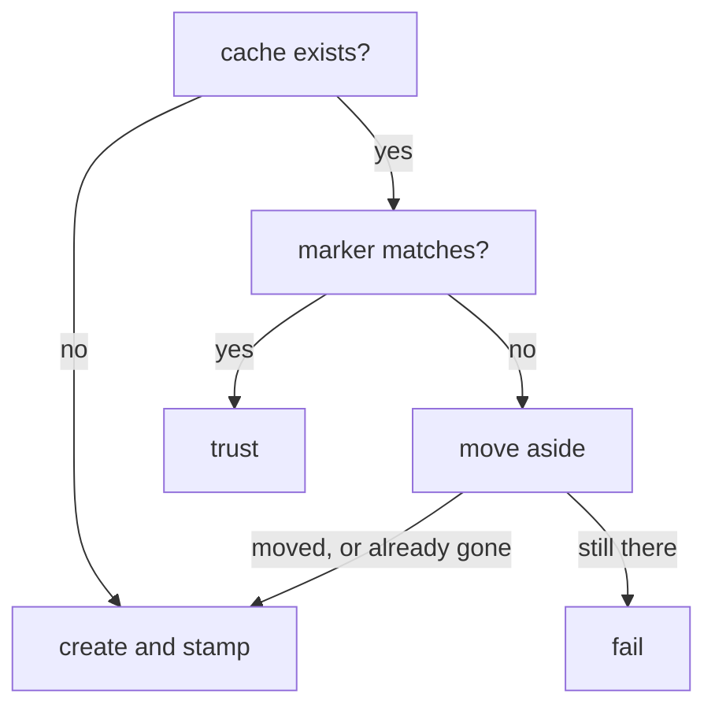

# Context Mode dispatcher: version pin, tool filter, and cache security

Source, tests, and the policies under `shared/policies/` outrank this page.

Context Mode is an optional retrieval helper (an MCP server that indexes and searches large text). The bootstrap never runs it directly. Every host reaches it through one script, `shared/hooks/scripts/context-mode-dispatch.sh`, which pins the version, checks Node.js, restricts the tool surface, and guards the on-disk cache. The dispatcher is generated into consumers as `.claude/hooks/scripts/context-mode-dispatch.sh`.

## Server mode only

The dispatcher has one working mode. `context-mode-dispatch.sh server` is what `.mcp.json`, `.vscode/mcp.json`, and `.codex/config.toml` launch. Antigravity's `.agents/mcp_config.json` gets no Context Mode entry, because its PreToolUse bridge denies every MCP call.

- **No hooks.** No host wires a Context Mode hook, and `validate_targets.py` fails when any hook handler runs the dispatcher. A call from stale hook wiring, such as an old `.codex/` adapter a consumer commits, uses any mode other than `server`. The dispatcher reads its input, prints nothing, and exits 0 before any storage setup.
- **`--self-check`** prints the contract facts described below and never starts the server.

Server mode runs these steps in order. Each failure prints one `ERROR context-mode-dispatch:` line and exits non-zero, because the server is the real tool.

1. Change to the outer repository root, which the dispatcher computes from its own location.
2. Select and verify the cache (see "One cache location" and "Cache trust and quarantine").
3. Resolve the launcher: a proven direct binary, or the pinned `npx` command.
4. Require Node and the filter script.
5. Require Node.js 24.15.0 or newer (`MIN_NODE_VERSION`).
6. Start `context-mode-mcp-filter.mjs` under Node in front of `context-mode server --agent codex`.

## One server identity for every client

Context Mode 2.x needs an `--agent` argument or `CLAUDE_PROJECT_DIR` to know its project. The kit starts every client's server the same way: `context-mode server --agent codex`, directly or as `npx -y "context-mode@$PINNED_CONTEXT_MODE_VERSION" server --agent codex`. It sets no `CLAUDE_PROJECT_DIR` and passes no `--workspace-folder`.

Under `--agent codex`, the server keys its project to the Git repository of its working folder. A server started inside the nested `.claude` repository would therefore index into a separate project. That is why the dispatcher changes to the outer repository root before it looks up the launcher. The same `cd` means the version proof, the filter, and the server all search `PATH` from one folder, and the filter checks `ctx_index` paths against that folder.

## The version pin is proven, not assumed

The pinned version is `2.1.8`, held in `PINNED_CONTEXT_MODE_VERSION`. The 2.x server reports `serverInfo.version` as `"dev"`, so a version can never be proven over the wire. `resolve_context_mode` proves it before anything runs:

- A `context-mode` executable on `PATH` is used only when its symlink resolves to an installed package whose own `package.json` has the name `context-mode` and exactly the pinned version. Checking the name too means a nested dependency manifest cannot be mistaken for Context Mode's own.
- A binary whose version is wrong or cannot be determined is never executed. The dispatcher falls back to `npx -y context-mode@<pin>`, which is pinned by construction because the version is in the command.

`context-mode-dispatch.sh --self-check` prints one `PASS context-mode-dispatch:` line per fact, so the check proves the contract instead of restating it: `required-version`, `required-node`, `observed-node`, `resolved-path`, `observed-version`, `launcher`, `version-contract` (`pinned-direct-binary` or `pinned-via-npx@<pin>`), `filter`, `storage-root`, `storage` (`writable` or `creatable`), and `nested-ignore`. When Node.js is older than the floor, it also warns that the MCP server cannot start. `scripts/check_runtime.py` runs this self-check.

Moving to a newer Context Mode release follows the pin-bump procedure in `docs/runtime-checks.md`. Its key rule is to change the dispatcher pin before running the real-binary test, because that test accepts a direct binary only when it equals the pin. The same file has the rollback note: after a revert, move the fresh cache folder aside before restoring the 1.x cache by hand.

## The three-tool filter

`context-mode-mcp-filter.mjs` sits between the host and Context Mode on standard input and output.

- **Identity gate.** The filter blocks `tools/list` and `tools/call` with `-32001` until an `initialize` response arrives whose `serverInfo.name` is exactly `context-mode`. A different name gets `-32002`, and the filter kills the upstream process. The gate never checks the version: Context Mode 1.x and 2.x report the same name, so the dispatcher's version proof is the only version check.
- **Reduced `initialize`.** The client receives only `protocolVersion`, `capabilities.tools`, and `serverInfo` with its name and version. Upstream `instructions`, prompts, resources, and experimental capabilities are dropped by construction.
- **Discovery probe answered locally.** MCP revision 2026-07-28 clients first probe a server with `server/discover` and skip `initialize` when the probe succeeds. Context Mode 2.1.8 answers that probe, with its upstream `instructions`, so a client that accepted it would never send `initialize`, and the identity gate above would refuse its `tools/list` and `tools/call`. The filter therefore answers `server/discover` itself with `-32601` (`Method not found`), drops a probe that has no `id`, and never forwards either, before or after an accepted `initialize`. A client that speaks both revisions treats that error as an older server and falls back to `initialize`. A client that speaks only 2026-07-28 gets no Context Mode tools.
- **Three tools.** Only `ctx_index`, `ctx_search`, and `ctx_stats` are advertised and allowed. Every other tool call, known or unknown, is answered locally with `-32601` (`Context Mode tool is not allowed by repository policy`) and never reaches upstream.
- **Kit descriptions.** Each allowed tool gets a fixed one-sentence kit description that names only allowed tools and gives no routing advice. Every string `description` inside a tool's input schema is removed at any depth, and `ctx_index` keeps only the properties in `INDEX_ARGS`.
- **Annotations.** Only boolean entries of a tool's `annotations` pass through, such as `readOnlyHint` and `destructiveHint`. Codex treats an unannotated tool differently, and a string such as `title` could carry advice text.
- **Files-only `ctx_index`.** It accepts only `content`, `path`, and a `source` label of at most 200 characters, with exactly one of `content` or `path`. A `path` must exist, contain no `..`, not be a symbolic link, resolve inside the repository, and be a regular file. A folder gets `-32602` with a message that a regular file inside the repository is required.
- **No leaks through reused ids.** Responses to `tools/list` are filtered by request id, and ids are counted rather than remembered once. Two requests that reuse an id cannot leak the unfiltered tool list.

`ctx_index` takes no folders because the 2026-11-12 pre-branch spike found that 2.x folder indexing has no limit on files, depth, or size, follows symlinks into sibling projects inside the repository's parent folder, and ignores a `.gitignore` above the indexed folder. The filter checks only the top-level path, so it cannot see inside a folder.

## One cache location, and only one

Context Mode 2.x stores its data under the folder named by `CONTEXT_MODE_DATA_DIR` and ignores `CONTEXT_MODE_DIR`. The bootstrap owns exactly one location for it: `.claude/.cache/context-mode/` inside the repository. The dispatcher still reads `CONTEXT_MODE_DIR` as its own override, and `select_storage_root` enforces the rule:

- No override: the project-local cache is used.
- An override that is relative, unsafe to canonicalize, or resolves anywhere other than the project-local cache or a path beneath it is refused with a warning. The project-local cache is used instead, and the refused path is never created, stamped, renamed, or otherwise touched.

After the cache is verified, `configure_storage` exports `CONTEXT_MODE_DATA_DIR` as the chosen root and overwrites any value the caller exported. An inherited value therefore cannot move Context Mode's data elsewhere.

The reason is ownership, not just safety. Quarantine, described next, works by renaming the cache directory. Honoring an arbitrary external path would let the bootstrap reorganize user-owned state outside the repository. The nested `ai-state` repository ignores and untracks `.cache/`, so the cache is never committed from this repository's own writes.

## Cache trust and quarantine

The remaining risk is a cache that arrives by another route. `.cache/` is only untracked, not deleted, so bytes committed to `ai-state` history by a hostile or compromised remote can land on disk during reconciliation before being untracked again. `configure_storage` runs before every server start and decides whether the cache on disk can be trusted. This diagram shows the decision.

- The marker is `.bootstrap-provenance` inside the cache, with four lines: `repository=<root>`, `context-mode=<pin>`, `filter=ctx-index-files-only-v2`, and `secret=<value>`. A pin bump or a new filter contract therefore starts a fresh cache, and the 1.x cache is never imported.
- The first three fields are public and predictable. The secret is what makes the marker unforgeable: a random 32-byte value generated once with `openssl rand` or `/dev/urandom` and stored at `.context-mode-provenance.secret` in the repository root, outside `.claude/`. `state-sync.sh` adds and commits only under `.claude/`, so the secret file never enters `ai-state` history, and the root restore it runs (`restore-root-adapters.sh`) copies only allowlisted adapter files, never this one. This gives no protection against a remote that replaces the synced scripts themselves. The installer's ignore block and `.openwikiignore` both exclude `.context-mode-provenance.secret*`.
- The secret is written to a temporary sibling and moved into place with `mv -n`, so two dispatcher invocations racing on first run still end with one secret on disk.
- A cache missing the marker or with any mismatching line is renamed to `<cache>.untrusted.<UTC timestamp>.<pid>` next to it and never deleted. A warning names the quarantine path. A fresh, empty guarded cache is created and stamped.
- Two servers that start together may both try to move the same old cache. When the move fails and the folder is gone, the dispatcher warns that another dispatcher already moved it aside and continues with a fresh cache. When the folder is still there, it is never trusted, stamped, or deleted: the dispatcher prints `mv`'s error and the server fails.

The consequence for lifecycle evidence is simple. Short of a remote that replaces the synced scripts themselves, no cache is searched or cited unless this dispatcher produced it locally. Moved-aside folders use disk space until a person deletes them.

## Where the rules live

- The tool allowlist and the files-only rule are also stated in `shared/policies/tool-routing.instructions.md`, and `validate_targets.py`'s Context Mode tool-surface check keeps the filter and the generated configuration in agreement. The validator also holds the pin (`CONTEXT_MODE_PINNED_VERSION`) and the devcontainer's Node.js image (`node:24.22.3-bookworm-slim`), and the devcontainer checks `context-mode --version` at build time.
- This repository's own tracked root adapters (`.mcp.json`, `.vscode/mcp.json`, `.codex/config.toml`) also start the server only through the dispatcher; `validate_targets.py` checks each one's `context-mode` entry. A user-level Context Mode plugin enabled in a person's own client settings brings its own unfiltered server and hooks, which the repository cannot govern.
- Hook wiring per host is in `scripts/generate_targets.py`; see [Hook dispatcher and guardrail scripts](../architecture/hooks-and-guardrails.md).

## Representative tests

- `tests/test_context_mode_dispatch.py` drives server mode with a fake `node` and covers the storage rules (relative, traversal, tracked, symlinked, and external overrides all fall back and never create the refused path; an approved subtree is preserved), the version contract (a direct binary only at the exact pin, refusal of wrong or undeterminable versions, the `npx` fallback with `server --agent codex`), the working folder from several start folders, the `CONTEXT_MODE_DATA_DIR` export, the Node.js floor, the self-check fields, the legacy hook no-op, a cache under an older filter contract being moved aside, and both lost-race branches.
- `tests/test_context_mode_mcp_filter.py` covers the reduced `initialize`, the exact three tools with kit descriptions, no schema description at any depth, boolean-only annotations, the identity gate (including `tools/list` and `tools/call` refused before an accepted `initialize`), blocked and unknown calls never reaching upstream, files-only `ctx_index`, and the duplicate-id and racing-id leak cases. Three probe tests send `server/discover` with the 2026-07-28 `_meta` before and after an accepted `initialize`, read every reply in order, and use a `ping` reply as an ordering barrier before checking that nothing reached upstream.
- `test_real_upstream_server_surface_is_filtered` is an opt-in real-binary test run with `CONTEXT_MODE_REAL=1 ... -k real_upstream`. It sends the `server/discover` probe first and expects `-32601`, starts from a nested Git repository at `<repo>/.claude`, indexes one file by relative path, and finds a word from it with `ctx_search`, so it fails if the dispatcher's root `cd` is removed.

## Related pages

- [Hook dispatcher and guardrail scripts](../architecture/hooks-and-guardrails.md)
- [Installing the bootstrap, file ownership, and runtime drift checks](install-ownership-and-runtime-checks.md)
- [Git-backed AI-state sync](git-backed-ai-state-sync.md)
- [Source, generated output, consumer repo, and nested AI state](../architecture/source-generated-consumer-layout.md)
