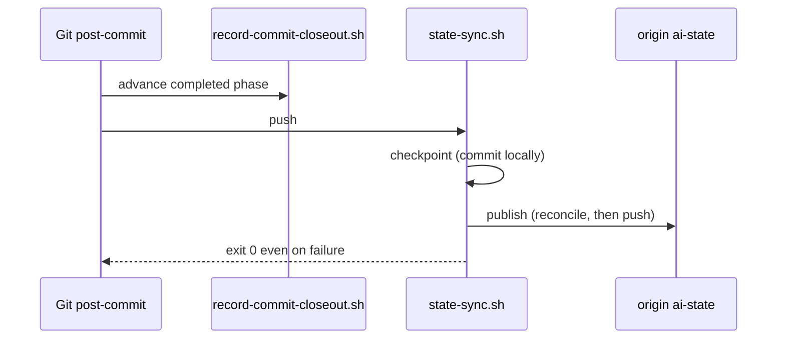

# Git-backed AI-state sync

Source, tests, and the policies under `shared/policies/` outrank this page.

In every full-install consumer, `.claude/` is a plain, self-contained Git repository with its own `.git/` directory on one branch named `ai-state`. It tracks the installed bootstrap files and the mutable AI state: `MEMORY.md`, `plans/**`, `explorations/**`, `session_logs/**`, and `quality_reports/**`. The outer repository ignores `.claude/` entirely, so `git branch` and `git log` at the root never show `ai-state`. Inspect it with `git -C .claude <command>`.

A sidecar install (`--mode sidecar`, in either profile) has none of this. The installer hands `--backup-state` to `backup_sidecar_state`, `--uninstall` to `uninstall_sidecar`, and a sidecar target to `install_sidecar`, each before any full-install step, so no nested repository, `ai-state` branch, or state sync is created or touched. The workflow profile's personal state folder, `.ai-bootstrap/` at the repository root, is a plain Git-ignored folder, not a nested repository; see [Sidecar overlay](sidecar-overlay.md).

## Two kinds of commit

- `bootstrap:` commits come from the installer and the batch updater when they refresh bootstrap-controlled files.
- `session:` commits come from session hooks saving state.

`git -C .claude log --stat` is therefore an audit trail of what every session and every bootstrap update changed. The nested remote is, by default, the outer repository's own `origin` with refspecs pinned to `ai-state`; an install-time `--state-remote` can point it elsewhere for privacy.

## The publication path after a commit

This diagram shows what happens after every outer-repository commit.

## `state-sync.sh` commands

`shared/hooks/scripts/state-sync.sh` is pure Bash with no `uv` or Python dependency. It is rendered into `.claude/hooks/scripts/` for normal use and into `.devcontainer/` as a bootstrap copy that exists before `.claude/` does on a fresh clone. `--local-only` or `AI_STATE_LOCAL_ONLY=1` skips every remote interaction.

| Command | What it does |
| --- | --- |
| `setup` | On a missing `.claude/.git`: init, configure the remote and pinned refspecs, write the nested `.gitignore` and `.gitattributes`, commit what is on disk, merge `origin/ai-state` allowing unrelated histories, restore root adapters, activate the outer Git hooks. If that merge is left unfinished because its abort failed, `setup` stops before restoring adapters or committing. On an existing repository it stays local: it only brings the nested `.gitignore` and `.gitattributes` up to date (see below) and does none of the rest. |
| `pull` | Record local changes, reconcile with `origin/ai-state`, then restore root adapters and checkpoint. A conflict is aborted and skips restoration; an abort that fails leaves the operation in place for a person. |
| `checkpoint` | Commit local AI state with no remote operation. Initializes the repository first if needed. |
| `publish` | Send already committed state only. A dirty worktree warns and preserves the uncheckpointed state. Repeated clean publication is a no-op. |
| `push` | `checkpoint` then `publish`. A failed checkpoint skips publication. |
| `status` | Read-only and network-free: initialized, clean or dirty, remote configured without exposing its URL, cached ahead and behind counts, `rebase:` and `merge:` state, `lock: free`, `lock: held`, or `lock: unavailable`, and the last recorded error. |
| `migrate-from-hf` | One-way import of pre-Git state as a `migrate:` commit. Historical. |

Every mutating command goes through `dispatch_mutating`. It first takes the sync lock described below, then runs `preflight_unfinished_operation`, which looks for an unfinished merge or rebase in the nested repository by file and runs no Git command.

## Unfinished rebases and merges

An unfinished operation is a rebase or merge that Git started and that now waits for a person to continue or abort it. State sync never commits over one:

- `commit_local_state` refuses, before any `git add -A`, while a rebase or merge is unfinished or `git ls-files -u` lists unmerged paths. The second test also catches a conflicted cherry-pick, revert, or `stash pop`.
- A merge or rebase already in progress when a command starts is protected. The command changes nothing, exits 0, and logs one warning to `.claude/session_logs/hooks-errors.log` that advises `--continue` after fixing conflicts, or `--abort`.
- The one exception is the orphaned autostash leftover, a `rebase-merge` folder that holds only an `autostash` file. `preflight_unfinished_operation` clears it with `rebase --quit` and then continues.
- When the current pull's rebase conflicts, state sync runs `rebase --abort` only. When an unrelated-history merge conflicts, it runs `merge --abort` only while `MERGE_HEAD` exists.
- If that abort fails, the rebase or merge is left in place for a person. The `settings.local.json` copy stays under `.claude/.git/` and the warning names it, and `setup` stops before restoring adapters or committing.

Before the rebase or the unrelated-history merge, `reconcile_committed_state` records whether the two histories are related, re-checks for an unfinished operation, and commits local changes. An abort therefore never has uncommitted work to lose. `scripts/validate_targets.py` enforces part of this on the generated script: `rebase --quit` must appear exactly once, and neither abort may be silenced with `|| true`.

## One sync at a time

Hooks from several sessions and clients, the outer `post-commit` hook, VS Code tasks, and a host plus its devcontainer can all run state sync on one checkout. `acquire_sync_lock` lets only one mutating run work at a time:

- It takes an exclusive `flock` on the repository root folder through descriptor 9. There is no lock file, and the kernel releases the lock when the holder exits.
- A run that finds the lock busy prints a notice on stderr and skips; the next sync includes its changes. `setup` and `migrate-from-hf`, which no hook calls, wait up to 60 seconds, then log a warning and skip.
- Without `flock` (stock macOS), or when `flock` fails for another reason, sync runs unlocked as before.
- The lock covers state-sync runs only. A direct `git -C .claude` command by a person or an agent does not take it.
- A child that inherits descriptor 9, such as a detached `git maintenance` or a hung SSH call, keeps the lock until it ends. `status` reports `lock: held` without waiting, and `lsof <repository root>` finds the holder.

## Network limits

At the top of the script, state sync exports `GIT_TERMINAL_PROMPT=0` and defaults `GIT_HTTP_LOW_SPEED_LIMIT` to `1000` and `GIT_HTTP_LOW_SPEED_TIME` to `60`. An HTTPS transfer slower than 1,000 bytes per second for 60 seconds is cancelled, so a stalled HTTPS transfer cannot hold the lock. Git never waits for a typed password, while stored credentials and credential helpers keep working.

Values the caller already set for the two stall variables win. An HTTPS connection that is still being opened and SSH remotes have no stall limit. The variables change no Git command line.

## Warn, never fail

The dispatcher wraps every command in a warn-and-continue and always exits 0. Warnings go to stderr and to `.claude/session_logs/hooks-errors.log`. This is deliberate:

- The script runs from session hooks, the outer `post-commit` Git hook, and VS Code tasks.
- A missing remote, an offline network, a busy lock, or a rebase conflict must never block a session or turn a completed commit into a failed one.
- The cost is that a sync problem shows only in the log and in `status`. The SessionStart hook reports hook-path and sync problems as context for the next session.

## What the nested repository never tracks

- `.cache/` (Context Mode storage and the OpenWiki guard's snapshot directory) and `session_logs/hooks-errors.log` are ignored. `untrack_local_only_paths` removes them, and `settings.local.json`, from the index whenever `commit_local_state` runs, without deleting the files.
- `settings.local.json` (Claude Code's per-user local settings) is ignored and removed from the index only, so the first checkpoint after an upgrade commits the untrack and the next publish removes the file from the shared remote. Because Git would otherwise delete or overwrite a clone's own copy when it pulls that commit, `preserve_local_settings` keeps a byte copy at `.claude/.git/settings.local.json.<suffix>` around every pull and unrelated-history merge, and `restore_local_settings` decides afterwards. An unchanged file just drops the copy. A missing file, or one whose bytes equal the `origin/<branch>` version Git wrote, gets the copy back ("restored local settings.local.json, which git replaced during reconciliation."). Any other content is a newer local write, so it is kept along with the copy and a warning names the copy. If the copy cannot be made, the pull or merge is skipped with a warning and retried next sync. A write that lands before Git writes its version in the same window cannot be told apart, so the older copy is restored in that case.
- If a run is stopped by `INT`, `TERM`, or `HUP`, the exit trap `settle_local_settings_on_exit` puts the copy back, or keeps and names it while a rebase or merge is unfinished. Like the normal path, that restore keeps the copy when the live file holds newer bytes or the copy cannot be written back. A run ended any other way (for example `SIGKILL`, `SIGQUIT`, or a power loss), or a signal that lands during the restore, can still leave the copy behind.
- `session_logs/hooks-bypass.log` stays tracked.
- The `.gitattributes` gives append-only `session_logs/*.log` files Git's `merge=union` driver, so two sessions appending to the same log reconcile automatically. Plans, `MEMORY.md`, and prose keep conflict-and-abort behavior so a real divergence stops for a person.

Both files belong to the consumer. `write_nested_gitignore` and `write_nested_gitattributes` write their template only when the file is missing, and otherwise only append what is absent: the `settings.local.json` line when `git check-ignore -q --no-index` says that path would not be ignored (exit status exactly 1, so a broken repository adds nothing), the `.cache/` and `hooks-errors.log` lines, and the `session_logs/*.log merge=union` line. They run in `setup` on an existing repository, in every `checkpoint` through `commit_local_state`, and on a fresh `setup`, so an older nested repository gains the union-merge rule and a consumer's own lines survive. A bootstrap refresh never deletes either file, because both are listed in `CONSUMER_STATE_PATHS` (see the install and ownership page).

## Root adapters and the bootstrap-root mirror

`state-sync.sh` only checks out `.claude/`. The installer-owned files outside it (`AGENTS.md`, `CLAUDE.md`, `.mcp.json`, `.codex/**`, `.agents/**`, `.vscode/*.json`, and the Copilot surface when not committed) are carried inside the nested repository under `.claude/bootstrap-root/`:

- `restore-root-adapters.sh` copies them back to their real locations, reading the list from `.claude/bootstrap-ownership.env`. It exits 0 silently when the mirror or the manifest is absent.
- It refuses a symlinked `.claude` or `.claude/bootstrap-root` with exit 1 before resolving any path, so it never copies adapter files from outside the repository. `state-sync.sh` logs that failure as `restoring root adapters failed; continuing.`
- `state-sync.sh` calls it on a fresh `setup`, on every successful `pull`, and on a `checkpoint` that had to initialize the repository.
- `verify.py` fingerprints the same mirror to prove control-plane provenance, so an adapter edited outside a bootstrap refresh fails verification until the refresh remirrors it.

`configure_outer_hooks_path`, called from the same restore path, sets the outer `core.hooksPath` to the fixed literal `.claude/hooks/git-hooks` once that directory exists. A matching value is left alone, a different value is overwritten with a warning naming the old one, and a failure only warns. It is the one write `state-sync.sh` makes outside `.claude/`, and nothing from the nested checkout is interpolated into it.

## Where sync runs

- **SessionStart** on Claude Code, Codex, and GitHub Copilot (Antigravity wires no lifecycle hooks): `state-sync.sh pull`, then `session-start-state.sh` reports the active plan and phase.
- **Stop**: `claude-stop.sh` and `codex-stop.sh` run `checkpoint` then `publish`, and GitHub Copilot runs `state-sync.sh push`. Stop paths are best-effort; closing an editor tab does not guarantee the event.
- **UserPromptSubmit** on Claude Code and Codex: `state-sync.sh push`.
- **Session end**: Codex runs a local `checkpoint` on `SessionEnd`. Claude Code runs `push` on `SessionEnd` and a local `checkpoint` on `StopFailure`.
- **Outer `post-commit` Git hook**: the closeout recorder, then `state-sync.sh push` with stdin from `/dev/null`. Git ignores the hook's exit status, so this is the durable publication boundary the Stop hooks cannot promise.
- **VS Code tasks**: an automatic `AI state: pull` on folder open, which runs `setup` then `pull`, and a manual `AI state: push`.
- **Devcontainer**: `post-start.sh` runs `setup` then `pull`. Before the container starts, the generated `devcontainer.json` runs a list-form `initializeCommand` (`mkdir -p`, no shell) on the host that creates `~/.openwiki` and `~/.cache/huggingface`, because Docker's `--mount` refuses a missing bind source. `scripts/validate_targets.py` requires that exact command.

## Representative tests

`tests/test_state_sync.py` runs the real script against temporary repositories:

- checkpoint commits locally without remote I/O, and setup and pull activate the outer hooks path without rewriting a matching one;
- the error log and cache are never tracked and are untracked without deletion; publish refuses a dirty worktree and is idempotent; push stays checkpoint-then-publish; status is credential-safe;
- a person's conflicted merge, a failed pull abort, and an unabortable `setup` merge each end with no new commit, and a fake `git` that logs every call proves that only `rebase --abort` or `merge --abort` ran;
- half-initialized rebase state is cleared only in its exact orphaned shape, and status reports `merge:` and `lock:` lines;
- a busy run skips without running Git, `setup` waits for the lock, and the hooks and devcontainer copies share one lock;
- a stalled HTTPS fetch ends within the stall limit, and the exit trap restores the settings copy after `TERM`, `INT`, or `HUP`;
- the restorer refuses a symlinked `.claude` or `.claude/bootstrap-root`.

## Related pages

- [Installing the bootstrap, file ownership, and runtime drift checks](install-ownership-and-runtime-checks.md)
- [Hook dispatcher and guardrail scripts](../architecture/hooks-and-guardrails.md)
- [Source, generated output, consumer repo, and nested AI state](../architecture/source-generated-consumer-layout.md)
- [Sidecar overlay](sidecar-overlay.md)
