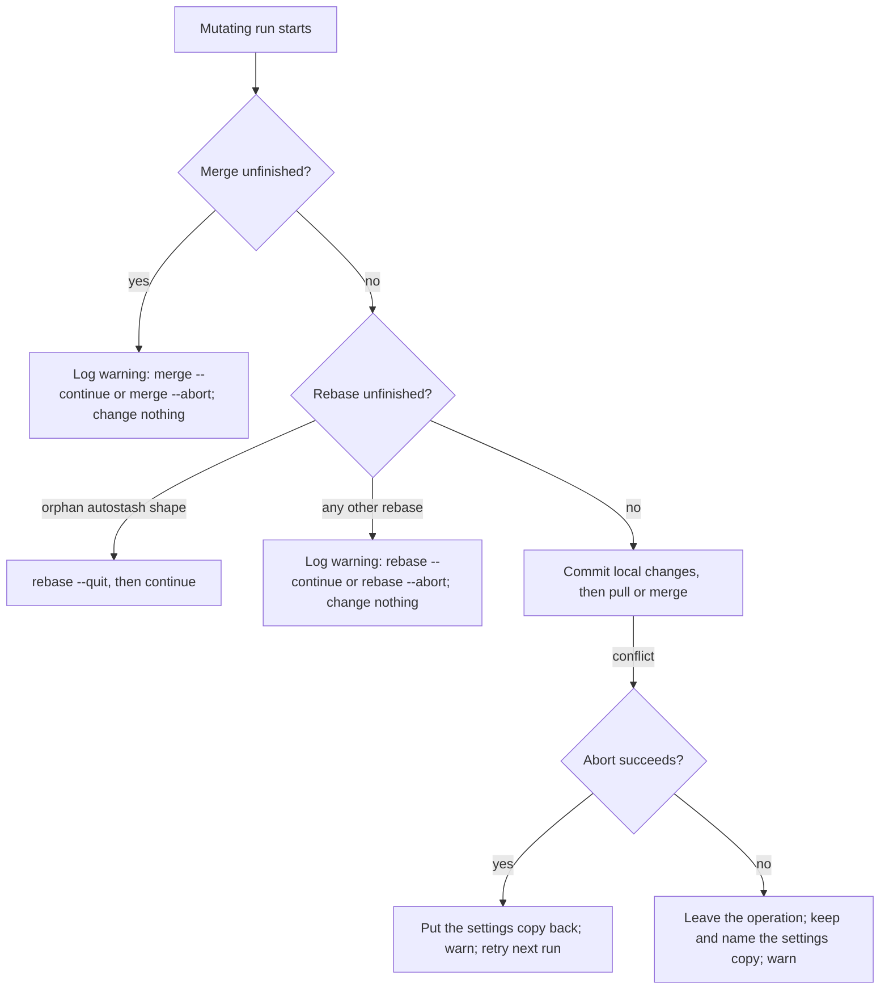

# Small Plan: Never Commit Over an Unfinished Rebase or Merge

## Scope

State sync can turn a conflict into a commit full of conflict markers. This phase makes every state-sync commit refuse while a rebase or merge is unfinished. It protects a merge it finds already in place, the same way it already protects an ambiguous rebase. It stops forcing out an operation it cannot abort. When it has to leave an operation unfinished, it keeps the settings copy under `.claude/.git/` and names it, instead of writing it back into a tree that Git still owns. In that case `setup` stops before restoring root adapters or committing. `status` reports an unfinished merge. Two small duplications go away. The big plan defines *unfinished operation*, *protected state*, *settings copy*, and *orphan autostash shape*. Requirements: REQ-001 to REQ-007.



## Steps

- [ ] **1. Detect unfinished operations and refuse to commit over them.**
  - Owner: `coder`. File: `shared/hooks/scripts/state-sync.sh` (modify).
  - Required Skills: `.claude/skills/ponytail/SKILL.md` (`full` mode).
  - Add `nested_merge_in_progress` (true while `$CLAUDE_DIR/.git/MERGE_HEAD` is a regular file) and `nested_operation_in_progress` (an unfinished rebase or merge). Reuse `nested_rebase_in_progress`.
  - `commit_local_state` (lines 248-276): its first action, before any untrack call or `git add -A`, refuses while `nested_operation_in_progress` is true or `git -C "$CLAUDE_DIR" ls-files -u` prints anything. The second test catches unmerged paths that no rebase folder or `MERGE_HEAD` marks: a conflicted cherry-pick, revert, or `stash pop`, and the detached HEAD with an unmerged index that today's `rebase --quit` fallback leaves behind in consumer repositories. It calls `warn "an unfinished rebase or merge, or unmerged paths, in $CLAUDE_DIR; not committing over it. Inspect with: git -C $CLAUDE_DIR status."` and returns 1. The preflight does not run this Git command, so a protected state still runs no Git command. The user approved this extra check on 2026-10-23.
  - Rename `preflight_mutating_rebase_state` to `preflight_unfinished_operation` and `PROTECTED_REBASE_STATE` to `PROTECTED_OPERATION_STATE`, and update every use in the file, because both now cover merges too.
  - The preflight looks for an unfinished merge first. It calls `warn "an unfinished merge is in progress; state sync will not alter it. Inspect with: git -C $CLAUDE_DIR status. Resolve with: git -C $CLAUDE_DIR merge --continue after fixing conflicts, or git -C $CLAUDE_DIR merge --abort."` and returns the protected status.
  - An ambiguous rebase now goes through `warn` too, replacing the raw `printf` at line 318. Keep the phrase `pre-existing rebase state is ambiguous; state sync will not alter it.` and advise `git -C $CLAUDE_DIR rebase --continue` after fixing conflicts, or `git -C $CLAUDE_DIR rebase --abort`. Never advise `rebase --quit` here. This reverses the 2026-08-09 rule that this message is stderr-only with no log write (`.claude/plans/2026-08-09_phase-A-state-sync-rebase-recovery.md`); the user approved the change on 2026-10-23, and the error log has been ignored and untracked since commit `0cad8db`.
  - The orphan autostash shape keeps its `rebase --quit` auto-clear unchanged. It is reached only after the merge check finds no unfinished merge.
  - `cmd_status` (lines 655-690): print `merge: none` or `merge: in-progress` on a new line right after the `rebase:` line, in both the uninitialized and the initialized report. Existing lines keep their text and order.
  - Acceptance: during a user's conflicted merge, every mutating mode exits 0, runs no Git command, changes no file or ref, and adds exactly one error-log line.

- [ ] **2. Leave an operation it cannot abort for the operator.**
  - Owner: `coder`. File: `shared/hooks/scripts/state-sync.sh`.
  - Required Skills: `.claude/skills/ponytail/SKILL.md` (`full` mode).
  - `clear_current_pull_rebase_state` (lines 357-374): run `git -C "$CLAUDE_DIR" rebase --abort` only, append its output to the error log, and return its status. Delete the `rebase --quit` fallback.
  - Failed pull (lines 547-559): when a rebase is in progress and its abort fails, do not call `restore_local_settings`. Warn `reconciliation with origin/$BRANCH failed and rebase --abort did not finish; the rebase was left in place. Inspect with: git -C $CLAUDE_DIR status. Resolve with: git -C $CLAUDE_DIR rebase --continue after fixing conflicts, or git -C $CLAUDE_DIR rebase --abort.` followed by the kept-settings sentence. Then clear `LOCAL_SETTINGS_BACKUP` so nothing later in the run writes the copy back. After a successful abort, or a failed pull that started no rebase, keep today's restore and warning text.
  - Unrelated-history merge failure (lines 505-511): replace `git -C "$CLAUDE_DIR" merge --abort 2>/dev/null || true` with a call whose output goes to the error log and whose status is checked. After a successful abort, keep today's behavior. After a failed abort, use the same pattern as the pull: no restore; a warning that says `merge --abort did not finish; the merge was left in place.` and advises `git -C $CLAUDE_DIR merge --continue` after fixing conflicts or `git -C $CLAUDE_DIR merge --abort`, followed by the kept-settings sentence; clear `LOCAL_SETTINGS_BACKUP`; return 1.
  - The kept-settings sentence comes from one helper, for example `kept_local_settings_note`. It prints ` settings.local.json was not restored; its copy is kept at <copy path>. Copy it back to <CLAUDE_DIR>/settings.local.json once the <rebase or merge> is resolved.` and prints nothing when no copy was taken. Pitfall: `$(...)` runs the helper in a subshell, so the helper cannot clear `LOCAL_SETTINGS_BACKUP`; the caller clears it after building the message.
  - Run the re-check (`preflight_unfinished_operation`) and the `commit_local_state` call (now at lines 523-535) for both paths, not only the rebase path. Order: first record whether `HEAD` and `origin/$BRANCH` share history (the existing `merge-base` call at line 496), then run the re-check and the commit, then take the merge path or the rebase path. A commit on top of `HEAD` does not change whether the two histories are related. Keep the `merge-base` call ahead of the re-check: `test_pre_rebase_checkpoint_rechecks_active_rebase` starts an operator rebase at that call and expects the re-check to catch it. The unrelated-history merge now also starts from a committed tree, so `merge --abort` never has uncommitted local changes to lose. Keep both messages.
  - Acceptance: the only `rebase --quit` left in the script is the orphan auto-clear, and no path writes the settings copy back while an operation is unfinished.

- [ ] **3. Make `setup` stop, and remove two duplications.**
  - Owner: `coder`. Files: `shared/hooks/scripts/state-sync.sh`; `tests/test_install_bootstrap.py` (only the two comments at lines 649 and 723 that name `untrack_error_log`).
  - Required Skills: `.claude/skills/ponytail/SKILL.md` (`full` mode).
  - `cmd_setup` (lines 431-453) and `setup_local_state` (lines 418-427) both carry the same existing-repository branch. Keep it only in `setup_local_state`. `cmd_setup` records whether `.claude/.git` was missing, calls `setup_local_state` once, and returns its status at once for an existing repository. This keeps the local-only contract that `test_setup_existing_nested_repo_does_not_checkpoint_pending_state` guards.
  - For a fresh repository, after reconciliation: return the protected status as today; then, while `nested_operation_in_progress` is true, return 1 before `restore_root_adapters` and `commit_local_state`. A reconciliation failure that leaves no unfinished operation keeps today's restore and commit.
  - MEMORY lesson: an earlier split of `cmd_setup` dropped its `restore_root_adapters` call. `test_setup_alone_restores_ignored_github_directory_on_fresh_repo` guards that call and must pass unmodified.
  - Replace `untrack_nested_cache`, `untrack_error_log`, and `untrack_local_settings` (lines 124-144) with one function, `untrack_local_only_paths`, whose only command is exactly `git -C "$CLAUDE_DIR" rm -r -f -q --cached --ignore-unmatch -- .cache session_logs/hooks-errors.log settings.local.json`. One comment explains all three paths. `commit_local_state` calls it once.
  - Acceptance: the existing untrack and setup tests pass unchanged.

- [ ] **4. Move the validator contract in this phase.**
  - Owner: `coder`. Files: `scripts/validate_targets.py`, `tests/test_validate_targets.py`.
  - Required Skills: `.claude/skills/ponytail/SKILL.md` (`full` mode), `.claude/skills/testing-patterns/SKILL.md`.
  - Extract the state-sync text checks in `validate_mcp_and_hooks` (lines 3292-3327) into `state_sync_text_errors(text: str) -> list[str]`, and call it on the generated hooks copy. The byte-identity check of the two installed copies stays inline. Unchanged checks keep their messages.
  - Replace the `"untrack_error_log" in text` condition with the literal command from step 3 (MEMORY: structural checks assert literal invocations).
  - Require `'git -C "$CLAUDE_DIR" rebase --quit'` to occur exactly once, for the orphan auto-clear. The message says the current pull's recovery must use `rebase --abort` only.
  - Add a check that `merge --abort 2>/dev/null || true` does not appear, mirroring the existing rebase check.
  - Tests: `state_sync_text_errors` returns `[]` for `shared/hooks/scripts/state-sync.sh`. Each of these mutations returns exactly one error that names its rule: a second `rebase --quit` invocation appended; the orphan invocation removed; the silent merge abort inserted; the untrack command removed.

- [ ] **5. Regression tests for the three reproduced failures and the new behavior.**
  - Owner: `coder`. File: `tests/test_state_sync.py`.
  - Required Skills: `.claude/skills/ponytail/SKILL.md` (`full` mode), `.claude/skills/testing-patterns/SKILL.md`.
  - MEMORY lessons: each new test fails against today's script; recovery and control-flow tests record real Git calls through a fake `git` that logs each call and then runs the real one, and assert the exact calls; fixtures commit inside pytest subprocesses, as the suite already does.
  - New helper `_valid_preexisting_merge(script, tmp_path, remote, name) -> tuple[Path, str]`, shaped like `_valid_preexisting_rebase`: a real conflicted `git merge` in the nested repository that leaves `MERGE_HEAD` and stage 1 to 3 index entries.
  - New tests. Expected values come from the fixture, from Git, or from this plan's contract, never from the script's output:
    1. `test_mutating_entrypoints_preserve_valid_preexisting_merge`, parametrized over `setup`, `pull`, `checkpoint`, `publish`, `push`, and `migrate-from-hf`. Expect exit 0; empty stdout; the merge warning and `merge --abort` advice on stderr; no fake-Git call log; and no change to HEAD, `git ls-files --stage`, the `MERGE_HEAD` bytes, `git status --porcelain=v1 -z`, the worktree bytes other than `session_logs/hooks-errors.log`, or the remote ref. `git rev-list --merges HEAD` stays empty. The error log gains exactly one line, and it holds the merge warning. This reproduces probe 1 from the big plan.
    2. `test_failed_pull_abort_leaves_rebase_and_keeps_settings_copy`, replacing `test_current_pull_recovery_reports_distinct_abort_and_quit_failures`. Two writers make a real conflict on `plans/x.md`. The second writer's local settings file holds known bytes. Its fake `git` passes `pull` to real Git and then deletes the live settings file, and fails only `rebase --abort`. Expect the logged rebase calls to be exactly `["rebase --abort"]`; the `rebase-merge` folder still on disk; the `ai-state` branch at its pre-pull commit; one settings copy under `.claude/.git/` with the original bytes, whose path appears on stderr; the live settings file still absent, so nothing wrote the copy back; `rebase --continue` and `rebase --abort` on stderr and no `rebase --quit`; the forced abort message in the error log. A following `checkpoint` with real Git leaves HEAD and `git rev-list --all --count` unchanged, keeps the unmerged path, and prints the protected rebase warning. A following `push` leaves the remote ref unchanged. This reproduces probe 2.
    3. `test_fresh_setup_with_unabortable_merge_neither_commits_nor_restores`. A fresh root with the rendered restorer and one ignored adapter source (`_install_pull_runtime`, `_write_github_adapter_source`) and a local settings file. The remote holds a conflicting `plans/x.md`. The fake `git` fails only `merge --abort`. Expect `MERGE_HEAD` on disk; exactly one commit, with subject `bootstrap: init ai-state`; no merge commit; the adapter not restored; one settings copy with the original bytes, named on stderr; `merge --continue` and `merge --abort` on stderr; and `setup failed; continuing.` on stderr. A following `checkpoint` makes no commit and prints the merge warning. This reproduces probe 3.
    4. `test_unrelated_history_merge_commits_local_changes_first`. A writer made with `checkpoint` and no remote has its own history. The test then adds `origin` by hand and leaves `plans/dirty.md` uncommitted. The remote holds an unrelated, non-conflicting history. After `pull`, the merge commit's first parent contains `plans/dirty.md` with the written bytes, the tree is clean, and the remote's files are on disk.
    5. `test_commit_refuses_while_a_merge_is_unfinished`. Covers the backstop in `commit_local_state`. A sibling stand-in `restore-root-adapters.sh` starts a real conflicting merge in the nested repository, and `pull --local-only` reaches `commit_local_state` right after it. Expect `not committing over it` and `post-pull checkpoint failed` on stderr, `MERGE_HEAD` on disk, HEAD unchanged, and no merge commit.
    6. `test_status_reports_merge_state`. An uninitialized root reports `merge: none`. A conflicted merge reports `merge: in-progress`. After `git merge --abort` it reports `merge: none`. The `rebase:` line keeps its text in all three.
    7. `test_checkpoint_refuses_unmerged_index_left_by_rebase_quit`. Start a real conflicting rebase in the nested repository, then run `git rebase --quit`, which leaves a detached HEAD with an unmerged index and no rebase folder. Expect `checkpoint` to exit 0, leave HEAD and `git rev-list --all --count` unchanged, leave `git ls-files -u` non-empty, and print `not committing over it`. This is the state today's fallback leaves behind (probe 2 in the big plan).
  - Changed tests:
    - `test_pre_rebase_checkpoint_rechecks_active_rebase` and `test_mutating_entrypoints_preserve_valid_preexisting_rebase`: replace "error log unchanged" with "the error log gains exactly one line, holding `pre-existing rebase state is ambiguous` and `rebase --abort`". Assert `rebase --quit` is absent from stderr. Leave `session_logs/hooks-errors.log` out of the worktree snapshot comparison.
    - `test_status_reports_rebase_state`: also assert `merge: none` in both reports.
  - These must pass unchanged: `test_pull_clears_half_initialized_rebase_state` (the orphan auto-clear), the settings tests (`test_conflicted_pull_keeps_the_local_settings_it_aborts_around`, `test_conflicted_merge_keeps_the_local_settings_it_aborts_around`, `test_fresh_clone_keeps_its_local_settings_when_origin_still_tracks_them`, `test_reconciliation_is_skipped_when_local_settings_cannot_be_preserved`, `test_pull_keeps_a_settings_write_made_while_it_ran`, `test_merge_keeps_a_settings_write_made_while_it_ran`, `test_pull_that_leaves_the_settings_file_alone_removes_its_byte_copy`), the untrack tests, the setup tests, `test_failed_pull_without_rebase_does_not_attempt_recovery`, and the push and migrate guard tests.

- [ ] **6. Update documentation.**
  - Owner: `documenter` (CLOSEOUT step 1). Files: `docs/runtime-checks.md`, `README.md`, `docs/smoke-tests.md`.
  - Required Skills: `.claude/skills/documentation/SKILL.md`.
  - `docs/runtime-checks.md`, state-sync section (about lines 480-505): state sync never commits while a rebase or merge is unfinished; it leaves one it finds in place alone, with a logged warning that advises `--continue` or `--abort`; when its own abort fails, it leaves the operation in place and keeps and names the settings copy; `status` reports a `merge:` line.
  - `README.md`, around lines 163-167: the Stop hook's `git add -A` commits nothing while a rebase or merge is unfinished in `.claude`.
  - `docs/smoke-tests.md`, lines 335 and 342: the same two facts, and that `setup` does not restore adapters after leaving a merge unfinished.
  - Leave `docs/2026-08-09-state-sync-rebase-recovery.md` unchanged; it is a dated record.

- [ ] **7. Orchestrator closeout items.**
  - Owner: orchestrator.
  - Before CLOSEOUT step 2, run `uv run python scripts/generate_targets.py --all` and then refresh this repository's own installed overlay with `uv run python scripts/install_bootstrap.py . --allow-self --local-only`, so `check_runtime.py` and the receipts see current runtime copies (MEMORY). From then on, this repository's own hooks run the new script.
  - In `.claude/MEMORY.md`, supersede the `[LEARN:domain]` entry at lines 120-129: `cmd_setup` no longer ignores a reconciliation failure that leaves a rebase or merge unfinished; it stops before restoring adapters or committing.

- [ ] **8. Review.**
  - Owner: `reviewer`. Review Profiles: `code`, `architecture`, `security`, `tests`, `ponytail`, `documentation`.
  - Focus: no path commits or writes the settings copy back while an operation is unfinished; the orphan auto-clear is the only `rebase --quit`; the setup contracts hold; each new test fails against the old script.

## Verification

```bash
uv run python scripts/generate_targets.py --all
uv run pytest tests/test_state_sync.py -q --tb=short
uv run pytest tests/test_validate_targets.py tests/test_install_bootstrap.py -q --tb=short
uv run python scripts/validate_targets.py
uv run python scripts/check_runtime.py
uv run python scripts/validate_plan_frontmatter.py
uv run python .claude/scripts/verify.py phase --format text
```

## Optional Verification

- Run the three consumer-report scenarios by hand in throwaway repositories against the regenerated script, and inspect `git log --graph -p` in each nested repository for conflict markers.

## Closeout Checklist

Follow the fixed closeout order in `.claude/instructions/workflow.instructions.md`
(Canonical Orchestrator Loop, step 5: CLOSEOUT); the order below mirrors it
rather than restating it.

- [ ] Documentation updated or explicitly skipped as pure-internal
- [ ] LEARN entries saved or no-lessons marker recorded
- [ ] Closeout session log has `**Status:** COMPLETED`
- [ ] Nested plan state checkpointed (`.claude` ai-state) before staging outer-repository files
- [ ] Intended outer files explicitly staged and `git diff --cached` reviewed
- [ ] Every surviving MINOR has an explicit disposition and non-empty reason
- [ ] Review findings resolved and persisted with branch/phase metadata
- [ ] Verification passed (`verify phase` PASS; `verify closeout` runs the plan's required verification items itself and PASS)
