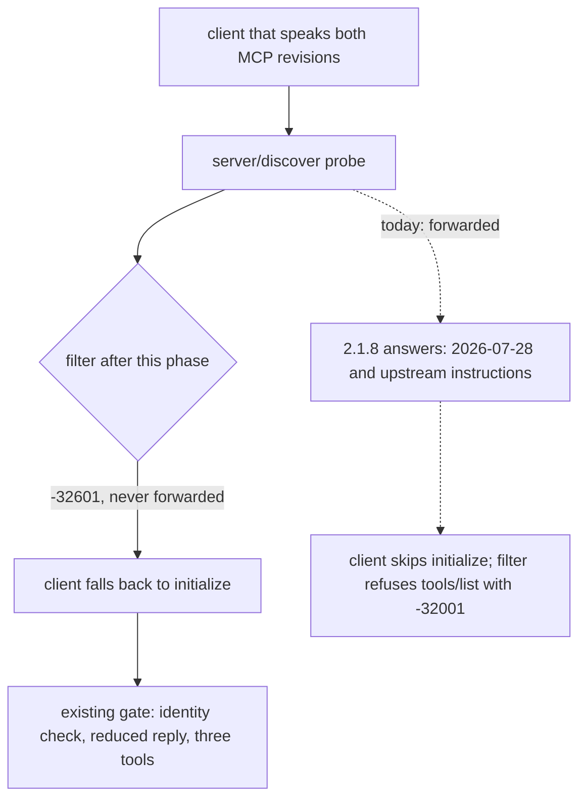

# Small Plan: Answer the MCP 2026-07-28 Discovery Probe So Clients Use `initialize`

## Scope

This phase fixes Finding 1 in `.claude/quality_reports/2026-11-12_context-mode-2x-live-check-findings.md`. The user asked for it on 2026-11-12 ("fix problem 1"). It covers REQ-007.

- **What failed.** In one live Claude Code 2.1.226 session, Context Mode had no tools: `Failed to fetch tools: Context Mode server is not initialized`. The live-check report blamed a client that sends `tools/list` before the `initialize` reply. A planner probe on 2026-11-12 found a different cause, and two independent plan reviews reproduced it against the real 2.1.8:
  - MCP revision 2026-07-28 removes the `initialize` handshake. On stdio, a client that speaks both the old and the new revision first sends a `server/discover` probe. It uses `initialize` only when the probe fails with an error that the new revision does not define.
  - The filter passes `server/discover` through to the server. When the request carries the new revision's `_meta` fields, the pinned 2.1.8 server answers with `supportedVersions: ["2026-07-28"]`, the server name `context-mode`, the version `dev`, and its full upstream `instructions`. Without `_meta` it answers `-32601`, which is why the live check concluded that 2.1.8 does not implement the probe.
  - The client then stays on the new revision and sends `tools/list` with no `initialize`. The filter refuses it with `-32001`, because it never saw an accepted `initialize`. This matches the failing session's debug log line for line: `protocolEra: "modern"`, `negotiatedProtocolVersion: "2026-07-28"`, server `context-mode` / `dev`, then the `-32001` error 3 ms later.
  - Side effect in that session: the upstream `instructions`, which Phase A removed because they tell the model to use blocked tools, reached the client through the probe's answer. That breaks REQ-003.
- **The fix.** The filter answers `server/discover` itself with `-32601 Method not found` and never forwards it, before and after an accepted `initialize`. That is what an older server answers, so the client falls back to `initialize`, and every existing check applies. A notification-shaped `server/discover` is dropped.
- **Finding 3 unit (Step 5, separable).** Two dispatcher comments and one filter comment overstate a rule, and the README repeats one of them. These fixes are outside "fix problem 1". Step 5 holds all of them, with its own checks, so the orchestrator can drop it as a unit if the user says so. No dispatcher behavior changes either way.
- **Unchanged.** `FILTER_CONTRACT` stays `ctx-index-files-only-v2`: the fix does not change what gets indexed, so no cache is moved aside. The identity gate still refuses `tools/list` and `tools/call` with `-32001` until an `initialize` reply is accepted, including a new-revision request that skips the probe. The root adapters and the root guidance do not change.
- **Not in scope.**
  - Holding a `tools/list` that arrives before the `initialize` reply (the earlier fix direction). No observed client does this, the 2025-11-25 revision says clients should not, and it would not have fixed this failure.
  - Supporting the 2026-07-28 revision in the filter. That is a larger design and needs its own plan.
  - Findings 2 and 4 of the quality report. The generated OpenWiki page that describes the gate is refreshed in Phase E through OpenWiki, never by hand here.
  - The follow-ups recorded in the big plan's "Reopened 2026-11-12" section.

Evidence:

- Probe script and output: `.claude/explorations/2026-11-12_context-mode-2x-live-checks/era_probe.py` and `era_probe-output.txt`, saved by the orchestrator with this plan, next to the live checks' `shim.sh`, `pipeline_probe.py`, and `discover_probe.py`.
- Failing session debug log: `~/.claude/debug/7ec0024f-e624-4cce-b940-8afaa9200645.txt`, lines 217-234.
- Client code: both Claude Code builds in use (2.1.226 and the VS Code extension's 2.1.322) treat every probe error other than `-32022` (`UnsupportedProtocolVersion`) as an older server and fall back to `initialize`. Plan review B read this from both binaries on 2026-11-12.
- Reproductions: two independent plan reviews on 2026-11-12 reproduced the failure and the `-32601` fix against the real 2.1.8. Step 1 records them.
- MCP 2026-07-28 changelog (<https://modelcontextprotocol.io/specification/2026-07-28/changelog>) and "Versioning and Compatibility" (<https://modelcontextprotocol.io/specification/2026-07-28/basic/lifecycle>): no `initialize`; on stdio, "probe with `server/discover` and fall back on any error that is not a recognized modern error".



Existing contracts this phase touches:

| Contract | Source | Keep | Change | Evidence |
| --- | --- | --- | --- | --- |
| Method pass-through | `handleClient`, final `upstream.stdin.write(raw)` | Every method other than `initialize`, `tools/list`, and `tools/call` passes through | `server/discover` is answered locally with `-32601` and never forwarded; a notification-shaped one is dropped | Probe output |
| No upstream `instructions` (REQ-003) | `handleUpstream`, reduced `initialize` | Only `protocolVersion`, `capabilities.tools`, and `serverInfo` reach the client | Now also true for clients that probe, because the probe's answer never reaches them | Probe output, case A |
| Identity gate | `serverAccepted`, `initializeIds` | `-32001` until an accepted `initialize`; a wrong server name gets `-32002` and upstream is stopped | None | Filter tests |
| Cache contract | `FILTER_CONTRACT` in the dispatcher | `ctx-index-files-only-v2` | None | Indexing rules unchanged |
| Validator filter checks | `validate_context_mode_tool_surface`, `CONTEXT_MODE_ROUTING_SURFACE_FILES` in `scripts/validate_targets.py` | The literal fragments it requires, no `isDirectory`, and no blocked tool name anywhere in the filter text, comments included | None | `scripts/validate_targets.py`; `tests/test_validate_targets.py` |

Decisive assumptions:

| Assumption | Evidence | Remaining limit |
| --- | --- | --- |
| A client that speaks both revisions falls back to `initialize` when the probe gets `-32601` | Client code of both Claude Code builds (every probe error other than `-32022` means an older server); the two plan reviews' reproductions; the spec rule quoted above | No live client run through the fixed filter yet. A 2.1.226 run with `MCP_PROTOCOL_NEGOTIATION=auto` on 2026-11-12 did not probe at all. Optional Verification item 1 records live runs of both builds. |
| 2.1.8 uses the new revision only for a request that carries the new `_meta` fields | Probe output: the probe with `_meta` gets a discover result, the probe without it gets `-32601`; Phase B's real-binary test uses `initialize` | None |
| The filter needs no other change for this failure | `handleClient` already refuses `tools/list` and `tools/call` with `-32001` before an accepted `initialize`, whatever their `params` | Other methods still pass through unfiltered, as before (big plan, Non-Goals and follow-ups) |

## Steps

- [x] **1. Start the phase and correct the record (AI state).**
  - Owner: orchestrator. No outer-repository file.
  - Set this plan's `status` to `in-progress` by hand before any other step; no hook does this on an existing branch (reopen rule, step 7). Confirm that the nested `.claude` repository was checkpointed after these plans were saved (reopen rule, step 8).
  - Check that `era_probe.py`, `era_probe-output.txt`, `shim.sh`, `pipeline_probe.py`, and `discover_probe.py` are saved under `.claude/explorations/2026-11-12_context-mode-2x-live-checks/`.
  - Append a dated "Correction" section to the exploration's `REPORT.md` and to the quality report: Finding 1's cause is the forwarded `server/discover` probe, not a pipelined `tools/list`; 2.1.8 answers the probe when it carries `_meta`; the probe's answer carried upstream `instructions`; two independent plan reviews reproduced the failure and the `-32601` fix against the real 2.1.8, and review B read the fallback rule from both client binaries. Do not rewrite the original text.

- [x] **2. Write the tests first.**
  - Owner: `coder`. File (modify): `tests/test_context_mode_mcp_filter.py`.
  - Required Skills: `.claude/skills/ponytail/SKILL.md` (`full` mode), `.claude/skills/testing-patterns/SKILL.md`.
  - Add one constant for the new revision's request `_meta`, with the keys `io.modelcontextprotocol/protocolVersion` (`"2026-07-28"`), `io.modelcontextprotocol/clientCapabilities`, and `io.modelcontextprotocol/clientInfo`. Fake and real tests send it.
  - Add `_LineReader.next()`: it returns the next JSON message from the pipe, with the same deadline as `response()`, and never skips a line. `response()` may be built on it.
  - Fake upstream (`FAKE_UPSTREAM`):
    - On `server/discover`, it answers like the real 2.1.8: a result with `supportedVersions: ["2026-07-28"]`, `capabilities`, an advice string in `instructions`, and `_meta` holding `io.modelcontextprotocol/serverInfo`.
    - It writes the trace before any `id` check: the tool name for `tools/call`, as today, and `server/discover` for a probe. The trace then shows whether a probe reached upstream, with or without an `id`.
    - For a message without an `id`, it skips only the reply, as a real server does not answer notifications. Today it echoes them, which would add an `id: null` line after `notifications/initialized`. The trace stays, so `test_notification_shaped_tools_call_never_reaches_upstream` can still fail.
  - New tests. Each reads every reply in order with `_LineReader.next()`, so a skipped, extra, or missing reply fails the test instead of hanging the suite. Do not mix `_LineReader` with `readline()` on the same process: `_LineReader` reads the pipe directly and cannot see lines Python has already buffered.
    1. **Probe refused before `initialize`.** `server/discover` (id 0, with the `_meta`). The next reply is id 0, with error code `-32601` and no `result`. The trace file is absent.
    2. **Notification probe dropped before `initialize`.** `server/discover` without an `id`, then `ping` (id 2). The next reply has id 2. The trace file is absent.
    3. **Fallback, then the probe again after `initialize`.** In order, each waiting for its reply: the probe (id 0) gets `-32601`; `initialize` (id 1) gets exactly the reduced keys; `notifications/initialized`; `tools/list` (id 2) returns exactly `TOOL_NAMES` with the kit descriptions; the probe again (id 3) gets `-32601`; a notification probe, then `ping` (id 4), whose reply is the next line. The trace file is absent.
  - Parametrize `test_tools_list_and_call_are_refused_until_an_initialize_is_accepted` over request `params` with and without the new `_meta`. Both requests get `-32001`, and the trace file is absent. This passes today; it pins that a new-revision request that skips the probe stays refused.
  - Expected values come from this plan and the probe output, not from the filter source: `-32601`, `-32001`, `TOOL_NAMES`, and the kit descriptions.
  - Negative control before Step 3: run the new tests on today's filter, and record in the session log which fail and why. Expected: tests 1 and 3 fail because the probe's answer passes through; test 2 fails because the probe reaches the fake and the trace file appears; the parametrized case passes.

- [x] **3. Filter: answer the probe.**
  - Owner: `coder`. File (modify): `shared/hooks/scripts/context-mode-mcp-filter.mjs`. Required Skills: `.claude/skills/ponytail/SKILL.md` (`full` mode).
  - In `handleClient`, after the non-object drop, add one branch for `server/discover`, the same before and after an accepted `initialize`:
    - without an `id`: drop it, with a short stderr note like the existing `tools/list` notification note;
    - with an `id`: answer `-32601` with the message `Method not found`, and return;
    - never write it to upstream.
  - One comment says why: this is the 2026-07-28 probe; the 2.1.8 answer carries upstream `instructions`, and a client that accepts it skips `initialize`, so the filter would refuse its `tools/list` and `tools/call` with `-32001`; `-32601` is what an older server answers, so the client falls back to `initialize`.
  - Must not:
    - change how any other method is handled; they still pass through, as the big plan's Non-Goals say;
    - change `FILTER_CONTRACT`, the identity gate, the reduced `initialize` reply, the allowlist, the `ctx_index` checks, or the pending-list bound;
    - name a blocked tool anywhere in the filter text, comments included. `validate_targets.py` and `tests/test_validate_targets.py` scan the whole file.
  - No validator change: `validate_context_mode_tool_surface` requires the allowlist `Set`, the `INDEX_ARGS` `Set`, the schema-property filter, and `if (!stat.isFile())`, and forbids `isDirectory`; none of them changes. `EXECUTION_DEFAULTS_POLICY_FRAGMENTS` holds no filter text.

- [x] **4. Real-binary test.**
  - Owner: `coder`. File (modify): `tests/test_context_mode_mcp_filter.py`, `test_real_upstream_server_surface_is_filtered`.
  - Required Skills: `.claude/skills/ponytail/SKILL.md` (`full` mode), `.claude/skills/testing-patterns/SKILL.md`, `.claude/skills/integration-gate-spike/SKILL.md`.
  - Before `initialize`, send the probe (id 0, with the shared `_meta`). Assert error code `-32601` and no `result`. All other steps and assertions stay.
  - Negative control: on today's filter, with the private prefix first on `PATH`, the real 2.1.8 answers the probe with a discover result that holds `instructions`, so the test fails. Record it in the session log.
  - Keep the test name. The pin-bump procedure and the Verification block select it with `-k real_upstream`.

- [x] **5. Finding 3 unit: comment and README fixes (separable).**
  - This step is outside "fix problem 1". The orchestrator drops it as a unit when the user says so: this step, its two Verification lines (marked "Finding 3 unit"), its review focus bullet, and the Finding 3 items in Phase E.
  - Owner: `coder` for the comments; `documenter` for the README sentence. Files (modify): `shared/hooks/scripts/context-mode-mcp-filter.mjs` (one comment), `shared/hooks/scripts/context-mode-dispatch.sh` (two comments), `README.md` (one sentence). Required Skills: `.claude/skills/ponytail/SKILL.md` (`full` mode), `.claude/skills/documentation/SKILL.md`.
  - Filter, line 13: "naming no other tool" is false, because the `ctx_search` description names `ctx_index`. Say instead that each description names no tool outside the allowlist.
  - Dispatcher, lines 17-20 (above `PROVENANCE_SECRET_FILE`) and lines 150-156 (above `read_or_create_provenance_secret`). The first says that `state-sync.sh` never adds, commits, or restores anything at the root outside `.claude/`, and that a hostile ai-state remote can never read or overwrite the secret. The second says the remote can never read or write the file, so it cannot learn or plant a matching secret. All of this overstates it: the root restore writes adapter files at the root, and `state-sync.sh` and `restore-root-adapters.sh` are themselves synced through ai-state. State only what the scripts do: `state-sync.sh` adds and commits only under `.claude/`, so this file never enters ai-state history, and the root restore it runs copies only allowlisted adapter files, never this one. Add the limit: this gives no protection against a remote that replaces the synced scripts themselves. No code line changes; the validator requires `PINNED_CONTEXT_MODE_VERSION="2.1.8"` and `"$MODE" == "server"`.
  - `README.md` near line 1432: replace "where `state-sync.sh` never adds, commits, or restores anything" with the same statement, including its limit.
  - The Verification lines check only that the known stale phrases are gone. The reviewer judges whether the new sentences are accurate.

- [x] **6. Documentation for the fix.**
  - Owner: `documenter` for `README.md` and `docs/runtime-checks.md`; orchestrator for the AI-state file. Required Skills: `.claude/skills/documentation/SKILL.md`.
  - `README.md`, Context Mode block (near line 1426): after the sentence on what the client sees from `initialize`, add one sentence that names `` `server/discover` ``. For example: "The filter answers `server/discover`, the probe of the 2026-07-28 MCP revision, itself with `-32601` and never forwards it, so a client that speaks both revisions falls back to `initialize` and never receives the upstream `instructions` that the probe's answer would carry."
  - `docs/runtime-checks.md` near line 101: the same sentence. Under "Known limits", add: "The filter speaks only the `initialize`-based MCP revisions (2025-11-25 and earlier). A client that speaks both revisions falls back to them; a client that only speaks 2026-07-28 gets no Context Mode tools."
  - No change, checked by the planner: `CLAUDE.md`, `AGENTS.md`, `docs/smoke-tests.md`, and `shared/policies/tool-routing.instructions.md`. None describes the handshake. `openwiki/operations/context-mode-dispatcher.md` does, but it is generated; Phase E refreshes it.
  - Orchestrator: `.claude/instructions/project-context.instructions.md`, Context Mode bullet (near line 129). After the `serverInfo.name` gate, add: the filter answers the 2026-07-28 `server/discover` probe itself with `-32601`, so clients use `initialize`; the 2.1.8 answer to the probe carries upstream `instructions`, and a client that accepts it skips `initialize`, so the filter would refuse its `tools/list` and `tools/call`.
  - LEARN candidate: `[LEARN:mcp] MCP 2026-07-28 clients probe stdio servers with server/discover and skip initialize when the probe succeeds; a filter that gates on initialize must answer the probe itself (-32601) so they fall back. Context Mode 2.1.8 answers the probe only when it carries the 2026-07-28 _meta, so a probe without _meta proves nothing.`

- [x] **7. Regenerate and refresh the self-install.**
  - Owner: orchestrator. Run `uv run python scripts/generate_targets.py --all`, then `uv run python scripts/install_bootstrap.py . --allow-self --local-only`, after all edits. Never hand-copy.
  - Reconnect the Context Mode MCP server in the running client (for example `/mcp` in Claude Code). The live checks below use fresh sessions.

- [x] **8. Review.**
  - Owner: `reviewer`. Review Profiles: `code`, `architecture`, `security`, `tests`, `ponytail`, `documentation`.
  - Focus:
    - a `server/discover` request never reaches upstream, before or after an accepted `initialize`, and its notification form is dropped;
    - the answer is `-32601` with no `result`, so a client that speaks both revisions falls back;
    - every other method is handled exactly as before;
    - no path is left for upstream `instructions` to reach the client through the probe;
    - the new tests can fail (negative control recorded) and read replies in order;
    - the docs state only what the code does;
    - Finding 3 unit: the new dispatcher and README sentences are accurate and claim no protection against a remote that can replace synced scripts.

## Risks and Fallbacks

- A client that only speaks 2026-07-28 gets no Context Mode tools. The spec expects that pairing to fail with an error the client shows to the user. No such client is in use here. Supporting it means gating and reducing new-revision results (they carry `_meta` server identity, `resultType`, `ttlMs`, and `cacheScope`), which needs its own plan.
- Claude Code 2.1.322 (the VS Code extension's build; 2.1.226 has no such store) remembers older stdio servers in `~/.claude/state/mcp-discover-verdicts.json`. An entry means the server's `server/discover` probe was answered method-not-found or not at all, so the client skips the probe and goes straight to `initialize`. Entries last 7 days for stdio and are deleted when a modern connection succeeds. The key is `stdio:` plus 32 hex characters of SHA-256 over the command, arguments, sorted environment, and project root, so each checkout has its own entry. After this fix, a new entry for Context Mode is the expected outcome, and it is harmless: the filter serves `initialize`. Source: plan review B, read from the binaries.
- Other methods still pass through unfiltered, as before. A client that skips the probe and sends a new-revision `prompts/list` or `resources/list` reaches upstream. This phase does not change that; the big plan records it as a follow-up.
- Rejected alternatives:
  - hold an early `tools/list` until the `initialize` reply: no observed client sends one, and it does not fix this failure;
  - forward the probe and strip `instructions` from its answer: the client would then skip `initialize`, so the filter would refuse its `tools/list` and `tools/call` with `-32001` and the session would still have no tools;
  - answer the probe with `UnsupportedProtocolVersionError` (`-32022`): the spec and both client builds treat it as a recognized modern error, so the client stays on the new revision instead of falling back;
  - support the 2026-07-28 revision in the filter: larger, needs its own plan.

## Verification

```bash
uv run python scripts/generate_targets.py --all
uv run pytest tests/test_context_mode_mcp_filter.py tests/test_context_mode_dispatch.py tests/test_validate_targets.py -q --tb=short
# Uses the private prefix from Phase B ($HOME/.cache/context-mode-pin, Context Mode 2.1.8).
PATH="$HOME/.cache/context-mode-pin/bin:$PATH" CONTEXT_MODE_REAL=1 uv run pytest tests/test_context_mode_mcp_filter.py -q --tb=short -k real_upstream
grep -q -F 'server/discover' shared/hooks/scripts/context-mode-mcp-filter.mjs
grep -q -F 'server/discover' tests/test_context_mode_mcp_filter.py
grep -q -F 'FILTER_CONTRACT="ctx-index-files-only-v2"' shared/hooks/scripts/context-mode-dispatch.sh
grep -q -F '`server/discover`' README.md
grep -q -F '`server/discover`' docs/runtime-checks.md
git diff --quiet HEAD -- CLAUDE.md AGENTS.md .mcp.json .vscode/mcp.json .codex/config.toml openwiki
# Finding 3 unit (Step 5): drop the next two lines together with that step.
test "$(grep -c -F 'naming no other tool' shared/hooks/scripts/context-mode-mcp-filter.mjs)" = "0"
test "$(cat shared/hooks/scripts/context-mode-dispatch.sh README.md | grep -c -F -e 'or restores anything' -e 'can never read or overwrite' -e 'can never read or write' -e 'cannot learn or plant')" = "0"
# End of the Finding 3 unit.
uv run python scripts/validate_targets.py
uv run python scripts/check_runtime.py
uv run python scripts/validate_plan_frontmatter.py
uv run python .claude/scripts/verify.py phase --format text
```

## Optional Verification

- Live client check of the probe, both Claude Code builds, each in a fresh session in this repository after Step 7: `claude` 2.1.226, and the VS Code extension's 2.1.322 binary `~/.vscode-server/extensions/anthropic.claude-code-2.1.322-linux-x64/resources/native-binary/claude`, each run with `MCP_PROTOCOL_NEGOTIATION=auto` and `--debug`. Read the Context Mode `Connection established` debug line. Expected: `"protocolEra":"legacy"`, `"negotiatedProtocolVersion":"2025-11-25"`, and no `Failed to fetch tools` line; for 2.1.322, also a new Context Mode entry in `~/.claude/state/mcp-discover-verdicts.json` (copy the file before and after). If a build's debug line has no `protocolEra` field, that build did not probe and proves nothing: record that line as the evidence for that build. A 2.1.226 run with these settings did not probe on 2026-11-12 (no `protocolEra` field; the capture shim showed `initialize` first). Record PASS when at least one build probed and every build that probed shows the expected values; record NOT RUN, with the debug lines, when no build probed; record FAIL otherwise.
- A fresh session on the default client path, after Step 7: exactly three Context Mode tools, and `ctx_index` with `content` followed by `ctx_search` works. This is a regression check only. The default path does not probe, so it cannot tell a fixed filter from an unfixed one.

## Closeout Checklist

Follow the fixed closeout order in `.claude/instructions/workflow.instructions.md`
(Canonical Orchestrator Loop, step 5: CLOSEOUT); the order below mirrors it
rather than restating it.

- [x] Documentation updated or explicitly skipped as pure-internal
- [x] LEARN entries saved or no-lessons marker recorded
- [x] Closeout session log has `**Status:** COMPLETED`
- [x] Nested plan state checkpointed (`.claude` ai-state) before staging outer-repository files
- [x] Intended outer files explicitly staged and `git diff --cached` reviewed
- [x] Every surviving MINOR has an explicit disposition and non-empty reason
- [x] Review findings resolved and persisted with branch/phase metadata
- [x] Verification passed (`verify phase` PASS; `verify closeout` runs the plan's required verification items itself and PASS)

## Pause Checkpoint

Use only after the user explicitly asks to stop or checkpoint and resume later.
Set `status: paused`, record the three pause fields, and create a session log
with `**Status:** PAUSED`. A checkpoint commit preserves incomplete work; it
does not require final findings, LEARN, DOCUMENT, or a completed closeout.
After the checkpoint commit, it may be pushed as a durable remote backup when
paused-publication invariants pass. It remains unfinished and blocks PR creation
and final closeout.
Keep the big plan `in-progress` with the same `current_phase`. On resume, read
the pause log and Git state, restore this plan to `in-progress`, and continue
this same phase without creating another small plan.
