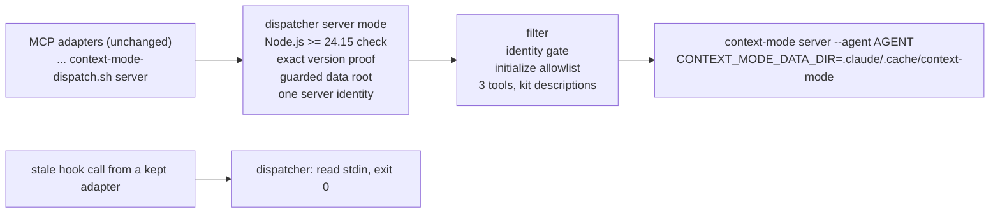

# Big Plan: context-mode-2x-migration

## Recommendation: wait, then go

Approve this plan now. Start it in this order:

1. Wait until the release stream settles (decision 1). The earliest date is 2026-11-26 (see "Approval record").
2. Run the pre-branch spike below. It is evidence only.
3. The planner writes the spike's exact pin, Node.js image, and server identity into Phases A and B.
4. The start gate passes, and the branch is created.

- **Not a pin bump.** Context Mode 2.x is a full rewrite. It changes the Node.js requirement, the server command, the server identity, the storage variable, and the hook output. This plan is a control-plane migration in three phases.
- **Why not start now.** Upstream shipped 11 stable releases in 4 days (2.0.0 on 2026-11-04 to 2.1.7 on 2026-11-08). On 2026-11-12, npm still shows `latest: 2.1.7`. A fast release stream can change a contract during the work, and that forces a second spike. Waiting costs little: the dispatcher refuses every version except `1.0.169`, and the evidence found no 1.0.169 flaw that the kit is exposed to (medium confidence, REPORT.md §1).
- **Why not "no-go".** 1.0.169 is the last 1.x release and gets no fixes. Its server calls the npm registry at startup and every hour, and no setting turns that off. Its install script can rewrite user-level Claude Code plugin files. The package has no npm provenance (a signed record of how the package was built). 2.x has no install script, signed provenance, no startup or hourly network calls, a working `--version`, and no Agent prompt rewrite (REPORT.md "Go or no-go").

## Approval record

- 2026-11-12: the user approved this plan and chose the recommended option for all seven decisions below: wait for the settle check and run the spike before the branch (1), drop Antigravity's Context Mode entry (2), drop `ctx_doctor` (3), MCP-only (4), Node.js 24 with the required slim-image check and an optional full CUDA build (5), `CONTEXT_MODE_DATA_DIR` under `.claude/.cache/context-mode/` (6), and one server identity chosen by spike S2 (7).
- 2026-11-12 start-gate run: the docs branch is merged into `dev` (PR #54), Node.js is v24.15.0, and Docker is 28.3.1, but the settle check failed. The newest stable release is 2.1.8 (2026-11-11T22:11Z, npm `latest`), so nothing runs before 2026-11-26.

## Decisions for the user

Each decision lists the options, what each means in practice, and the recommendation. The phases are written for the recommended options. If you choose another option, the planner revises the named phases before the branch is created.

### 1. When to start, and where the spike runs

- **Recommended: wait until the release stream settles, then run the spike before the branch.**
  - "Settled" means: the newest stable 2.x release on npm is at least 14 days old, and npm's `latest` tag points at it. The start gate checks both with one command.
  - Each new stable release restarts the window. 2.1.8 was published on 2026-11-11, so the earliest start is 2026-11-26. The 14-day window is a judgment: it is more than three times the length of the 4-day burst.
  - The spike then runs as an exploration under `.claude/explorations/`, like the 2026-11-11 spike. The planner writes its results into Phases A and B before you see the final phases, so nothing on the branch waits for a later answer.
  - If the settle check still fails on 2026-12-20, the orchestrator asks you whether to pin the newest release anyway (the spike still runs on it) or keep waiting.
- **Start now (after the docs branch merges).** The spike runs on 2.1.7 now. This works, because everything is pinned. But a fix release during the work means a second spike, and possibly a second pin bump and another cache reset.
- **Run the spike as a phase on the branch.** Rejected:
  - the start gate cannot use results that only exist after the branch;
  - later phases carry placeholders until it ends;
  - a docs-only phase adds a full review and closeout cycle.
- **No-go.** Stay on 1.0.169 with no end date. No work now. The 1.x costs above stay, and the gap to upstream grows.

### 2. Antigravity, which has no 2.x agent id

Today Antigravity's `.agents/mcp_config.json` gets the Context Mode server entry. But its PreToolUse bridge denies every MCP call, so Antigravity cannot use it (`docs/target-mapping.md` line 95; `README.md` near line 1426). Antigravity has no Context Mode hooks.

- **Recommended: drop the Context Mode server from Antigravity's generated config.** No working feature is lost. The validator then requires that the entry stays absent, and `docs/target-mapping.md` records the gap. Phase A. A consumer that commits `.agents/` keeps the old entry on refresh (the installer keeps tracked adapters). It stays unused, because the bridge denies MCP calls.
- **Keep a structural entry.** It looks configured but cannot work under 2.x.
- **Keep the entry with a borrowed agent id.** Upstream does not support it, and Antigravity cannot call MCP tools anyway.
- **Keep Antigravity on 1.0.169.** Rejected: two pins and two filters for a client that cannot call MCP tools today.

### 3. `ctx_doctor`

Under 2.x, `ctx_doctor` does the following (REPORT.md §7, §9):

- it makes network calls (npm, then `git ls-remote` to GitHub);
- its check D3 always fails for the kit's wiring;
- it tells the model to run `context-mode setup --agents claude-code`;
- it writes a report file and prints a `gh issue create` command.

- **Recommended: drop it.** Context Mode then exposes three tools: `ctx_index`, `ctx_search`, `ctx_stats`. The kit's `context-mode-dispatch.sh --self-check` and `scripts/check_runtime.py` already check health offline. Dropping it removes a tool whose output tells the model two risky things: to install upstream's unfiltered hooks into your client configuration, which would bypass this filter, and to publish a public issue. Phase A. Cost: a wording change on every surface that says "four tools".
- **Keep it.** No wording change. The network calls, the misleading `setup` advice, the report files, and the `gh issue create` suggestion stay, and the docs must describe them.

### 4. The hook lane

Corrected evidence:

- **Nothing reaches any client, as wired.** Under 2.x, the kit's hooks forward nothing to any client as they are wired today.
- **PreToolUse** forwards nothing on every client and has no side effects (2.x writes nothing to its database in PreToolUse; REPORT.md §6).
- **PreCompact** is a no-op on Claude Code and Codex: the 2.x decoders reject the event and log an error (REPORT.md §4).
- **Restore text never reaches a client:**
  - Claude's text uses the upstream plugin prefix, so the filter drops it.
  - Copilot's text arrives only through UserPromptSubmit, which the kit does not wire.
  - Codex's text arrives on SessionStart with `source: compact`. But the kit's Codex SessionStart matcher is `startup|resume|clear` (`scripts/generate_targets.py:1218`), so it is never delivered. The Codex `compact` fixture was a synthetic input.
- **What remains is side effects.** The local session journal, and, on Claude, large tool outputs indexed into the local store. Nothing in the kit is known to use either. `ctx_search` with `scope: session` is 2.x-only, so nothing you use today depends on it.
- The restore text (`<context_mode_state>`) contains your last prompt and the paths of edited files.

- **Recommended: MCP-only.** Remove every Context Mode hook handler on Claude Code, Codex, and Copilot. Delete the dispatcher's hook mode, the filter's `--hook-output` mode, the 32 fixtures, `capture.py`, and their tests. Phase A.
  - You lose nothing that reaches the model under 2.x.
  - Each hook event no longer starts Node.js.
  - The migration no longer needs fixture recording or payload-shape work.
  - A stale hook call from a committed `.codex/` reads its input and exits 0 silently.
  - Statements that session continuity comes from the hooks are removed from `CLAUDE.md`, `AGENTS.md`, the agent prompts, and the routing policy.
- **Keep the wiring as it is.** Smallest diff. Every hook event starts Node.js for nothing, and each Claude and Codex compaction logs an error.
- **Narrow.** Remove PreToolUse on all clients and PreCompact on Claude Code and Codex. Keep SessionStart (all clients), PostToolUse (`Bash` on Claude Code and Codex, every tool on Copilot), and Copilot's PreCompact. Output to the model stays nothing; you keep the side effects only.
- **Narrow, plus Codex compaction.** Add a Codex SessionStart group with matcher `compact` that runs only the dispatcher. This works only if spike S5 shows that Codex sends `source: compact`. After a Codex compaction, the model then gets your last prompt text, earlier prompts, and edited file paths back.
- **Full continuity on all clients.** Narrow, plus UserPromptSubmit hooks, PostToolUse on every tool, and a filter rewrite of Claude's plugin prefix. Costs:
  - one more Node.js start per prompt and per tool call;
  - every prompt is stored locally and fed back;
  - the work depends on payload key names that nobody has seen live yet.

  This belongs in a separate, later plan.

The "Re-plan notes" section lists what each non-recommended option changes in the phases.

### 5. Node.js 24 in the devcontainer, and how to check it

2.x needs Node.js 24.15.0 or newer. The devcontainer copies Node.js from `node:22.22.0-bookworm-slim`. On Node.js 22, 2.x installs with only a warning, but the server starts degraded (REPORT.md §3).

- **Recommended: move to the newest `node:24.x.y-bookworm-slim` with x of 15 or more, and check it with a required slim-image test.**
  - The required check runs the chosen Node.js image. It confirms Node.js 24.15 or newer, then installs and runs the pinned 2.x. It needs Docker and network, but not the 9.2 GB CUDA base image.
  - The full CUDA devcontainer build is an Optional Verification item, because it needs the local CUDA image and network to ghcr.io, PyPI, and npm.
  - Evidence so far: this host already runs OpenWiki 0.7.2 and Context Mode 1.0.169 on Node.js v24.15.0 (both run as MCP servers in the 2026-11-12 planning session). jsdom 29.1.1 and mermaid 11.16.0 allow Node.js 24 by their declared engines.
  - Spike S6 builds the full image once, before the branch.
  - The dispatcher's server mode also refuses Node.js older than 24.15.0 with a clear message, instead of starting a silent, degraded server.
- **Require the full CUDA build at every closeout.** Strongest proof, but slow, and bound to this machine's cache and network.
- **Stay on Node.js 22.** Only possible with "no-go".

### 6. Storage

2.x ignores `CONTEXT_MODE_DIR`. It keeps its data under `CONTEXT_MODE_DATA_DIR` (default `~/.context-mode`), and it does not import 1.x data.

- **Recommended: point `CONTEXT_MODE_DATA_DIR` at the existing guarded root `.claude/.cache/context-mode/`.** Phase B.
  - The dispatcher always overwrites any inherited value, and `CONTEXT_MODE_DIR` stays the kit's only override variable, with today's rule.
  - On the first 2.x start, the provenance check moves the 1.x cache aside as `.claude/.cache/context-mode.untrusted.<time>.<pid>`. That folder is kept: never deleted and never migrated. Every later pin bump does the same, so those folders add up until you delete them by hand.
  - Two servers that start at the same moment no longer fail on that move (Phase B fixes the race).
  - A rollback note explains how to go back.
- **New sibling folder for 2.x.** Leaves the 1.x folder in place, at the cost of a second root and more dispatcher code.
- **Major-version provenance.** Caches survive patch bumps, but a 2.x patch can change the database schema.
- **Delete the 1.x cache automatically.** Rejected: the dispatcher never deletes user data.

### 7. Server identity and committed MCP adapters

2.x needs to know which client it serves, through `--agent <id>` or `CLAUDE_PROJECT_DIR`. The installer keeps an adapter (`.mcp.json`, `.codex/`, `.agents/`, `.vscode/mcp.json`) that a consumer has committed, so a change to the server command never reaches those consumers.

- **Recommended: one server identity for every client, chosen by spike S2.** For example `--agent codex` from the repository root. The MCP adapters keep today's `... server` command, so committed adapters keep working. Phase B.
  - Cost: the text inside tool results can name another client's tool prefix. The filter does not rewrite results, so this is cosmetic.
  - If S2 finds that no single identity serves all three clients, the planner switches to per-client ids and asks you again.
- **Per-client ids (`server claude-code`, `server openai-codex`, `server github-copilot`).** Each client gets its own agent id. A consumer that commits its MCP adapters keeps the id-less command. Its Context Mode server then exits 64 until someone regenerates the adapters by hand. The README would carry a refresh note.
- **Per-client ids with an id-less fallback.** The dispatcher picks a default identity when no id is given. This is only safe when S2 shows that one identity works, and in that case the recommended option is simpler.

## Pre-Branch Spike

Evidence only. It runs after the settle check passes and before the start gate. There is no branch and no outer-repository change.

- **Owner:** orchestrator, delegating to an evidence-only `coder` with a scratch download folder. Required Skills: `.claude/skills/integration-gate-spike/SKILL.md`, and `.claude/skills/ponytail/SKILL.md` (`full` mode, for harness edits).
- **Output:** the orchestrator saves the report and any harness changes under `.claude/explorations/<run-date>_context-mode-2x-recheck/` (AI state).

Harness rules, as in the 2026-11-11 spike:

- Copy `.claude/explorations/2026-11-11_context-mode-2x-evidence/scripts/` into the scratch folder.
- Copy the dispatcher and the filter to a path whose text does not contain `.claude/hooks/scripts`, because the repository guard blocks commands that name it.
- Install the candidate (the newest stable 2.x) with `--prefix`, a scratch npm cache, and `--ignore-scripts`. Never install globally. Never run `setup`, `upgrade`, `doctor --fix`, or `ctx_upgrade`.
- Run probes through `cmrun.sh` (`env -i`, all home, config, and temp variables in the scratch run folder; bubblewrap without network wherever a probe needs none).
- Use `git init` only, because the commit gate blocks `git commit` even in scratch repositories.

Probes:

1. **S1 Release record.**
   - Record `npm view context-mode time dist-tags --json`, the candidate, and `npm audit signatures`.
   - From the release notes since 2.1.7, list every change to: the server command, agent ids, `CONTEXT_MODE_DATA_DIR`, tool names and schemas, network calls, and writes outside the data root.
2. **S2 Server contract and one server identity.**
   - Settings: working folder = a scratch Git repository; `CONTEXT_MODE_DATA_DIR=<repo>/.claude/.cache/context-mode`; `HOME` = a scratch folder.
   - Start the server for each case:
     - `--agent claude-code`, with and without `CLAUDE_PROJECT_DIR`;
     - `--agent codex`;
     - `--agent vscode`, with and without `--workspace-folder <repo>`;
     - no `--agent`, with `CLAUDE_PROJECT_DIR=<repo>`.
   - Record:
     - the `initialize` result keys, `serverInfo.name` and `serverInfo.version`;
     - the `instructions` text and the capabilities;
     - every tool name;
     - for `ctx_index`, `ctx_search`, and `ctx_stats`: description, `inputSchema`, property descriptions, `_meta`, and annotations.
   - Also record `serverInfo.name` from the host's 1.0.169.
   - Single-identity check, for the two candidate identities (`--agent codex` from the repository root; no `--agent` with `CLAUDE_PROJECT_DIR`):
     - Run three sessions whose `initialize` `clientInfo` names a Claude Code, a Codex, and a VS Code client. In each, run `ctx_index` with `content`, then a `ctx_search` that finds it.
     - Record any difference by client in results, project folder, files written, or server-to-client requests (for example `roots/list`).
     - Pass: all three sessions index and search in one project folder keyed to the outer repository; nothing is written outside the data root; and no client must answer a request differently.
     - Prefer `--agent codex` from the repository root when both pass, because it sets no other client's variable.
   - Repeat once with the working folder inside a nested Git repository at `<repo>/.claude`. Record the project folder. If it differs, the dispatcher changes to the repository root before launching.
3. **S3 `ctx_index` folders.**
   - Index a scratch folder with 300 small files, a depth of 7, one file listed in `.gitignore`, and one symlink to a file outside the repository.
   - Record: whether a folder is accepted, the file count and depth indexed, whether the ignored file is skipped, and whether the symlink is followed.
4. **S4 Writes and network.**
   - List every file created under the data root, `HOME`, the repository tree, and `TMPDIR`.
   - Record outbound network attempts (strace) for startup and for the three tools.
5. **S5 Codex compaction.**
   - From Codex's published hook documentation and source, record whether Codex sends SessionStart with `source: compact`.
   - Record whether any kit matcher would deliver it. Today it is `startup|resume|clear` (`scripts/generate_targets.py:1218`).
   - This only informs decision 4's "narrow plus Codex compaction" option.
6. **S6 Node.js 24 image.**
   - Read the newest v24 release with a minor of 15 or more from `https://nodejs.org/dist/index.json`. Confirm that `node:<version>-bookworm-slim` exists with `docker manifest inspect`.
   - Run Phase B's two required slim-image commands on it.
   - Build a scratch copy of `shared/devcontainer/Dockerfile` with three changes: that image, `context-mode@<candidate>`, and `test "$(context-mode --version)" = "<candidate>"` in place of `context-mode --help >/dev/null`.
   - In the built image, run `openwiki integrations list </dev/null`, a `require` of the global `jsdom`, and a read of the global `mermaid` version. Record the build time.
7. **S7 Antigravity.** Record the agent ids the candidate accepts, and whether one targets Antigravity.
8. **S8 Drift.** For each finding in the Context section and each line of REPORT.md "Go or no-go", record `unchanged` or `changed`.

The report holds these exact lines:

- `Pinned candidate: <version>`
- `Node image: node:<version>-bookworm-slim`
- `Server identity: <argv and environment>`
- `Server name: <1.0.169 name> / <candidate name>`

It has one section per probe, and a `## Plan impact` section with one line each for Phase A and Phase B.

Stop conditions:

- The settle check fails: stop, and run nothing.
- The candidate's server is degraded, or `ctx_index`, `ctx_search`, or `ctx_stats` is missing or renamed: stop and re-plan.
- Any write lands outside the data root (other than the scratch npm cache): stop and re-plan. The storage contract no longer holds.
- The Node.js image checks fail: stop.
- These do not stop the spike; they go back to you or to the planner:
  - no single identity passes S2 → decision 7;
  - S7 finds an Antigravity id → decision 2;
  - S3 finds no bound, or symlinks followed → the files-only fallback in Phase B.

Planner revision before the branch (one planner run):

- Replace the tokens `PIN_FROM_SPIKE`, `NODE_IMAGE_FROM_SPIKE`, and `AGENT_FROM_SPIKE` in Phases A and B. Verification commands already read these values from source.
- Phase A: the identity gate's accepted names, and the `ctx_index` kit description (S3).
- Phase B: the server extras that S2 found necessary (change of working folder, `CLAUDE_PROJECT_DIR`, `--workspace-folder`), and the `ctx_index` files-only fallback when S3 requires it.
- Per-client ids, if decision 7 changes (see Re-plan notes).

## Start Gate

Every command must pass before the branch is created. The orchestrator records the output in the Phase A session log.

```bash
# Needs network (npm registry): the newest stable 2.x is at least 14 days old and is npm's latest.
npm view context-mode time dist-tags --json | node -e 'const j=JSON.parse(require("fs").readFileSync(0,"utf8"));const v=Object.keys(j.time).filter(k=>/^2\.\d+\.\d+$/.test(k)).sort((a,b)=>new Date(j.time[a])-new Date(j.time[b])).pop();process.exit((Date.now()-new Date(j.time[v]))/864e5>=14&&j["dist-tags"].latest===v?0:1)'
node -e 'const[a,b]=process.versions.node.split(".").map(Number);process.exit(a>24||(a===24&&b>=15)?0:1)'
test "$(git rev-parse --abbrev-ref HEAD)" = "dev"
test -z "$(git status --porcelain)"
git show dev:README.md | grep -q -F 'The fourth generated target, Google Antigravity'
git show dev:openwiki/architecture/hooks-and-guardrails.md | grep -q -F 'mcp__.*)$'
docker version --format '{{.Server.Version}}'
test -n "$(ls .claude/explorations/*_context-mode-2x-recheck/REPORT.md 2>/dev/null)"
test "$(cat .claude/plans/2026-11-12_phase-A-context-mode-mcp-only-surface.md .claude/plans/2026-11-12_phase-B-context-mode-2x-switch.md | grep -c -F '_FROM_SPIKE')" = "0"
```

The two `git show dev:` lines prove that the docs branch `readme-and-wiki-drift-fixes_implementation` (both of its phases) is merged into `dev`. The orchestrator also records your choices for the seven decisions in this plan.

## Context

The repository pins Context Mode `1.0.169` in these places:

- the dispatcher (`shared/hooks/scripts/context-mode-dispatch.sh`);
- the MCP (Model Context Protocol) filter (`shared/hooks/scripts/context-mode-mcp-filter.mjs`);
- the devcontainer (`shared/devcontainer/Dockerfile`);
- the validator (`scripts/validate_targets.py`);
- 32 recorded hook fixtures;
- tests and docs.

The 2026-11-11 spike (`.claude/explorations/2026-11-11_context-mode-2x-evidence/REPORT.md`) found the following:

- Node.js 24.15+ is required.
- `serverInfo.version` is always `"dev"`, so the filter's version gate fails.
- The server needs `--agent <id>` or `CLAUDE_PROJECT_DIR`, and Antigravity has no id.
- The server command is `context-mode server`.
- The new `instructions` text passes the filter and tells the model to use blocked tools.
- `CONTEXT_MODE_DIR` is ignored, `CONTEXT_MODE_DATA_DIR` sets the data root, and 1.x data is not migrated.
- PreCompact is a no-op on Claude Code and Codex, and PreToolUse forwards nothing.
- New hook output shapes appear. Claude hook text uses the plugin prefix.
- `ctx_doctor` goes online, always fails D3, and writes report files.

The planner's 2026-11-12 check added one more finding: the kit's Codex SessionStart matcher excludes `compact`. So, as wired, no 2.x hook output reaches any client.

Terms:

- **Data root**: the folder 2.x keeps its data in.
- **Provenance marker**: the `.bootstrap-provenance` file the dispatcher writes into the cache. It holds the repository path, the pinned version, the filter contract, and a local secret. A cache without a matching marker is moved aside, never trusted.
- **Server identity**: the `--agent` value and environment the dispatcher starts the 2.x server with.

## Goals

- Run Context Mode 2.x as a filtered MCP server for Claude Code, Codex, and GitHub Copilot, with an exact version pin, project-local storage, and fail-open behavior when it is missing.
- Remove what the evidence shows is dead or harmful under 2.x: the hook lane, `ctx_doctor`, the upstream `instructions` text, and the Antigravity entry.
- Leave a pin-bump procedure that works for later 2.x releases.

## Non-Goals and Constraints

- Lane: control-plane/high-risk. This means a full plan and the review profiles `code`, `architecture`, `security`, `tests`, and `ponytail`, plus `config` and `documentation`. Every coding step loads `.claude/skills/ponytail/SKILL.md` in `full` mode.
- `dist/` and the self-install are only regenerated, never hand-copied: `uv run python scripts/generate_targets.py --all`, then `uv run python scripts/install_bootstrap.py . --allow-self --local-only`.
- Deliberately left out:
  - any Context Mode hook, including UserPromptSubmit, Codex `compact`, and a Claude plugin-prefix rewrite (decision 4);
  - forwarding output replacement (`updatedToolOutput`);
  - every other 2.x tool: `ctx_execute`, `ctx_batch`, `ctx_resume`, `ctx_upgrade`, `ctx_purge`, and now `ctx_doctor` (all filtered and rejected);
  - `ctx_index` with `url`;
  - the Copilot CLI agent id;
  - migrating 1.x data, and deleting quarantined caches;
  - filtering MCP methods other than `initialize`, `tools/list`, and `tools/call`;
  - changing the provenance scheme;
  - rewriting tool-name text inside tool results;
  - updating the host's global Context Mode install, and refreshing consumers (the user's call after the merge);
  - the stray 1.x folder `.github/context-mode/sessions/` on this host.

## Design Overview



Existing contracts this plan touches:

| Contract | Source | Keep | Change | Evidence |
| --- | --- | --- | --- | --- |
| Exact version pin | `PINNED_CONTEXT_MODE_VERSION`, `direct_context_mode_version`, `resolve_context_mode` | The manifest proves a direct binary; otherwise `npx -y context-mode@<pin>` | Pin value; Node.js floor in server mode | REPORT.md §4 |
| Server version gate | `PINNED_VERSION` in the filter | Tools blocked until `initialize` succeeds | Gate on `serverInfo.name` | REPORT.md §7 (`"dev"`) |
| MCP surface | `ALLOWED_TOOLS`, `INDEX_ARGS`, `validateIndex` | Allowlist, local rejection, containment | Three tools; `initialize` allowlist; kit descriptions | REPORT.md §7 |
| Advice-only hook lane | dispatcher hook mode, `sanitizeHookOutput` | Fail-open: a hook call always exits 0 | Removed; legacy calls are silent no-ops | REPORT.md §5-6; `generate_targets.py:1218` |
| Guarded storage | `select_storage_root`, `configure_storage` | One root; secret; quarantine, never delete | Export `CONTEXT_MODE_DATA_DIR`; lost-race tolerance | REPORT.md §8 |
| One server entry | `shared/mcp/servers.json` | One base command for Claude, Codex, Copilot | No Antigravity entry | REPORT.md §7; `install_bootstrap.py:560-571` |

## Decisive Assumptions

| Assumption | Evidence | Remaining limit | Settled by |
| --- | --- | --- | --- |
| One server identity serves all three clients | REPORT.md §7 (I2: `--agent codex` works from the working folder; `CLAUDE_PROJECT_DIR` selects `claude-code`) | Not tried with three client handshakes | Spike S2; fallback: per-client ids (decision 7) |
| The chosen Node.js 24 image runs 2.x and the other global tools | This host runs OpenWiki 0.7.2 and Context Mode 1.0.169 on Node.js 24.15.0; declared engines | No image built yet | Spike S6; Phase B required slim checks; full build optional |
| `ctx_index` folder indexing is bounded | None (the 2.x schema has no bound arguments) | Bounds and symlinks unknown | Spike S3; fallback: files only |
| 2.x writes only under the data root | REPORT.md §10 | Nested-repository working folder not probed | Spike S2 and S4; stop on failure |
| No hook output reaches a client as wired | `generate_targets.py:1218`; REPORT.md §5 | Whether Codex sends `compact` at all | Spike S5 (matters only for an alternative) |

## Requirement Map

| Requirement | Acceptance and existing contract | Owning phase | Evidence |
| --- | --- | --- | --- |
| REQ-001 | The dispatcher enforces the exact pin and the Node.js 24.15 floor on the server route and in `--self-check` | `2026-11-12_phase-B-context-mode-2x-switch` | Dispatcher tests; real server test |
| REQ-002 | MCP adapters for Claude, Codex, and Copilot keep today's command; Antigravity has no Context Mode entry | `2026-11-12_phase-A-context-mode-mcp-only-surface` | Validator; root adapters unchanged |
| REQ-003 | The client sees only `ctx_index`, `ctx_search`, `ctx_stats`, kit descriptions, and no upstream `instructions` | `2026-11-12_phase-A-context-mode-mcp-only-surface` | Filter tests; real server test |
| REQ-004 | No Context Mode hook runs on any client; a legacy hook call exits 0 silently | `2026-11-12_phase-A-context-mode-mcp-only-surface` | Lifecycle, validator, dispatcher tests |
| REQ-005 | 2.x data lives only under `.claude/.cache/context-mode/`; older caches are moved aside, never deleted; a lost quarantine race does not fail | `2026-11-12_phase-B-context-mode-2x-switch` | Dispatcher and state-sync tests; real server test |
| REQ-006 | The server starts with the spike's single identity | `2026-11-12_phase-B-context-mode-2x-switch` | Dispatcher tests; real server test |

## Phases

- [ ] `2026-11-12_phase-A-context-mode-mcp-only-surface` — on 1.0.169: no Context Mode hooks, three tools, filtered `initialize`, kit descriptions, no Antigravity entry
- [ ] `2026-11-12_phase-B-context-mode-2x-switch` — Node.js 24 image, the 2.x pin, one server identity, data root, Node.js floor, quarantine race, docs
- [ ] `2026-11-12_phase-C-knowledge-refresh` — OpenWiki refresh and the stale-claims audit

## Phase Summary

| Phase | Owners | Main files | Required skills | Review profiles | Real-binary check |
| --- | --- | --- | --- | --- | --- |
| A | coder, documenter, orchestrator, reviewer | filter, dispatcher, generator, `shared/hooks/hooks.json`, validator, tests, fixture deletion, agent prompts, `onboard` skill, routing policy, root guidance, docs | `ponytail` (full), `testing-patterns`, `integration-gate-spike`, `documentation` | `code`, `architecture`, `security`, `tests`, `ponytail`, `config`, `documentation` | `CONTEXT_MODE_REAL=1` server test against the host's 1.0.169 |
| B | coder, documenter, orchestrator, reviewer | dispatcher, Dockerfile, validator, tests, routing policy, docs | `ponytail` (full), `testing-patterns`, `integration-gate-spike`, `documentation` | `code`, `architecture`, `security`, `tests`, `ponytail`, `config`, `documentation` | private-prefix `--version`; `CONTEXT_MODE_REAL=1` server test; slim-image checks |
| C | orchestrator, documenter, reviewer | `openwiki/**` (through OpenWiki only), live-advice surfaces | `knowledge-refresh`, `openwiki`, `documentation` | `code`, `architecture`, `security`, `tests`, `ponytail`, `documentation` | none |

The order is A, then B, then C. Phase B's filter and test changes build on Phase A.

## Re-plan Notes (non-recommended options)

- **Decision 4, "keep" or "narrow".**
  - Phase A keeps the dispatcher's hook mode and the filter's `--hook-output` mode.
    - "Narrow" removes only PreToolUse (all clients), PreCompact (Claude Code and Codex), and `CLAUDE_CONTEXT_MODE_MATCHER`.
    - It keeps SessionStart (all clients), PostToolUse (`Bash` on Claude Code and Codex, every tool on Copilot), and Copilot's PreCompact.
    - It deletes the 1.x advice tags and adds a test that hook text naming `ctx_doctor` is dropped, because `ALLOWED_TOOLS` is shared with `sanitizeHookOutput`.
  - Phase B gains:
    - `context-mode hook --agent <id>`, with a client-to-agent mapping inside the dispatcher (hook argv already carries the client);
    - `CONTEXT_MODE_DATA_DIR` in hook mode;
    - a `capture.py` rewrite and about 11 re-recorded fixtures;
    - a rewritten real hook test;
    - known limits stating that no hook output reaches a client as wired.
- **Decision 4, "narrow plus Codex compaction"** (only when spike S5 shows that Codex sends `compact`). As "narrow", plus a separate Codex SessionStart group with matcher `compact` that runs only the dispatcher. State sync and session logging do not run on compaction. Also: a validator rule for that group, a filter test that the `<context_mode_state>` block passes only when every tool name in it is allowed, and a live Codex check.
- **Decision 7, per-client ids.**
  - Phase A gains:
    - a generator helper that appends ` <client-id>` to the server command for `.mcp.json`, `.vscode/mcp.json`, and `.codex/config.toml`;
    - hand edits of this repository's three tracked root adapters;
    - per-adapter validator comparison;
    - a dispatcher `server` mode that requires a valid id (exit 64 otherwise);
    - a README refresh note for consumers that commit their adapters.
  - Phase B maps `claude-code`, `openai-codex`, and `github-copilot` to the agent ids `claude-code`, `codex`, and `vscode` (plus `--workspace-folder` for `vscode` when S2 shows it is needed).

## Risks and Fallbacks

- **A new 2.x release lands during Phases A and B.** Keep the spike's pin. A later bump follows Phase B's pin-bump procedure.
- **Removing the filter's version gate removes one layer of checking.** The dispatcher is the only program that starts the filter. It proves the version from the manifest, or pins it in the `npx` command. Phase A's review checks every caller.
- **Consumers that commit `.codex/` or `.github/hooks` keep stale Context Mode hook entries.** The dispatcher answers them with a silent exit 0, and the README tells them how to regenerate.
- **The required slim-image checks need Docker and network.** The full CUDA build is optional. That build's layers after `COPY --from=ghcr.io/astral-sh/uv:latest` (`shared/devcontainer/Dockerfile:62`) rebuild whenever that tag moves, so a cache from the spike is not guaranteed.
- **Two MCP servers starting together on the first 2.x run** both try to move the old cache. Phase B treats the lost race as success when the folder is already gone.
- **This branch's own sessions lose the small 1.x Claude compaction restore after Phase A.** Consumers get the whole plan at once.
- **Rollback.** Reverting the merge brings back the previous pin. Its dispatcher moves the 2.x cache aside on the first run and does not restore the 1.x cache by itself. Phase B documents this.

## Done Criteria

- All three phases are complete, with `verify phase` PASS and `verify closeout` PASS on their required items.
- No Context Mode hook runs on any client, and a legacy hook call exits 0 silently.
- The dispatcher pins the spike's release, refuses every other version, refuses Node.js older than 24.15.0 in server mode, and starts the server with one identity.
- The client sees exactly three tools, kit descriptions, and no upstream `instructions`.
- 2.x data lives under `.claude/.cache/context-mode/`. Older caches are moved aside, not deleted.
- The devcontainer's Node.js image is 24.15 or newer and runs the pinned release.
- No live surface outside dated records names `1.0.169`, and OpenWiki is refreshed.

## Verification

```bash
uv run python .claude/scripts/verify.py fast --format json
```

## Completion Evidence

The final phase listed under `phases:` must also run a documentation,
memory, and LEARN audit: sweep every live-advice surface for claims this plan
or earlier work invalidated, correct or supersede each one, leave dated
records (archived plans, dated design narratives, closed session logs)
unchanged, and record the audited surfaces and each one's outcome under a
`## Stale-claims surfaces checked` heading in that phase's closeout session
log. `verify.py`'s closeout gate requires that exact heading, non-empty,
whenever the phase it is closing out is this list's last entry.

In a repository where `openwiki/INSTRUCTIONS.md` exists, that final phase
may also need to be a dedicated knowledge-refresh phase: see the canonical
Knowledge-Refresh Final Phase rule in `.claude/instructions/workflow.instructions.md`
for exactly when and how, including its recursion guard.

## Planner Self-Check (devil's advocate)

A separate devil's advocate review ran on the first draft. Its items are resolved in this version. This table is the planner's own check of this version.

| Concern | Risk | Alternative | Recommendation |
| --- | --- | --- | --- |
| Without the filter's version gate, the dispatcher is the only version proof | MEDIUM | Pass the expected version to the filter | ACCEPT: 2.x reports `"dev"`, so a wire check proves nothing, and the dispatcher is the only program that starts the filter |
| One server identity may change behavior for some client | MEDIUM | Per-client ids | INVESTIGATE (spike S2), with per-client ids as the planned fallback |
| MCP-only gives up future session continuity | LOW | "Narrow" | ACCEPT: nothing reaches the model as wired; full continuity belongs in a later plan after live payloads are seen |
| Phase A is large | MEDIUM | Split hooks and MCP surface | ACCEPT: most of it is deletion, and both halves rewrite the same sentences and files |
| Kit descriptions can drift from upstream behavior | LOW | Keep upstream text and scrub blocked names | ACCEPT: upstream moved routing advice into the descriptions, and the kit's routing policy is the authority |
