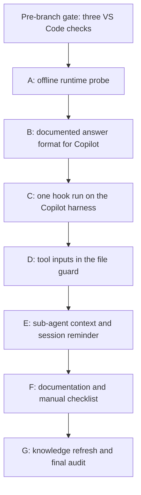

# Big Plan: copilot-harness-migration

## Context

VS Code runs Copilot chats in one of two **harnesses**. A harness is the part
of the client that runs the agent, calls tools, and runs hooks.

- The **Local harness** is VS Code's older built-in agent. It is the only
  Copilot mode this bootstrap was built for. VS Code 1.146 deprecated it, and
  VS Code removes it in February 2027.
- The **Copilot harness** is the newer agent runtime that VS Code shares with
  Copilot CLI. It is the default for new chats since VS Code 1.143. This
  computer runs VS Code 1.146.0 with the bundled runtime `1.0.108-0`
  (`@github/copilot-sdk` `1.0.30-preview.0`).

The evidence is
`.claude/explorations/2026-11-17_copilot-harness-migration-evidence/REPORT.md`
(findings F1 to F16 and Addendum A1 to A3), plus three planning probes run on
2026-11-17 against the same runtime (below). "Run" means seen in a live run
of that runtime; "Source" means read in VS Code's installed files; "Docs"
means official documentation.

The guards already work on the Copilot harness: 16 of 16 scripted tool calls
gave the expected result (F3). The real problems are:

1. Every hook runs twice, because the runtime also loads
   `.claude/settings.json` (F2; confirmed in the real VS Code, A3).
2. The guards' answers work only through an undocumented compatibility rule.
   Renaming the hook events to the documented camelCase names would switch
   every deny off (F4).
3. With the six Codex-family models, every file edit is denied, because the
   file guard crashes on the patch tool's text input (F6).
4. The runtime's shell helper tools `read_bash`, `list_bash`, and `stop_bash`
   are always denied, so a background shell can be started but never read
   or stopped (planning probe P3, new).
5. A read of a hook or agent file through the runtime's read tool asks for
   approval, because the guard does not know the read tool's name in the
   PascalCase hook input (`Read`). Sub-agents must read
   `.claude/agents/<id>.md` at every start (Source, new).
6. Sub-agents get no repository instructions and no skill list (F9).
7. The search tools can read a secret-shaped file that the read tool cannot
   (F7). This is a policy choice for the user.
8. The root guidance is loaded three times (F10). This plan measures and
   documents it; it does not change it.

### Approved user decisions (2026-11-17; not reopened)

1. Scope is the Copilot harness inside VS Code. Copilot CLI and cloud agents
   are not claimed. A later small CLI addition is not blocked, but not
   designed or tested.
2. The Local harness keeps working until its removal (February 2027). No
   change may break it. Removing Local-only files and claims at removal is a
   recorded follow-up.
3. The user runs three checks in a signed-in VS Code window before approving
   this plan (see "Pre-branch gate").

### Planning probes (2026-11-17, runtime `1.0.108-0`, offline, scripted local model)

The orchestrator copies their outputs into the evidence folder before
approval. They used the exploration harness (`scripts/run.sh`).

| Probe | Question | Result |
| --- | --- | --- |
| P1 | What do commands run by the runtime's shell tool see? Does an answer with both shapes work? Does top-level context work under PascalCase `SessionStart`? | Shell-tool commands see `COPILOT_CLI=1`, `COPILOT_AGENT_SESSION_ID`, `COPILOT_HOME`, `COPILOT_CLI_ENABLED_FEATURE_FLAGS`, and `COPILOT_RUNTIME_PROCESS_FILE_LOGGING`. They do not see `COPILOT_HOOK_DEPTH` or `COPILOT_PROJECT_DIR`. A top-level plus nested `deny` is honored under `PreToolUse` and `preToolUse`. A top-level plus nested `ask` asks exactly once under each. Top-level `additionalContext` under `SessionStart` and `PostToolUse` reaches the model; the nested copy does not. |
| P2 | Does `SubagentStart` context reach custom sub-agents? | Yes, under `SubagentStart` and `subagentStart`. Top-level `additionalContext` reached the first user message of `coder` and `reviewer`; the nested copy did not. The input carries `agentName` and `agent_type`. |
| P3 | What happens to the runtime's shell helper tools with the bootstrap's Copilot hook file? | `read_bash`, `list_bash`, and `stop_bash` keep their names in the hook input. All three are denied: `protect-files classifier error: Bash payload has no command`. |

Other facts used:

- Source: VS Code's Copilot extension 0.74.0 (`ChatHookService`, the Local
  harness) reads a pre-tool decision only from `hookSpecificOutput`. It
  drops a whole result only when a top-level `hookEventName` names a
  different event.
- This planning session is Claude Code started by VS Code's extension host.
  Its environment holds `COPILOT_CLI_ENABLED_FEATURE_FLAGS` and
  `COPILOT_OTEL_FILE_EXPORTER_PATH`, leaked from the Copilot extension. It
  has no `COPILOT_CLI` and no `COPILOT_HOOK_DEPTH`.
- A2: with `"chat.useClaudeHooks": true`, the Local harness also runs the
  Claude Code hooks. Their environment has no `COPILOT_CLI=1`, only the two
  leaked variables above.
- A3: in the real VS Code Copilot harness, hooks see `COPILOT_CLI=1`,
  `COPILOT_PROJECT_DIR`, `COPILOT_HOOK_DIR`, `COPILOT_HOOK_DEPTH=1`,
  `CLAUDE_PROJECT_DIR`, `CLAUDE_CODE_DISABLE_PRECOMPACT_SKIP=1`, and
  `COPILOT_CLI_RUN_AS_NODE=1`. A variable named `CLAUDE_CODE_*` is therefore
  not proof of a real Claude Code session. The three MCP servers each
  connected once.

## Pre-branch gate

The user runs these checks in a signed-in VS Code window on the trusted test
folder, before approving this plan. The results can change the plan.

**Precondition (A1).** VS Code's agent host is the process that runs
Copilot-harness sessions. It needs the folder `/run/user/<uid>`. When that
folder is missing, `agenthost.log` (under
`~/.vscode-server/data/logs/<session>/`) repeats
`listen EACCES: permission denied /run/user/<uid>/vscode-ipc-<id>.sock` and
the chat freezes. Create the folder first (A3). This is an environment fault,
not a bootstrap defect.

**Logging.** `scripts/setup_probe_hooks.mjs <folder> <hooklog.sh> both` in
the evidence folder adds loggers to `.github/hooks/`. To also log the hooks
that come from the Claude settings, add the logger to
`.claude/settings.local.json` with `scripts/setup_claude_local.mjs`.

| Check | What to record | Plan decisions it can change |
| --- | --- | --- |
| (a) A new chat uses the Copilot harness, and the agent runs `git reset --hard HEAD` | The harness shown in the picker; the denial text; how many denials appear | Not denied: VS Code does not run repository hooks the way the SDK run does. Stop before branch creation. Phases B to E rest on that premise and must be re-planned. Phase A stays. Denied: proceed. |
| (b) The agent creates `.vscode/settings.json` (a protected config, so the guard asks) | What the question looks like; how many times it appears; what "Allow all" does; what Autopilot does | Two questions: confirms Phase C. One question: check `hooks-sessions.log`. If the Claude-settings hooks do not run in VS Code, cancel Phase C with that evidence. "Allow all" approves hook questions silently: the user decides whether `github-copilot` moves from ask to deny for protected configs, as on Codex. That would be a stricter rule, added to Phase B. Autopilot denies: documentation only (Phase F). |
| (c) The tool names and environment the hooks see for one shell command, one file read, one create or edit, one search, and one sub-agent start, from both hook sources | `tool_name` per tool; the `COPILOT_*` and `CLAUDE*` variables per source | Names other than `Bash`, `Read`, `Write`, `Edit`, `Grep`, `Glob`, and `Agent`, or VS Code's own shell tools (`bash`, `read_bash`, `write_bash`, `bash_shutdown`): Phase D's lists and fixtures use the observed names. A shell tool whose name does not end in `bash` is added to `TERMINAL_TOOLS` and `is_bash_tool_payload` in Phase D (stricter). No `COPILOT_HOOK_DEPTH` in the Claude-settings hooks: Phase C uses `COPILOT_PROJECT_DIR` (also set only for hooks in P1) or is cancelled. |

**Open user preference (answered at approval).** Should the search tools be
denied, like the read tool, when they name a secret-shaped path such as
`.env`? The recommendation is yes, for explicit paths only. Shell reads such
as `cat .env` stay allowed (user decision of 2026-10-21). If the answer is
no, the orchestrator removes Phase D step 5 and its tests before branch
creation.

## Goals

- The Copilot harness in VS Code runs each bootstrap hook once per event.
- The guards' answers follow the documented Copilot format, so a later
  rename to camelCase events cannot switch a deny off.
- The Codex-family models can edit files, and protected files keep their
  decisions under the patch tool.
- The runtime's shell helper tools work; the read tool does not ask for
  reads.
- Sub-agents receive the repository rules and know where skills live.
- A repeatable, offline proof on the real runtime exists, plus ordinary
  tests built from observed inputs.
- Documentation states exactly what was run, on which runtime version, and
  that VS Code hooks are "in preview".

## Non-Goals and Constraints (optional)

- Not claimed: Copilot CLI, Copilot cloud agents, or a per-agent model pin
  for Copilot (agent `model` stays `target-default`; follow-up).
- Out of scope: the OpenWiki server and wiki guard for Copilot; rewriting
  guards for a new input format; any fast path or exemption for "trivial"
  tasks.
- Rejected: renaming the hook events to camelCase in this plan. The Local
  harness may not accept them, and the rename only becomes safe after
  Phase B.
- Local harness: no change may break it. Its files stay: the
  `.github/hooks/hooks.json` event names, `agents:` in the agent files
  (called wrappers below), and `.vscode/mcp.json`.
- Hook Python is standard library only, compiles on Python 3.9, and runs
  with bare `python3`. Tests, hooks, and `verify.py` make no model call.
- Never hand-edit `dist/`. Change `shared/` or the generator, regenerate, and
  refresh this repository's own install with
  `uv run python scripts/install_bootstrap.py . --allow-self --local-only`.
- A guard change may only tighten or keep a decision, unless the
  decision-change table below lists it with a reason.
- Byte budgets and the 300-character skill listing cap in
  `scripts/validate_targets.py` stay in force.
- Unknown older installs on other computers must stay safe. Every change is
  safe whether the new or the old copy of each file lands first (see
  Phase C).

## Design Overview

### Phase order



Phase A comes first so that every later phase has a required check on the
real runtime (the `integration-gate-spike` rule). D comes before E because
sub-agents read their agent file at start, and D stops that read from
asking.

### Contracts this plan touches

| Contract (source or symbol) | Behavior to keep | Planned change | Evidence |
| --- | --- | --- | --- |
| `_lib-frontmatter.sh` `deny_pretool`, `ask_pretool`, `additional_context` | Byte-identical nested output for `claude-code`, `openai-codex`, `google-antigravity` | For `TARGET_ID=github-copilot`, print the same values at the top level as well (B) | F4, P1, Source (Local reads only nested) |
| `protect-files.py` `emit` | Same decision per client | Top-level keys for `github-copilot` (B) | same |
| `pretool-bash-guard.sh:27`, `antigravity-pretool.py` `guard_decision` | Read the nested decision | No change: the output with both shapes keeps the nested object. Tests pin it (B) | Source |
| `shared/hooks/hooks.json` | PascalCase events; same scripts | `git-protection.sh github-copilot` (B); `SubagentStart` and a session reminder (E) | F4, P2 |
| `run-hook.sh` | Runs the named script with its arguments | Stand-down rule for hooks from the Claude settings on the Copilot harness (C) | F2, A2, A3, P1 |
| `generate_targets.py` `_claude_hook_cmd` | Same Claude hook commands | Adds the `BOOTSTRAP_HOOK_SOURCE=claude-settings` prefix (C) | — |
| `protect-files.py` `main`, `READ_ONLY_TOOLS`, `PATH_KEYS` | Fail closed on unknown input; secret files denied for every tool | Patch-text input, shell helpers, `read` alias, search `paths` (D) | F6, F7, F8, P3 |
| `validate_targets.py` `COPILOT_EXPECTED_EVENTS`, `ROOT_GUIDANCE_BUDGETS` | Exact event set; budgets | Adds `SubagentStart` and a 2 KiB budget for `.github/copilot-instructions.md` (E) | P2 |
| `render_github_agent_adapter` | Wrapper fields for Local | No change (fields kept for Local) | F9 |

### Design decisions

**Q1. Stopping the double run.**

- **Rejected: an early exit keyed only on `COPILOT_CLI=1`.** The runtime's
  shell tool passes `COPILOT_CLI=1` to every command it runs (P1). A Claude
  Code session started from such a shell would inherit it, and all its
  guards would stop.
- **Rejected: dropping one hook source.**
  - Dropping `.github/hooks/hooks.json` breaks the Local harness (decision
    2) and labels Copilot sessions `claude-code`. It also loses the `.env`
    read deny: the Claude settings send only `Edit|Write` and `Bash` to the
    file guard, and the Copilot runtime does not apply Claude's
    `permissions.deny` read rules (F3).
  - Dropping the Claude settings hooks would break Claude Code. No
    documented switch makes the runtime skip only the Claude files (F2).
- **Chosen (Phase C):** a hook reached through `.claude/settings.json`
  stands down (reads and discards its input, prints nothing, exits 0) only
  when all of these hold:
  1. `BOOTSTRAP_HOOK_SOURCE=claude-settings`, which only the generated
     Claude settings commands set;
  2. `COPILOT_CLI=1`;
  3. `COPILOT_HOOK_DEPTH` is non-empty. The runtime sets it only for hook
     processes: it is missing from shell-tool commands (P1) and from Claude
     Code sessions;
  4. `CLAUDECODE` is empty. Claude Code sets `CLAUDECODE=1` for the commands
     it runs. Whether its hook processes inherit it is not checked, so this
     condition is extra protection, not relied on;
  5. `.github/hooks/hooks.json` is a regular file, not a link, and names all
     five guards with their client argument.
- **Coverage.** This covers the Copilot harness only.
  - The Local harness with `chat.useClaudeHooks: true` keeps its double run.
  - Its Claude-settings hooks have the same environment as a real Claude
    Code session (A2 and this session).
  - Local's hook sources are chosen by user settings (`chat.useHooks`,
    `chat.hookFilesLocations`, `chat.useClaudeHooks`; Docs). A hook there
    cannot know whether the other source also runs, so standing down could
    leave Local with no guards.
  - Phase C and Phase F document that this setting doubles the hooks and
    should be off for this bootstrap.
- **Old installs.**
  - New `run-hook.sh` with old settings (no marker): no stand-down. The
    double run continues, and the guards keep running.
  - Old `run-hook.sh` with new settings: the prefix is ignored, with the
    same result. No mix removes a guard.

**Q2. The documented answer format for Copilot only.**

- For `TARGET_ID=github-copilot`, the shared library and `protect-files.py`
  print the decision both at the top level and nested. For example:
  `{"permissionDecision":"deny","permissionDecisionReason":"...","hookSpecificOutput":{"hookEventName":"PreToolUse","permissionDecision":"deny","permissionDecisionReason":"..."}}`.
  The same applies to `additionalContext`. There is no top-level
  `hookEventName`.
- The Copilot harness honors the top level under both event casings, and
  this shape asks exactly once (P1). The Local harness keeps reading the
  nested object (Source).
- Claude Code, Codex, and Antigravity keep their exact bytes. Whether they
  accept extra top-level keys was never observed, and they do not need
  them.
- `git-protection.sh` gets the missing `github-copilot` argument. Three
  scripts that print through the library (`enforce-pr-gate.sh`,
  `session-start-state.sh`, `record-branch-state.sh`) set `TARGET_ID` from
  their argument.
- The two readers need no change, because the nested object stays. Tests
  pin that.

**Q3. Patch text.**

- A string `tool_input` that parses as JSON keeps today's path.
- A string that starts, after leading blanks, with `*** Begin Patch` goes
  through the existing `add_patch_paths` parser and `emit`, but only for a
  tool that is neither a shell tool nor read-only.
- Any other string raises `AmbiguousCommand` and fails closed, as today.

**Q4. Sub-agent rules.**

- A new `SubagentStart` hook (`subagent-context.sh github-copilot`) gives
  each sub-agent the text of `.github/copilot-instructions.md` (1,676 bytes
  today; a new 2 KiB budget). It adds one fixed line about where agent files
  and skills live.
- The text is printed top-level and nested, built with `python3`
  `json.dumps`.
- Why this route:
  - It is deterministic and observed (P2).
  - Wrapper text would depend on the model choosing to read another file.
  - VS Code does not pass on `include-custom-instructions` (F9, Docs).
- Wrapper fields stay as they are. `agents:`, `user-invocable`, and
  `disable-model-invocation` are used by the Local harness. The Copilot
  harness ignores `agents:` (F9). Removing them is a recorded follow-up for
  the Local removal.

**Q5. Root guidance loaded three times.**

- Honest outcome: measured and documented, no trim.
- Claude Code needs `CLAUDE.md`. Codex and Antigravity need `AGENTS.md`. The
  Local harness needs `.github/copilot-instructions.md`.
- The runtime merges all of them and removes only identical copies (Docs).
  Its only off switch, `--no-custom-instructions`, is a CLI flag that
  removes everything.
- The only Copilot-only file is 1,676 bytes of about 10.8 KB of duplicated
  text, and Phase E makes it the sub-agent context.
- Follow-up: revisit after the Local removal.

**Q6. Repeatable proof.**

- Phase A adds `scripts/check_copilot_runtime.py` and the Node runner
  `scripts/copilot_runtime_probe.mjs`, adapted from the evidence harness.
  - It uses the newest VS Code server copy of the SDK and VS Code's bundled
    `node`.
  - It uses a private runtime folder and no login.
  - The scripted model answers on 127.0.0.1.
  - It installs a fresh copy of this bootstrap into a temporary folder.
- It is opt-in. `verify.py` and pytest never start it.
- Each later phase adds the checks for its own fix and lists the probe with
  `--require` in its required verification.
- Ordinary pytest cases use the observed inputs, copied into the tests (the
  `raw/` files live in the nested AI-state repository, not in the outer
  one).
- The probe starts the runtime through the SDK, not through VS Code's agent
  host. The planning probes ran between 16:20 and 16:36 on 2026-11-17,
  before the user created `/run/user/1000` at 16:41 (A3), so the A1 fault
  did not stop them.

**Q7. The sidecar overlay.**

- No code change. The sidecar ships no hooks and no `.github/agents/`, so it
  has no double run.
- On runtime `1.0.108-0` the Copilot harness also reads `.claude/rules/`
  (Copilot CLI changelog 1.0.89) and `.claude/agents/` (F9). The contract's
  2026-09-25 statement that the Agent Host did not load
  `.claude/rules/ai-bootstrap-sidecar.md` may therefore be out of date.
- Phase F records a discovery check of both sidecar profiles on this
  runtime, and turns any defect into a follow-up.

**Other work items.**

- `.vscode/mcp.json` stays for the Local harness. In the real VS Code
  Copilot harness each project server connected once (A3).
- The reporting reminder for Copilot comes at session start (Phase E). That
  route is documented; the per-prompt route contradicts the docs (F13).

### Decision changes (guard behavior)

| # | Tool call | Before | After | Why |
| --- | --- | --- | --- | --- |
| L1 | Runtime read tool (`Read`) on a hook, server, or agent config | ask | no decision (secret files still denied) | The existing policy says read tools get no decision for configs (`READ_ONLY_TOOLS` comment; `docs/target-mapping.md` "Read tools stay allowed"). `Read` is the PascalCase name of the already-listed `view`. Sub-agents read `.claude/agents/<id>.md` at every start. (D) |
| L2 | `read_bash`, `list_bash`, `stop_bash` with no `command` | deny (crash) | path keys checked like a native tool; no shell classification | They carry only `shellId` and `delay`, and act on a shell whose command was already judged (P3). With a `command` they are still judged as shell commands. (D) |
| L3 | `apply_patch` text | deny (crash) | normal decision per target | Same decisions as the same patch inside a shell command. (D) |
| L4 | A hook from `.claude/settings.json` on the Copilot harness | runs | stands down when the five conditions hold | The `.github/hooks/hooks.json` copy runs the same guards with the `github-copilot` client (C) |
| T1 | `grep`, `rg`, `glob` with a secret-shaped `paths` entry | no decision | deny | User preference question; recommended yes (D) |

### Decisive assumptions

| Id | Assumption | Evidence | Remaining limit |
| --- | --- | --- | --- |
| DA1 | VS Code runs repository hooks like the SDK run | A3: trust granted, double session log, same environment | No tool call yet in VS Code: gate check (a) |
| DA2 | The answer with both shapes is honored by the Copilot harness and harmless to the Local harness | P1 (Run); Copilot extension 0.74.0 (Source) | Local not run with the new output; Phase F's manual checklist covers it |
| DA3 | `COPILOT_HOOK_DEPTH` is set only for runtime hook processes | P1, F2 logs, A3, this session's environment | The Claude-settings hooks in VS Code are not logged yet: gate check (c) |
| DA4 | The Copilot harness always loads `.github/hooks/*.json` in a trusted folder | Docs; F2; F15 | An enterprise policy that disables repository hooks disables both sources |
| DA5 | `SubagentStart` context reaches custom sub-agents | P2 | Not seen in VS Code yet; Phase F checklist |
| DA6 | The shell helper tools carry no command | P3; the runtime's tool list (`raw/built-in-tools.txt`) | VS Code's own `write_bash` carries `command` (Source) and stays a shell tool |
| DA7 | `Read` on a config asks today | Source only (`READ_ONLY_TOOLS` lacks `read`) | Phase D's first test proves it before the change |

### Test strategy

- **Critical cases:**
  - each deny from F3 on the real runtime (Phase A);
  - deny and ask under camelCase event names after Phase B;
  - one question per protected edit with both sources (C);
  - the five patch targets (D);
  - the shell helpers (D);
  - the sub-agent context (E).
- **Negative cases:**
  - no stand-down for the environment of a real Claude Code session, of
    Claude Code started from a Copilot shell (P1 variables), or of a Local
    session (A2 variables);
  - no stand-down with a missing, linked, or incomplete Copilot hook file;
  - patch text that is not terminated;
  - a string that is neither JSON nor patch text;
  - a `read_bash` input that carries a `command`;
  - other clients' output byte-identical.
- **Real versus mocked:** the probe runs the real runtime with only the
  model scripted. Pytest runs the real hook scripts on recorded inputs and
  never starts the runtime.
- **Expected values** come from the documented policy (`docs/target-mapping.md`
  rows, the F3 table, the decision-change table above), never from running
  the new code.
- **Not verified by any script here:** VS Code's own layer (approval
  dialogs, "Allow all", Autopilot, the tools VS Code adds). It is covered by
  the pre-branch gate and by Phase F's manual checklist.

### Risks and fallbacks

| Risk | Fallback |
| --- | --- |
| A gate check shows VS Code differs from the SDK run | Revise the affected phases before branch creation (gate table) |
| A VS Code update changes the runtime mid-plan | The probe reports the runtime version. A FAIL is handled like any failed check; the plan is revised only when new evidence changes a decision |
| The probe takes too long for the 600-second limit per verification item | The probe caps itself at 480 seconds and uses at most three sessions plus discovery |
| The stand-down signal differs in VS Code | Gate check (c); the fallback variable is `COPILOT_PROJECT_DIR`; else cancel Phase C with evidence |
| `chat.useClaudeHooks: true` keeps the Local double run | Documented, with the advice to turn it off (C, F) |

### Recorded follow-ups (not in this plan)

At the Local removal (February 2027):

- rename the hook events to camelCase (safe after Phase B);
- remove `agents:` and other Local-only wrapper fields;
- decide on `.vscode/mcp.json`;
- shrink `.github/copilot-instructions.md`;
- drop the Local-only claims, tool names, and settings advice.

Separately:

- a per-agent Copilot model pin;
- Copilot CLI support;
- the OpenWiki server for Copilot;
- the open checks that are not in the gate: the per-prompt reminder (F13),
  when `sessionEnd` fires, and what
  `github.copilot.chat.cli.customAgents.enabled` gates.

## Requirement Map (optional)

| Requirement | Acceptance and existing contract | Owning phase | Evidence |
| --- | --- | --- | --- |
| REQ-001 | A repeatable, offline check of the real runtime, opt-in, no model call | `2026-11-17_phase-A-copilot-runtime-probe` | `scripts/check_copilot_runtime.py --require` |
| REQ-002 | The Copilot client's guard answers carry the documented top-level shape; other clients' bytes unchanged | `2026-11-17_phase-B-copilot-hook-answers` | `tests/test_hook_gates.py`; probe camelCase session |
| REQ-003 | One hook run per event on the Copilot harness; never a stand-down for Claude Code or Local | `2026-11-17_phase-C-single-hook-run` | stand-down tests; probe single-run checks |
| REQ-004 | The patch tool, the shell helpers, and the read tool behave as the decision-change table says | `2026-11-17_phase-D-copilot-tool-inputs` | decision battery; probe |
| REQ-005 | Search tools on secret-shaped paths follow the user's answer | `2026-11-17_phase-D-copilot-tool-inputs` | decision battery; probe |
| REQ-006 | Sub-agents receive the Copilot root guidance; sessions get the reporting reminder | `2026-11-17_phase-E-subagent-context` | hook tests; probe |
| REQ-007 | The Local harness keeps working (nested output kept; event names and wrapper fields unchanged) | B to E | tests; Phase F manual checklist |
| REQ-008 | Docs state what ran, on which version, with the preview label and the A1 precondition | `2026-11-17_phase-F-copilot-docs` | stale-text and new-text checks |

## Phases

- [ ] `2026-11-17_phase-A-copilot-runtime-probe` — offline check of the real runtime; baseline checks
- [ ] `2026-11-17_phase-B-copilot-hook-answers` — documented answer format for the Copilot client
- [ ] `2026-11-17_phase-C-single-hook-run` — Claude-settings hooks stand down on the Copilot harness
- [ ] `2026-11-17_phase-D-copilot-tool-inputs` — patch text, shell helpers, read alias, search paths
- [ ] `2026-11-17_phase-E-subagent-context` — sub-agent context and session-start reminder
- [ ] `2026-11-17_phase-F-copilot-docs` — documentation, manual checklist, sidecar recorded check
- [ ] `2026-11-17_phase-G-knowledge-refresh` — knowledge refresh and final audit

## Verification

```bash
uv run python .claude/scripts/verify.py fast --format json
uv run python scripts/validate_plan_frontmatter.py
```

## Done Criteria

- Every phase is `complete`.
- `uv run python scripts/check_copilot_runtime.py --require` passes every
  check on the newest VS Code server runtime and prints its version.
- Claude Code, Codex, and Antigravity hook output is byte-identical to
  before (tests).
- The Local harness reads the same nested answers; its event names and
  wrapper fields are unchanged.
- Every guard decision change is in the decision-change table. The Phase D
  battery and differential run show no other change.
- Docs name runtime `1.0.108-0` (or the version the final probe prints),
  say that VS Code hooks are in preview, and list the manual checks and the
  follow-ups.
- The knowledge refresh is done, and the final audit is logged under
  `## Stale-claims surfaces checked`.

## Completion Evidence

The final phase listed under `phases:` must also run a documentation,
memory, and LEARN audit: sweep every live-advice surface for claims this plan
or earlier work invalidated, correct or supersede each one, leave dated
records (archived plans, dated design narratives, closed session logs)
unchanged, and record the audited surfaces and each one's outcome under a
`## Stale-claims surfaces checked` heading in that phase's closeout session
log. `verify.py`'s closeout gate requires that exact heading, non-empty,
whenever the phase it is closing out is this list's last entry.

In a repository where `openwiki/INSTRUCTIONS.md` exists, that final phase
may also need to be a dedicated knowledge-refresh phase: see the canonical
Knowledge-Refresh Final Phase rule in `.claude/instructions/plan-lifecycle.instructions.md`
for exactly when and how, including its recursion guard.
