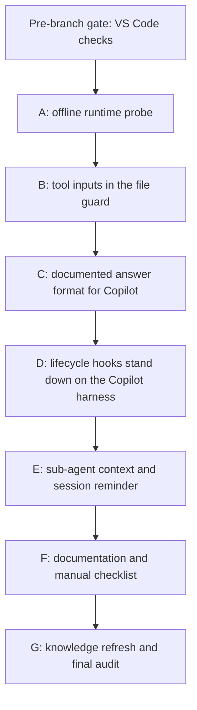

# Big Plan: copilot-harness-migration

## Context

VS Code runs Copilot chats in one of two **harnesses**. A harness is the part
of the client that runs the agent, calls tools, and runs hooks.

- The **Local harness** is VS Code's older built-in agent, the only Copilot
  mode this bootstrap was built for. VS Code 1.146 deprecated it, and VS Code
  removes it in February 2027.
- The **Copilot harness** is the newer agent runtime that VS Code shares
  with Copilot CLI. It is the default for new chats since VS Code 1.143.
  This computer runs VS Code 1.146.0 with runtime `1.0.108-0`
  (`@github/copilot-sdk` `1.0.30-preview.0`).

Evidence is in
`.claude/explorations/2026-11-17_copilot-harness-migration-evidence/`:
`REPORT.md` (findings F1 to F16, Addendum A1 to A4) and
`DEVILS-ADVOCATE-2026-11-17.md`. It also includes four planning probes
(below; the orchestrator copies their outputs into that folder).

- **Run** means seen in a live run of that runtime, offline or in the real
  VS Code.
- **Source** means read in VS Code's installed files.
- **Docs** means official documentation.

**Tool sets differ.** VS Code can give a model a different tool set than
the runtime's own list for that model. In the real VS Code, Auto chose
`gpt-6-luna` and VS Code gave it the patch tool `apply_patch`, while the
runtime's `tools.list` gives `gpt-6-luna` the `create` and `edit` tools
(A4). Offline, only Codex-family model ids get `apply_patch`, so the probe
uses `gpt-5.2-codex` to exercise it.

The guards already work on the Copilot harness. Offline, 16 of 16 scripted
calls gave the expected result (F3). In the real VS Code,
`git reset --hard HEAD` was denied (A4). The real problems, most urgent
first:

1. **Every file edit fails when the chosen model uses the patch tool.** The
   file guard crashes on the patch tool's text input, so the call is denied
   ("hook exited with code 2"). This happened in the real VS Code with
   `gpt-6-luna` (A4) and offline with six Codex-family models (F6).
2. The runtime's shell helper tools `read_bash`, `list_bash`, and
   `stop_bash` are always denied, so a background shell can be started but
   never read or stopped (probe P3).
3. A read of a hook or agent file with the read tool asks for approval. The
   guard does not know the read tool's PascalCase name `Read` (Source;
   confirmed by a run in the critique). Sub-agents read
   `.claude/agents/<id>.md` at every start.
4. The search tools can read a secret-shaped file that the read tool cannot
   (F7). This is a policy choice for the user.
5. The guards' answers work only through an undocumented compatibility
   rule. Renaming the events to the documented camelCase names would switch
   every deny off (F4).
6. Every hook runs twice, because the runtime also loads
   `.claude/settings.json`: two session-log entries, state sync twice, and
   two questions for a protected edit (F2; the real VS Code, A3).
7. Sub-agents get no repository instructions and no skill list (F9).
8. The root guidance is loaded three times (F10). Measured and documented
   only.

### Approved user decisions (2026-11-17; not reopened)

1. Scope is the Copilot harness inside VS Code. Copilot CLI and cloud agents
   are not claimed. A later small CLI addition is not blocked, but not
   designed or tested.
2. The Local harness keeps working until its removal (February 2027). No
   change may break it. Removing Local-only files and claims at removal is a
   recorded follow-up.
3. The user runs three checks in a signed-in VS Code window before approving
   this plan (see "Pre-branch gate").

### Planning probes (2026-11-17, runtime `1.0.108-0`, offline, scripted local model)

| Probe | Question | Result |
| --- | --- | --- |
| P1 | What do commands run by the runtime's shell tool see? Does an answer with both shapes work? Does top-level context work under PascalCase `SessionStart`? | Commands see `COPILOT_CLI=1`, `COPILOT_AGENT_SESSION_ID`, `COPILOT_HOME`, `COPILOT_CLI_ENABLED_FEATURE_FLAGS`, and `COPILOT_RUNTIME_PROCESS_FILE_LOGGING`. They do not see `COPILOT_HOOK_DEPTH` or `COPILOT_PROJECT_DIR`. A top-level plus nested `deny` is honored under `PreToolUse` and `preToolUse`; the same `ask` asks exactly once. Top-level `additionalContext` under `SessionStart` and `PostToolUse` reaches the model; the nested copy does not. |
| P2 | Does `SubagentStart` context reach custom sub-agents? | Yes, under `SubagentStart` and `subagentStart`: top-level `additionalContext` reached the first user message of `coder` and `reviewer`; the nested copy did not. The input carries `agentName` and `agent_type`. |
| P3 | Shell helper tools with the bootstrap's Copilot hook file | `read_bash`, `list_bash`, and `stop_bash` keep their names. All three are denied: `protect-files classifier error: Bash payload has no command`. One later `read_bash` ran with no pre-tool hook at all: the runtime's own read of a finished background shell. |
| P4 | Discovery from a subfolder two levels below the repository root | The same 54 hooks as from the root, including `.github/hooks/hooks.json` and the Claude settings. Each entry carries `enabled` and `disableKey` fields. |

Other facts used:

- **Local harness (Source).** VS Code's Copilot extension 0.74.0 reads a
  pre-tool decision only from `hookSpecificOutput`. It ignores a whole
  result only when a top-level `hookEventName` names another event.
- **Leaked variables.** This planning session is Claude Code started by
  VS Code's extension host. Its environment holds
  `COPILOT_CLI_ENABLED_FEATURE_FLAGS` and `COPILOT_OTEL_FILE_EXPORTER_PATH`,
  leaked from the Copilot extension, and no `COPILOT_CLI` or
  `COPILOT_HOOK_DEPTH`.
- **A2.** With `"chat.useClaudeHooks": true`, the Local harness also runs
  the Claude Code hooks. Their environment has no `COPILOT_CLI=1`.
- **A3.** Hooks in the real VS Code Copilot harness see `COPILOT_CLI=1`,
  `COPILOT_PROJECT_DIR`, `COPILOT_HOOK_DIR`, `COPILOT_HOOK_DEPTH=1`,
  `CLAUDE_PROJECT_DIR`, `CLAUDE_CODE_DISABLE_PRECOMPACT_SKIP=1`, and
  `COPILOT_CLI_RUN_AS_NODE=1`. A `CLAUDE_CODE_*` variable is not proof of
  Claude Code. Each project MCP server connected once.
- **A4.** Tool names in VS Code hooks:
  - PascalCase: `Bash`, `Read`, `Glob`, `Edit` (for `apply_patch`, with
    string input), `Write` (for `create`), `AskUserQuestion` (for
    `ask_user`), `skill`, `tool_search_tool`;
  - camelCase: the runtime's own names.

  VS Code approved reads itself (`"decisionSource":"host_policy"`). A guard
  `ask` reaches VS Code as a permission request of kind `hook` with
  `hookMessage` set to the guard's reason.

## Pre-branch gate

The user runs these checks in a signed-in VS Code window on the trusted test
folder, before approving this plan.

**Precondition (A1).** VS Code's agent host is the process that runs
Copilot-harness sessions. It needs the folder `/run/user/<uid>`, owned by
the user. When the folder is missing, `agenthost.log` (under
`~/.vscode-server/data/logs/<session>/`) repeats
`listen EACCES: permission denied /run/user/<uid>/vscode-ipc-<id>.sock` and
the chat freezes. Create it with:

```bash
sudo install -d -m 700 -o "$(id -u)" -g "$(id -g)" /run/user/$(id -u)
```

Repeat this after every WSL restart. This is an environment fault, not a
bootstrap defect.

**Logging.** `scripts/setup_probe_hooks.mjs` in the evidence folder logs
the `.github/hooks` source. A logger for the Claude-settings source is in
the test folder's `.claude/settings.local.json` (A4).

| Check | Status | What to record | Plan decisions it can change |
| --- | --- | --- | --- |
| (a) A Copilot-harness chat; the agent runs `git reset --hard HEAD` | **Passed** (A4) | — | — |
| (b) The agent edits `.vscode/settings.json` (protected config, so the guard asks) | Partly seen: the request arrives as kind `hook` with the guard's `hookMessage` (A4) | How many questions the user sees; what "Allow all" does; what Autopilot does | One question with both sources running: check `hooks-sessions.log`. If the Claude-settings hooks do not run in VS Code, cancel Phase D with that evidence. "Allow all" approves hook questions silently: the user decides whether `github-copilot` moves from ask to deny for protected configs, a stricter rule added to Phase C. Autopilot denies: documentation only (Phase F). |
| (c) Hook tool names and environment for a shell command, a read, a create or edit, a search, and a sub-agent start, from both sources. Also `env \| grep -E '^(COPILOT\|CLAUDE)'` run through the VS Code shell tool. Optional: a window opened on a subfolder of the repository | Tool names seen (A4); sub-agent start, Claude-settings hook environment, and shell-tool environment still open | `tool_name` per tool; `COPILOT_*` and `CLAUDE*` per source; whether `COPILOT_HOOK_DEPTH` is absent from the shell-tool output; which sources load from a subfolder | New tool names go into Phase B step 6. `COPILOT_HOOK_DEPTH` in the shell-tool output, or missing from Claude-settings hooks: Phase D uses `COPILOT_PROJECT_DIR` (also hook-only in P1), or is cancelled. Under option B a wrong signal costs only logging and state sync. |

**Gate result (2026-11-17, evidence Addendum A4 to A6).**

- (a) Passed.
- (b) Seen for a shell write to `.vscode/settings.json`: the user answered
  one question; VS Code itself approved the second request for the same
  command (`"decisionSource":"host_policy"`). The read-back of that file
  with the read tool asked the user again, which is row L1. "Allow all" and
  Autopilot were not exercised: the agent stopped after its own pre-check
  was denied. They stay on Phase F's manual checklist. If "Allow all" turns
  out to approve guard questions silently, the stricter rule in the table
  above is a user decision and a plan revision.
- (c) Passed. A sub-agent start was seen (`agentName: reviewer`, started by
  the `task` tool). Hooks from the Claude settings see `COPILOT_CLI=1`,
  `COPILOT_HOOK_DEPTH=1`, and `COPILOT_PROJECT_DIR`, and no
  `COPILOT_HOOK_DIR`. Commands run by the VS Code shell tool see
  `COPILOT_CLI=1` and `COPILOT_AGENT_SESSION_ID`, and no
  `COPILOT_HOOK_DEPTH` and no `COPILOT_PROJECT_DIR`. The optional subfolder
  window was not run; P4 covers it offline.

**User choices at approval.**

1. Search tools: should `grep`, `rg`, and `glob` be denied, like the read
   tool, when they name a secret-shaped path such as `.env`? Recommended:
   yes, explicit paths only. Shell reads such as `cat .env` stay allowed
   (user decision of 2026-10-21). If no, the orchestrator removes all of
   these before branch creation:
   - Phase B step 5;
   - its rows in the step 1 battery;
   - the probe check `search-secret-denied`;
   - the T1 text in Phase B step 8;
   - decision row T1;
   - REQ-005.
2. How much stands down on the Copilot harness: option A, B, or C (below).
   Recommended and planned: **B**.

**Approval record (2026-11-17).** The user answered four questions and
approved the plan:

- Stand-down: **option B** (lifecycle hooks only; the guards keep running
  from both sources).
- Search tools on secret-shaped paths: **yes, refuse** (decision row T1
  stays).
- The two less strict rules: **both agreed** (rows L1, the read tool on
  configuration files, and L2, the shell helper tools).
- **Approved to start.** The untested "Allow all" case stays on Phase F's
  manual checklist.

## Goals

- Models that use the patch tool can create and edit files, and protected
  files keep their decisions.
- The runtime's shell helpers work, and the read tool does not ask for
  reads.
- The guards' answers follow the documented Copilot format. Phase C removes
  the output blocker for a later camelCase rename.
- Lifecycle hooks (session log, session-start state, AI-state sync,
  reminders) run once per event on the Copilot harness, and the guards keep
  running from both sources.
- Sub-agents receive the repository rules and know where skills live.
- A repeatable, offline proof on the real runtime exists, plus ordinary
  tests built from observed inputs.
- Documentation states exactly what was run, on which runtime version, that
  VS Code hooks are "in preview", and that VS Code's tool set for a model
  can differ from the runtime's own list.

## Non-Goals and Constraints (optional)

- Not claimed: Copilot CLI, Copilot cloud agents, or a per-agent model pin
  for Copilot (agent `model` stays `target-default`; follow-up).
- Out of scope: the OpenWiki server and wiki guard for Copilot; rewriting
  the guards for a new input format; any fast path or exemption for
  "trivial" tasks.
- Rejected: renaming the hook events to camelCase in this plan. The Local
  harness may not accept them, and Phase C removes only the output blocker.
- Local harness: no change may break it. Kept: the event names, `agents:`
  in the agent files (wrappers), and `.vscode/mcp.json`.
- Hook Python is standard library only, compiles on Python 3.9, and runs
  with bare `python3`. Tests, hooks, and `verify.py` make no model call.
- Never hand-edit `dist/`. Regenerate, then refresh this repository's own
  install with
  `uv run python scripts/install_bootstrap.py . --allow-self --local-only`.
- A guard change may only tighten or keep a decision, unless the
  decision-change table lists it with a reason.
- Byte budgets and the 300-character skill listing cap stay in force.
- Unknown older installs stay safe whichever copy of each file lands first
  (Phase D).

## Design Overview

### Phase order



- A comes first, so every later phase has a required check on the real
  runtime (the `integration-gate-spike` rule).
- B comes next because the patch-text crash blocks file edits in the real
  client.
- C must come before D: D's probe relies on the Copilot copy's answers being
  honored on their own terms.
- B must come before E: sub-agents read their agent file at start, and B
  stops that read from asking.

### Contracts this plan touches

| Contract (source or symbol) | Behavior to keep | Planned change | Evidence |
| --- | --- | --- | --- |
| `protect-files.py` `main`, `add_patch_paths`, `READ_ONLY_TOOLS`, `PATH_KEYS` | Fail closed on unknown input; secret files denied for every tool | Patch-text input; tolerant header matching; shell helpers; `read` alias; search `paths` (B) | F6, F7, F8, P3, A4, critique item 1 |
| `_lib-frontmatter.sh` `json_escape`, `deny_pretool`, `ask_pretool`, `additional_context` | Byte-identical nested output for `claude-code`, `openai-codex`, `google-antigravity` | For `TARGET_ID=github-copilot`, the same values also at the top level; control characters become spaces (C) | F4, P1, Source |
| `protect-files.py` `emit` | Same decision per client | Top-level keys for `github-copilot` (C) | same |
| `pretool-bash-guard.sh:27`, `antigravity-pretool.py` `guard_decision` | Read the nested decision | No change; tests pin it (C) | Source, critique |
| `shared/hooks/hooks.json` | PascalCase events; same scripts | `git-protection.sh github-copilot` (C); `SubagentStart` and a session reminder (E) | F4, P2 |
| `run-hook.sh` | Runs the named script | Lifecycle stand-down rule (D) | F2, A2, A3, P1, P4 |
| `generate_targets.py` `_claude_hook_cmd` | Same Claude hook commands | `BOOTSTRAP_HOOK_SOURCE=claude-settings` prefix (D) | — |
| `validate_targets.py` `COPILOT_EXPECTED_EVENTS` | Exact event set | Adds `SubagentStart`; separate 2 KiB check for `.github/copilot-instructions.md` (E) | P2, critique item 7 |
| `render_github_agent_adapter` | Wrapper fields for Local | No change | F9 |

### Design decisions

**Q1. The double run, and how much stands down.**

- **Rejected: an early exit keyed only on `COPILOT_CLI=1`.** The runtime's
  shell tool passes `COPILOT_CLI=1` to every command (P1). A Claude Code
  session started from such a shell would lose its hooks.
- **Rejected: dropping a hook source.**
  - Dropping `.github/hooks/hooks.json` breaks the Local harness and labels
    Copilot sessions `claude-code`. It also loses the `.env` read deny,
    because the Claude settings route only `Edit|Write` and `Bash` to the
    file guard (F3).
  - The Claude settings cannot be dropped for Copilot only: there is no
    documented switch (F2). P4's per-hook `disableKey` is undocumented and
    is a hash, so a generated file cannot use it.
- **Covered: the Copilot harness only.** The Local harness with
  `chat.useClaudeHooks: true` keeps its double run.
  - Its Claude-settings hooks have the environment of a real Claude Code
    session (A2 and this session).
  - Its hook sources follow user settings (`chat.useHooks`,
    `chat.hookFilesLocations`, `chat.useClaudeHooks`; Docs), so a hook
    cannot know whether the other source runs.
  - The docs advise turning that setting off.

#### How much stands down on the Copilot harness (the user confirms at approval)

| Option | What stands down | Questions per protected edit | Failure case: the `.github/hooks` copy does not run (a malformed item the runtime drops, a future runtime change) | What changes in this plan |
| --- | --- | --- | --- | --- |
| **A** | Every hook from the Claude settings | one | No guards in that session | Phase D: the stand-down set is every script. Condition 7 requires all five guards with the `github-copilot` argument. The probe's `ask-*` checks require exactly one question. The decision-change table gains "Claude-settings guards stand down on the Copilot harness". |
| **B (planned)** | Lifecycle hooks only: `state-sync.sh`, `session-log.sh`, `session-start-state.sh`, `claude-stop.sh`, `reporting-reminder.sh` | two. A deny also happens twice, which is harmless because a deny wins. | Lost for that session: session-log entries, session-start context, AI-state pull and push, the reminder. The guards keep running. | As written in Phase D |
| **C** | Lifecycle hooks; the Claude-settings guards run, but the launcher drops their `ask` answers | one | Protected-config edits proceed with no question: an ask becomes an allow | Phase D: `run-hook.sh` captures the output of `protect-files.sh` and `pretool-bash-guard.sh` (no `exec`) under the same conditions. It drops output whose decision is `ask` (exit 0) and passes a deny and any non-zero exit unchanged. New tests for both paths; the probe expects one question; the decision-change table gains the row "Claude-settings guard asks dropped on the Copilot harness", a loosening in the failure case. |

**Correction for row B (Phase D review, 2026-11-18).** The column
"Questions per protected edit" counts the hook questions the runtime raises,
which the probe pins at two. In the one real VS Code run, VS Code answered
the second question itself, so the user saw one (A6). The sentence "A deny
also happens twice" has no supporting run: the recorded runs show one deny
reason per denied call, and a deny from either file blocks the call. The
docs written in Phase D state it this way.

**Option B conditions.** A lifecycle hook reached through
`.claude/settings.json` stands down (reads and discards its input, prints
nothing, exits 0) only when all of these hold:

1. the script is in the lifecycle set above;
2. `BOOTSTRAP_HOOK_SOURCE=claude-settings`, which only the generated Claude
   settings set;
3. `COPILOT_CLI=1`;
4. `COPILOT_HOOK_DEPTH` is non-empty, because the runtime sets it only for
   hook processes (P1, A3);
5. `COPILOT_HOOK_DIR` is empty, because it is set only for `.github/hooks`
   hooks (F2, A3). This stops an inherited marker from making both copies
   stand down;
6. `CLAUDECODE` is empty. This is extra protection: whether Claude Code's
   hook processes have it is not checked;
7. `.github/hooks/hooks.json` is a regular file, not a link, has no
   `disableAllHooks`, and contains `session-log.sh github-copilot` and
   `state-sync.sh push`.

- **Old installs.** New launcher with old settings: no marker, so no
  stand-down. Old launcher with new settings: the prefix is ignored. No mix
  removes a hook that guards anything.
- **Lost by design** on the Copilot harness: the Claude-settings state push
  at `UserPromptSubmit` and `SessionEnd`, and the checkpoint at
  `StopFailure`. The Copilot file still pushes at every `Stop`, and the
  post-commit Git hook still checkpoints and publishes AI state.

**Q2. The documented answer format for Copilot only (Phase C).**

- For `TARGET_ID=github-copilot`, the library and `protect-files.py` print
  the decision both at the top level and nested, with no top-level
  `hookEventName`. The same applies to `additionalContext`.
- The Copilot harness honors the top level under both casings (P1). The
  Local harness reads the nested object (Source).
- Claude Code, Codex, and Antigravity keep their exact bytes.
- Every script that prints through the library assigns `TARGET_ID`
  explicitly, so an exported value cannot change another client's output.
- `json_escape` turns control characters into spaces, so a reason can never
  produce invalid JSON. On Copilot, invalid JSON lets the tool run (F5).
- After Phase C, the context text from `session-start-state.sh` and
  `record-branch-state.sh` starts reaching the Copilot model. Today it is
  dropped.

**Q3. Patch text (Phase B).**

- A string `tool_input` that parses as JSON keeps today's path.
- A string that starts, after leading blanks, with `*** Begin Patch` goes
  through `add_patch_paths`, for a tool that is neither a shell tool nor
  read-only.
- Anything else fails closed.
- `add_patch_paths` now matches the four header shapes case-insensitively,
  with any leading or inner blanks, so an indented header still gives a
  target.
- It does not fail closed on every unknown `*** ` line, because an update
  hunk's context line is the file's own text after one space (for example
  Markdown ` *** bold ***`).

**Q4. Sub-agent rules (Phase E).**

- A `SubagentStart` hook gives each sub-agent the text of
  `.github/copilot-instructions.md`, with a 2 KiB budget checked
  separately. It adds one fixed line about agent files and skills.
- Observed under both event casings (P2); PascalCase is not documented for
  this event.
- Wrapper fields stay for the Local harness; their removal is a follow-up.

**Q5. Root guidance loaded three times.**

- Measured and documented, no trim.
- Each root file is needed by a client: `CLAUDE.md` by Claude Code,
  `AGENTS.md` by Codex and Antigravity, `.github/copilot-instructions.md`
  by the Local harness.
- The runtime removes only identical copies (Docs).

**Q6. Repeatable proof (Phase A).**

- `scripts/check_copilot_runtime.py` plus `scripts/copilot_runtime_probe.mjs`
  run the SDK copy from the newest VS Code server folder (by folder
  modification time), with VS Code's `node`.
- No account, no login, and a private data folder.
- The scripted model answers on 127.0.0.1. The temporary project has its
  `.mcp.json` removed, so no MCP server starts, and the check `mcp-none`
  proves it. That makes it truly offline.
- It is opt-in. Later phases list it with `--require` in their required
  verification.
- It does not reproduce VS Code's own layer, including VS Code's own tool
  set per model.

**Q7. The sidecar overlay.**

- No code change: it ships no hooks and no `.github/agents/`.
- Phase F records a discovery check of both profiles on this runtime.

**Other items.**

- `.vscode/mcp.json` stays for the Local harness. Each project server
  connected once in the real VS Code (A3).
- The reporting reminder for Copilot comes at session start (Phase E).

### Decision changes (guard behavior)

| # | Tool call | Before | After | Why |
| --- | --- | --- | --- | --- |
| L1 | Read tool (`Read`) on a hook, server, or agent config | ask | no decision (secret files still denied) | The existing policy gives read tools no decision for configs (`READ_ONLY_TOOLS` comment; `docs/target-mapping.md` "Read tools stay allowed"). `Read` is the PascalCase name of the listed `view`. Sub-agents read their agent file at every start. (B) |
| L2 | `read_bash`, `list_bash`, `stop_bash` with no `command` | deny (crash) | path keys judged like a native tool; no shell classification | They carry only `shellId` and `delay`, and act on a shell already judged (P3). With a `command` they are judged as shell commands. (B) |
| L3 | Patch text | deny (crash) | normal decision per target | The same decisions as the same patch inside a shell command (B) |
| T1 | `grep`, `rg`, `glob` with a secret-shaped `paths` entry | no decision | deny | User choice 1; recommended yes (B) |
| T2 | A patch header with leading or inner blanks, or in another letter case (shell, object, or text input) | no target, so no decision | target judged | Critique item 1 (B) |
| T3 | A guard reason that contains a control character | invalid JSON, so the tool runs | valid JSON with the same decision | `json_escape` (C) |
| T4 | A runtime tool that runs commands without passing its inner steps through the hooks | no decision | deny on `github-copilot`, by name | Only for a tool Phase B step 6 finds; otherwise no change (B) |

Option B changes no guard decision. Option A or C adds the row named in the
options table.

Phase B outcome for row T4 (2026-11-17): step 6 found two tools,
`run_dynamic_workflow` and `dynamic_workflows_manage`. Both are denied by
name on `github-copilot` only, because no offline run could show a
workflow's own code passing through a hook.

### Decisive assumptions

| Id | Assumption | Evidence | Remaining limit |
| --- | --- | --- | --- |
| DA1 | VS Code runs repository hooks like the SDK run | A3 (trust, double session log, same environment); A4 (the real deny) | VS Code's own tool set per model differs (A4); covered by Phase F's manual checklist |
| DA2 | The answer with both shapes works on the Copilot harness and is harmless to the Local harness | P1; Source (0.74.0) | Local not run with the new output; Phase F checklist |
| DA3 | `COPILOT_HOOK_DEPTH` is set only for runtime hook processes | P1, F2, A3, this session | VS Code shell-tool environment and Claude-settings hooks: gate check (c) |
| DA4 | Under option B, a wrong stand-down loses no guard | The stand-down set has no guard script (Phase D test) | — |
| DA5 | `SubagentStart` context reaches custom sub-agents | P2 | Not yet seen in VS Code; Phase F checklist |
| DA6 | The shell helper tools carry no command | P3; `raw/built-in-tools.txt` | VS Code's own `write_bash` carries `command` (Source) and stays a shell tool |
| DA7 | `Read` on a config asks today | Source; run in the critique | Phase B's first test pins it before the change |
| DA8 | Both hook sources load from a subfolder | P4 on `1.0.108-0` | Copilot CLI changelog 1.0.111 mentions root hooks not loading from a subfolder; the Phase A check `hooks-subfolder` catches a change |

### Test strategy

- **Critical cases:**
  - the patch tool on the real runtime, including an indented header (B);
  - the shell helpers (B);
  - each F3 deny (A);
  - deny and ask under camelCase events, including the commit, branch, and
    PR gates (C);
  - one session-log entry per session, with two guard questions (D);
  - the sub-agent context (E).
- **Negative cases:**
  - no stand-down for the environment of a real Claude Code session, of
    Claude Code started from a Copilot shell (P1 variables), or of a Local
    session (A2 variables);
  - no stand-down for any guard script;
  - no stand-down with a missing, linked, disabled (`disableAllHooks`), or
    incomplete Copilot hook file, or with `COPILOT_HOOK_DIR` set;
  - unterminated patch text;
  - a string that is neither JSON nor patch text;
  - `read_bash` with a `command`;
  - an exported `TARGET_ID`;
  - other clients' bytes unchanged.
- **Real versus mocked:** the probe runs the real runtime with only the
  model scripted and no MCP servers. Pytest runs the real hook scripts on
  recorded inputs and never starts the runtime.
- **Expected values** come from the documented policy and the
  decision-change table, never from running the new code.
- **Not verified by any script:** VS Code's own layer (dialogs, "Allow
  all", Autopilot, its tool set per model). Covered by the gate and by
  Phase F's manual checklist.

### Risks and fallbacks

| Risk | Fallback |
| --- | --- |
| A VS Code check differs from the SDK run | Revise the affected phases before branch creation (gate table) |
| VS Code gives a model a tool the offline runtime does not offer it | Phase B maps tools by their hook name and input, not by model; the manual checklist runs in VS Code |
| The runtime drops a malformed item, or stops loading the `.github/hooks` copy | Under option B only logging and state sync are lost; the probe checks `hooks-sources` and `hooks-subfolder` |
| A VS Code update changes the runtime mid-plan | The probe prints the version. A FAIL is handled like any failed check. |
| The probe exceeds the limit per verification item (600 seconds at approval; 1020 seconds since Phase B) | 480-second cap; no MCP servers; at most three sessions plus discovery |
| The `chat.useClaudeHooks: true` double run on Local | Documented, with the advice to turn the setting off (D, F) |

### Recorded follow-ups (not in this plan)

At the Local removal (February 2027):

- rename the hook events to camelCase (Phase C removes the output blocker;
  the input side must then be re-checked);
- remove `agents:` and other Local-only wrapper fields;
- decide on `.vscode/mcp.json`;
- shrink `.github/copilot-instructions.md`;
- drop the Local-only claims, tool names, and settings advice.

Separately:

- a per-agent Copilot model pin;
- Copilot CLI support;
- the OpenWiki server for Copilot;
- the path-scoped policies offered twice (`.github/instructions/` and
  `.claude/rules/`, F10);
- the runtime's per-hook `disableKey` (P4);
- any tool Phase B step 6 records;
- the open checks outside the gate: the per-prompt reminder (F13), when
  `sessionEnd` fires, and what
  `github.copilot.chat.cli.customAgents.enabled` gates.

## Requirement Map (optional)

| Requirement | Acceptance and existing contract | Owning phase | Evidence |
| --- | --- | --- | --- |
| REQ-001 | A repeatable, offline check of the real runtime, opt-in, no model call, no MCP server | `2026-11-17_phase-A-copilot-runtime-probe` | `scripts/check_copilot_runtime.py --require` |
| REQ-002 | Patch tool, shell helpers, read tool, and unmapped tools behave as the decision-change table says | `2026-11-17_phase-B-copilot-tool-inputs` | decision battery; probe |
| REQ-005 | Search tools on secret-shaped paths follow user choice 1 | `2026-11-17_phase-B-copilot-tool-inputs` | decision battery; probe |
| REQ-003 | The Copilot client's guard answers carry the documented top-level shape; other clients' bytes unchanged | `2026-11-17_phase-C-copilot-hook-answers` | `tests/test_hook_gates.py`; probe camelCase session |
| REQ-004 | Lifecycle hooks run once per event on the Copilot harness; guards never stand down; never a stand-down for Claude Code or Local | `2026-11-17_phase-D-lifecycle-hook-stand-down` | stand-down tests; probe |
| REQ-006 | Sub-agents receive the Copilot root guidance; sessions get the reporting reminder | `2026-11-17_phase-E-subagent-context` | hook tests; probe |
| REQ-007 | The Local harness keeps working | B to E | tests; Phase F checklist |
| REQ-008 | Docs state what ran, on which version, the preview label, the tool-set difference, and the A1 precondition | `2026-11-17_phase-F-copilot-docs` | assigned-text checks |

## Phases

- [x] `2026-11-17_phase-A-copilot-runtime-probe` — offline check of the real runtime; baseline checks
- [x] `2026-11-17_phase-B-copilot-tool-inputs` — patch text, shell helpers, read alias, search paths, unmapped tools
- [x] `2026-11-17_phase-C-copilot-hook-answers` — documented answer format for the Copilot client
- [x] `2026-11-17_phase-D-lifecycle-hook-stand-down` — Claude-settings lifecycle hooks stand down on the Copilot harness
- [x] `2026-11-17_phase-E-subagent-context` — sub-agent context and session-start reminder
- [x] `2026-11-17_phase-F-copilot-docs` — documentation, manual checklist, sidecar recorded check
- [x] `2026-11-17_phase-G-knowledge-refresh` — knowledge refresh and final audit

## Verification

```bash
uv run python .claude/scripts/verify.py fast --format json
uv run python scripts/validate_plan_frontmatter.py
```

## Done Criteria

- Every phase is `complete`.
- `uv run python scripts/check_copilot_runtime.py --require` passes every
  check on the newest VS Code server runtime and prints its version.
- Claude Code, Codex, and Antigravity hook output is byte-identical to
  before (tests).
- The Local harness reads the same nested answers; its event names and
  wrapper fields are unchanged.
- Every guard decision change is in the decision-change table; the Phase B
  battery and differential run show no other change.
- No guard script stands down (Phase D tests), unless the user chose
  option A or C and the table names it.
- Docs name the runtime version the final probe printed, the preview label,
  the tool-set difference, the manual checks, and the follow-ups.
- The knowledge refresh is done, and the final audit is logged under
  `## Stale-claims surfaces checked`.

## Completion Evidence

The final phase listed under `phases:` must also run a documentation,
memory, and LEARN audit: sweep every live-advice surface for claims this plan
or earlier work invalidated, correct or supersede each one, leave dated
records (archived plans, dated design narratives, closed session logs)
unchanged, and record the audited surfaces and each one's outcome under a
`## Stale-claims surfaces checked` heading in that phase's closeout session
log. `verify.py`'s closeout gate requires that exact heading, non-empty,
whenever the phase it is closing out is this list's last entry.

In a repository where `openwiki/INSTRUCTIONS.md` exists, that final phase
may also need to be a dedicated knowledge-refresh phase: see the canonical
Knowledge-Refresh Final Phase rule in `.claude/instructions/plan-lifecycle.instructions.md`
for exactly when and how, including its recursion guard.
