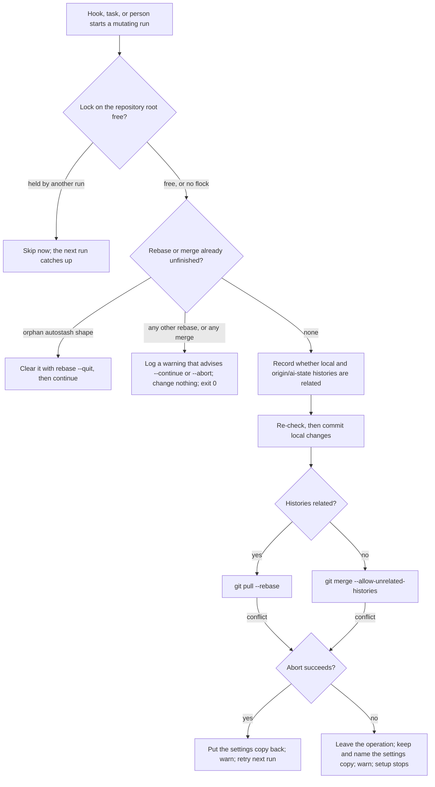

# Big Plan: State-Sync Safety Fixes

## Context

An agent in a consumer repository reported 14 issues in AI-state sync. The orchestrator checked each one against `shared/` on `dev` at `a0c6003`. The consumer's shipped copies are byte-identical to what `dev` generates today. Probes with real Git in throwaway repositories reproduced three ways state sync commits conflict markers:

1. A user's own conflicted merge in `.claude`: one `checkpoint` finished it as a two-parent commit that contains conflict markers, and printed nothing.
2. A pull conflict whose `rebase --abort` failed: the `rebase --quit` fallback left a detached HEAD with an unmerged index. The next `checkpoint` committed the markers there, the `ai-state` branch never moved, and `push` was then rejected as non-fast-forward.
3. A fresh `setup` whose unrelated-history merge conflicted and whose `merge --abort` failed: `setup` committed the merge with markers.

The `--quit` fallback came from the 2026-08-09 incident (`docs/2026-08-09-state-sync-rebase-recovery.md`, a dated record): a half-made autostash state that `--abort` could not clear. Today's pull runs without `--autostash` (a validator enforces that), and the exact leftover shape from that incident keeps its own automatic clear. The fallback is no longer needed for its original cause.

The other verified gaps: two state-sync runs can overlap on one checkout, because several sessions and clients, the outer `post-commit` hook, a VS Code task, and the host plus its devcontainer all share it. A run stopped by a signal leaves its settings copy behind. The root-adapter restorer follows a symlinked `.claude` or `.claude/bootstrap-root`. The devcontainer bind-mounts two host folders that Docker refuses to create.

Terms used in every phase:

- **Unfinished operation**: a rebase or merge in the nested `.claude` repository that Git started and that now waits for a person to continue or abort it.
- **Protected state**: an unfinished operation that state sync finds already in place when it starts. State sync leaves it alone.
- **Settings copy**: the byte copy of the nested `settings.local.json` that `state-sync.sh` keeps under `.claude/.git/` while Git runs, so Git cannot lose the machine-local file.
- **Orphan autostash shape**: the exact leftover from the 2026-08-09 incident, a `rebase-merge` folder that holds only one regular `autostash` file. State sync clears it with `rebase --quit`, and that stays.

## Goals

- State sync never commits while a rebase or merge is unfinished, and never forces one out with `rebase --quit` unless it is the orphan autostash shape.
- A merge that state sync finds in place is protected exactly like an ambiguous rebase, with a logged warning that advises `--continue` or `--abort`.
- When state sync cannot abort its own pull or merge, it leaves the operation for the operator, keeps the settings copy, and names it. `setup` then stops before restoring adapters or committing. `status` reports an unfinished merge.
- Only one mutating state-sync run works on a checkout at a time; a run that finds it busy skips and the next run catches up.
- A run that ends early through a signal puts the settings copy back, or keeps and names it while an operation is unfinished.
- The restorer refuses a symlinked `.claude` or `.claude/bootstrap-root`; the devcontainer creates both bind-mount folders on the host before the container starts.
- Documentation and the enabled OpenWiki layer describe the new behavior, and the final phase audits live guidance for stale claims.

## Non-Goals and Constraints

- Approved scope only. Not in this plan: pinning the Dockerfile (report item 12), changing the guard's read-only list (item 14), deleting the live settings file before a pull or merge, host- or process-tagged copy names, `.superseded` renames, recovering stale copies at the start of a run, and automatically continuing a rebase whose only conflict is `settings.local.json`. These came from the consumer's reference patch and were rejected. Raise new evidence as a question; never plan it silently.
- Keep copy-don't-move: `preserve_local_settings` copies the live file and never deletes it.
- The two installed copies of `state-sync.sh` and `restore-root-adapters.sh` stay generated from `shared/` and byte-identical. Never hand-edit `dist/` or an installed copy; regenerate with `uv run python scripts/generate_targets.py --all`.
- Hook scripts stay compatible with Bash 3.2 (stock macOS): a fixed file descriptor number, no `{fd}` allocation, no `mapfile`, and the repository's `${arr[@]+"${arr[@]}"}` guard for any array that can be empty.
- Every mode still exits 0 at the script boundary, so a hook never blocks a session.
- Refreshing the consumer repository is the user's own follow-up after merge.
- This is control-plane/high-risk work: every coding step applies `.claude/skills/ponytail/SKILL.md` in `full` mode, and review uses `code`, `architecture`, `security`, `tests`, and `ponytail`, plus `documentation` because each phase changes docs and `config` from phase C on because it changes `devcontainer.json`. Findings bind the whole branch diff against `dev`, so later phases keep the earlier profiles.

## Design Overview



An exit trap covers a run that ends early through `INT`, `TERM`, or `HUP`: it puts the settings copy back, or keeps and names it while an operation is unfinished. `commit_local_state` also refuses on its own whenever an operation is unfinished, as a backstop for any path the preflight check does not cover.

### Decisive assumptions and evidence

| Assumption | Evidence | Remaining limit |
| --- | --- | --- |
| `flock(1)` can lock the repository root folder through a read-only descriptor, exits 1 when busy and another code (65 seen) on other failures, and holds the lock until every process holding the descriptor exits | Planning probe, 2026-10-23, util-linux 2.39.3 on Linux 6.18 (WSL2) | A detached child that inherits the descriptor keeps the lock until it ends |
| `trap 'exit N'` on `INT`, `TERM`, and `HUP` runs the `EXIT` trap, and a process-group signal returns 130, 143, and 129 | Planning probe, Bash 5.2.21 | `SIGKILL` cannot be trapped |
| `exec 9<missing \|\| ...` does not end the script under `set -e` in Bash's default mode | Planning probe | Not observed on Bash 3.2; that path is reached only after `flock` is found, which stock macOS lacks |
| The host and the devcontainer share the lock | Not observed | Needs both sides on one kernel; phase B lists a manual check under Optional Verification. Without it, behavior is as today |
| `initializeCommand` runs on the host, its list form runs without a shell, and `${localEnv:HOME}` works in it | containers.dev JSON reference (https://containers.dev/implementors/json_reference/) | An unset `HOME` becomes empty; those hosts already fail the mounts |
| Docker's `--mount` refuses a missing bind source | Docker bind-mount documentation (https://docs.docker.com/engine/storage/bind-mounts/) | None |
| Logging the protected-state warning on every run is acceptable | Fetch failures already warn on every run; `status` shows the last line as `last-error` | One error-log line per hook run while an operation stays unfinished |

### Contracts touched

| Contract (source) | Behavior to keep | Planned change | Evidence |
| --- | --- | --- | --- |
| `dispatch_mutating`, `shared/hooks/scripts/state-sync.sh:335-355` | Protected state exits 0; every mode exits 0 | Takes the lock first (B); merge counts as protected (A) | `test_mutating_entrypoints_preserve_valid_preexisting_rebase` |
| Preflight, `state-sync.sh:313-333` | Orphan autostash shape cleared by exactly one `rebase --quit` | Merge check; warning through `warn`; advice `--continue` or `--abort` | `test_pull_clears_half_initialized_rebase_state`, `test_extra_or_nonfile_rebase_metadata_is_preserved` |
| `commit_local_state`, `state-sync.sh:248-276` | Untracks the cache, error log, and local settings; first commit when there is no HEAD | Refuses during an unfinished operation; one untrack command | The untrack tests |
| `reconcile_committed_state`, `state-sync.sh:473-567` | Nonzero on conflict, so publish and migrate skip the push; settings restore rules | Re-check and commit for both paths, after the history check; abort only; keep the copy when an abort fails | Settings, push, and migrate tests |
| `cmd_setup` and `setup_local_state`, `state-sync.sh:418-453` | Existing repo: local-only, no commit; fresh repo: restores adapters | One existing-repo branch; stop when an operation is left unfinished | `test_setup_existing_nested_repo_does_not_checkpoint_pending_state`, `test_setup_alone_restores_ignored_github_directory_on_fresh_repo` |
| `cmd_status`, `state-sync.sh:655-690` | Read-only, no network, existing lines and order | New `merge:` line after `rebase:` | Status tests (they match substrings, not whole output) |
| State-sync text checks, `scripts/validate_targets.py:3292-3327` | Literal-invocation checks | Extracted to a testable function; untrack literal; one `rebase --quit`; no silent merge abort | New validator tests |
| `restore-root-adapters.sh:30-35, 88-89` | Exit 0 when there is nothing to restore; per-path leaf checks | Refuse symlinked roots; containment checks | `test_restore_root_adapters_rejects_allowed_source_symlink_escape` |
| `scripts/check_runtime.py:473` | Exact-line allowlist for the restorer's array loop | None; that line stays as is | `tests/test_check_runtime.py` |
| `devcontainer.json`, validator at `scripts/validate_targets.py:9492-9545`, installer rewrite at `scripts/install_bootstrap.py:1005-1025` | Mounts and environment checks; the rewrite keeps unknown keys | Add `initializeCommand` and a validator helper | New validator tests |

### Test strategy

- Real Git in throwaway repositories, as the suite already does; a bare repository stands in for `origin`, so there is no network.
- Recovery and control-flow tests use a fake `git` that logs each call and then runs the real one, and assert the exact calls (MEMORY lesson).
- Each new test fails against today's script: it asserts a marker that only the fixed path produces and the absence of the old path's marker.
- Expected values come from the fixture (bytes the test wrote, commits it made), from Git (refs, `MERGE_HEAD`, the index), or from conventions (exit code 128 plus the signal number), never from the script's own output.
- Entry points are also covered from the generated devcontainer copy, which resolves the repository root by its own location (MEMORY lesson).
- Lock tests hold the lock from Python with `fcntl.flock`, which uses the same kernel lock as `flock(1)`. Signal tests start the script in its own process group and signal the group, as a hook runner would.
- No mocks of the script itself. The host-to-container lock is the one criterion with no automated check; it is listed under phase B's Optional Verification.

## Requirement Map

| Requirement | Acceptance and existing contract | Owning phase | Evidence |
| --- | --- | --- | --- |
| REQ-001 | No commit while a rebase or merge is unfinished; `commit_local_state` | `2026-10-23_phase-A-unfinished-git-operations` | Guard test; merge and rebase entry-point tests |
| REQ-002 | A merge found in place is protected; logged warning advises `--continue` or `--abort` | `2026-10-23_phase-A-unfinished-git-operations` | Merge entry-point test |
| REQ-003 | The current pull's recovery uses `rebase --abort` only; a failed abort leaves the rebase | `2026-10-23_phase-A-unfinished-git-operations` | Abort-failure test; validator count |
| REQ-004 | The unrelated-history merge starts from a committed tree; a failed abort leaves the merge | `2026-10-23_phase-A-unfinished-git-operations` | First-parent test; fresh-setup test |
| REQ-005 | The settings copy is kept and named whenever an operation is left unfinished | Phase A (explicit paths) and phase B (exit trap) | Abort-failure tests; trap test |
| REQ-006 | `setup` stops before restoring adapters or committing when an operation is left unfinished | `2026-10-23_phase-A-unfinished-git-operations` | Fresh-setup test |
| REQ-007 | `status` reports `merge: none` or `merge: in-progress` | `2026-10-23_phase-A-unfinished-git-operations` | Status test |
| REQ-008 | One mutating run at a time; a busy run skips | `2026-10-23_phase-B-sync-lock-and-exit-trap` | `sync_lock` tests |
| REQ-009 | A run ended by `INT`, `TERM`, or `HUP` restores the settings copy | `2026-10-23_phase-B-sync-lock-and-exit-trap` | `exit_trap` tests |
| REQ-010 | The restorer refuses a symlinked `.claude` or `.claude/bootstrap-root` | `2026-10-23_phase-C-restorer-and-devcontainer-hardening` | Restorer tests |
| REQ-011 | The devcontainer creates both bind-mount folders on the host | `2026-10-23_phase-C-restorer-and-devcontainer-hardening` | Validator helper tests |
| REQ-012 | Docs and OpenWiki match; stale claims audited | `2026-10-23_phase-D-knowledge-refresh` | Session log `## Stale-claims surfaces checked` |

## Phases

- [ ] `2026-10-23_phase-A-unfinished-git-operations` — never commit over an unfinished rebase or merge; leave what cannot be aborted for the operator.
- [ ] `2026-10-23_phase-B-sync-lock-and-exit-trap` — one sync at a time, and an exit trap for the settings copy.
- [ ] `2026-10-23_phase-C-restorer-and-devcontainer-hardening` — refuse symlinked restore roots; create the devcontainer's bind-mount folders.
- [ ] `2026-10-23_phase-D-knowledge-refresh` — refresh OpenWiki and audit live guidance for stale claims.

## Verification

```bash
uv run python scripts/validate_plan_frontmatter.py .claude/plans/state-sync-safety-fixes.md .claude/plans/2026-10-23_phase-A-unfinished-git-operations.md .claude/plans/2026-10-23_phase-B-sync-lock-and-exit-trap.md .claude/plans/2026-10-23_phase-C-restorer-and-devcontainer-hardening.md .claude/plans/2026-10-23_phase-D-knowledge-refresh.md
```

## Completion Evidence

The last phase, `2026-10-23_phase-D-knowledge-refresh`, refreshes OpenWiki through `.claude/skills/knowledge-refresh/SKILL.md` and runs the documentation, memory, and LEARN audit across all live-advice surfaces. It records each audited surface and its outcome under `## Stale-claims surfaces checked` in its closeout session log. Each completed phase has its own verification, review, findings, session log, commit, and normal push evidence.
